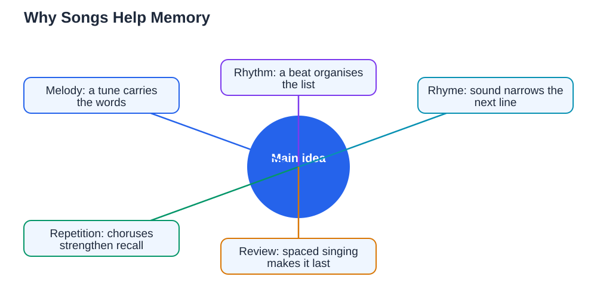

Music and memory learning are closely linked, which is why a song you heard years ago can suddenly replay in your head in full, while a list you read yesterday has already faded. Melody, rhythm, and rhyme give your brain extra hooks to hold onto information: instead of remembering bare words, you remember a tune, a beat, and a pattern of sounds that carry the words along with them. That is why young children learn the alphabet through a song, and why advertisers set slogans to music. Students can use the same power deliberately, turning hard-to-remember facts into short songs, chants, or rhythmic phrases that are far easier to recall. This guide explains why songs stick and how to use music as a study tool wisely.

## Music and Memory Learning: Why Songs Stick in Your Head

Songs stick because they combine several kinds of memory at once. Words alone rely mainly on verbal memory, but a song adds melody, rhythm, rhyme, and often movement or emotion, and each of those gives your brain another route back to the same information. Repetition also plays a part: songs are designed to repeat their chorus and patterns, and every repetition strengthens the memory. Rhymes help because knowing the sound of one line narrows down what the next line can be, which makes recall feel almost automatic. Emotion matters too: a tune you enjoy or find funny is remembered more easily than a dull list, because your brain pays more attention to things that feel pleasant or surprising. Understanding this helps you use music on purpose, rather than wondering why some songs refuse to leave your head.

## Turning Facts Into Songs and Chants

To turn study material into a song, start small. Pick one short list or set of facts that you keep forgetting, such as the order of steps in a process or a set of key terms. Choose a simple, familiar tune with a steady rhythm, or invent a short chant with a clear beat. Fit the facts to the rhythm, keeping the words short and the lines roughly the same length, and use rhyme where it comes naturally rather than forcing it. Sing or chant your new version several times, then test yourself by recalling it without looking. If a line feels awkward, rewrite it until it flows, because a smooth line is easier to remember than a clumsy one. Keep your study songs short: one verse that covers one topic is far more useful than a long song that tries to cover a whole chapter. You can make several short songs, one per topic, and review them like flashcards.

## Rhythm, Rhyme, and Movement as Memory Hooks

Even without a full melody, rhythm and rhyme can carry facts. Try clapping a steady beat while you say a list in order, giving each item one beat, so the list becomes a rhythmic pattern rather than a string of words. Try turning a definition into a rhyming couplet, or grouping items into pairs that share a sound. Adding a simple movement, such as tapping a finger for each step in a process, gives your body a memory hook as well. These hooks work because they organise information into patterns, and patterns are easier to recall than random items. When you later try to remember the list, recalling the beat or the rhyme often brings the words back with it. Practise your rhythmic versions out loud, because saying them is part of what makes them stick; silently reading a song is much less effective than singing or chanting it.

## Using Background Music Wisely While You Study

Background music can help or hinder study, depending on how you use it. Music with lyrics often distracts, because your brain tries to follow the words of the song and the words of your work at the same time. For focused reading or writing, quiet instrumental music or silence usually works better. For repetitive tasks, such as organising notes or doing routine practice, gentle music you know well may make the time feel pleasant without pulling your attention away. The key is to notice your own results: if you remember less or work more slowly with music on, turn it off for that task. Save songs with words for breaks, or for the deliberate memory technique described above, where the song itself carries the study material. Used this way, music becomes a tool you control, not a distraction you endure. When you check study material with AI tools, verify answers against your textbook, because AI can make mistakes.

## Reviewing Musical Memories So They Last

A study song only helps if you review it. Sing or chant your song shortly after making it, again later the same day, and again over the following days, spacing the reviews out rather than cramming them all at once. Each review strengthens the memory, and the spacing effect means that recalling something just as you are starting to forget it builds a stronger memory than repeating it many times in a row. Test yourself by singing the song from memory, not just singing along while reading the words, because the effort of recall is what builds lasting learning. If a song fades, that is normal and useful information: it tells you which topic needs another review. Keep a small collection of your best study songs and chants, and revisit them before tests as part of your normal revision. Music makes revision more enjoyable, and enjoyable revision is revision you actually do. For more on building steady study habits, see [Practising Scales: Simple, Short and Daily](/blog/practising-scales-simply.html) for an example of short daily practice applied to music.

## AI Help: Muse AI

Muse AI is Meta's personal AI assistant, and it can help you use music for memory. You can ask it to help you turn a short list of facts into a rhyming chant, or to suggest ways to organise study material into memorable patterns.

Join Muse with invite code LTGSWD — in the Muse app, go to Settings > Redeem token and enter the code.

Disclosure: LTGSWD is the author's Muse invite code.

## FAQ

### Why do songs stay in my head longer than lists?

Songs combine melody, rhythm, rhyme, and repetition, giving your brain several routes to the same information. A plain list has only words to hold onto, so it fades faster than a patterned, musical version.

### Does background music help or hurt studying?

It depends on the task and the music. Lyrics often distract during reading and writing, while quiet instrumental music may suit routine tasks. Notice your own results and choose silence when focus matters most.

### Can I use a familiar tune for a study song?

Yes, and it often works well, because the tune is already in your memory. Fit short, simple facts to the rhythm, keep lines even, and test yourself by singing the new words from memory.

### What if I am not musical? Can this still work?

Yes. You do not need to be a good singer to benefit. Simple chants, clapped rhythms, and rhyming lines work as memory hooks even for people who do not consider themselves musical.

### How often should I review a study song?

Review it soon after making it, again later the same day, and then spaced over following days. Testing yourself from memory each time builds much stronger recall than singing along while reading the words.

## Conclusion

Songs stick because melody, rhythm, rhyme, and repetition give your brain many hooks for one piece of information. Use that power deliberately: turn short lists into songs or chants, review them spaced over days, and keep background music in its proper place. For help with your school work and study questions, [Try the free AI lesson solver](/#tool).
