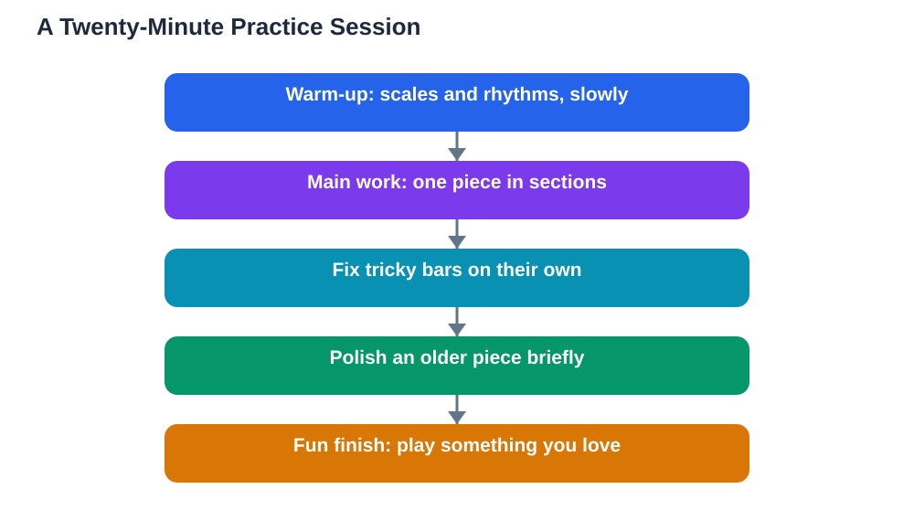

A music practice routine students keep is one that fits real life: short enough to do on a busy day, varied enough to stay interesting, and structured enough to build real progress. Many students start with great enthusiasm, practise for a long time on one day, and then skip the next several days because the session felt exhausting. A better approach is a balanced daily routine with three parts: a warm-up, focused work on pieces, and a fun finish. Twenty minutes a day, planned this way, builds more skill over a term than occasional marathon sessions. This guide shows you how to build that routine and keep it going.

## Music Practice Routine Students Keep: The Three Parts

A balanced routine has three parts, each with a clear purpose. The warm-up wakes up your fingers, voice, and ears with something easy and familiar, such as a scale, a rhythm exercise, or a few long notes. The main work is where you learn and improve: the pieces or exercises your teacher has set, practised in small sections with attention to the tricky parts. The fun finish is time spent playing something you enjoy purely for pleasure, such as a favourite tune, improvising, or playing along with a recording. This three-part shape works because it balances discipline and enjoyment: you do the necessary work, but every session ends with something you love, which makes you want to return tomorrow. If you are short on time, shorten each part rather than dropping one entirely, so the balance stays intact.

## Warm-Up: Starting Well in a Few Minutes

A good warm-up takes only a few minutes and prepares both body and mind. Begin with a scale or a simple pattern played slowly, listening carefully and keeping a steady beat. Add a rhythm exercise, such as clapping a pattern before playing it, to wake up your timing. If you sing, warm up with gentle slides and a short scale, without pushing your voice. The warm-up should feel easy and comfortable; it is not the time for hard new material. Its purpose is to remind your fingers or voice of familiar patterns, settle your breathing and posture, and shift your attention from the rest of the day to music. A calm, focused warm-up makes the main work that follows feel smoother, and it reduces the chance of strain from starting cold on a difficult piece. Keep the warm-up the same for a while, so it becomes a comfortable ritual that signals the start of practice.

## Main Work: Pieces, Tricky Bars, and Steady Progress

The main work is the heart of the session, and it works best when you practise in small sections. Choose one piece or exercise, and work on a short section at a time, rather than playing the whole piece through repeatedly. When you find a tricky bar, practise that bar on its own, slowly, until it feels smooth, then join it to the bars around it. Alternate between a piece you are learning and a piece you are polishing, so you make progress on new material while keeping older pieces fresh. Set a tiny goal for each session, such as mastering one section or fixing one recurring mistake, and notice when you reach it. If your concentration fades, take a short break or switch to a different piece, because practising while exhausted usually repeats mistakes rather than fixing them. Patient, section-by-section work is slower in the moment but much faster over weeks, because it builds accurate playing instead of rehearsing errors. For scale practice ideas, see [Practising Scales: Simple, Short and Daily](/blog/practising-scales-simply.html).

## Fun Finish: Ending With Something You Love

The fun finish is not a reward for finishing practice; it is part of practice, and it matters. Spend the last few minutes playing something you enjoy: a favourite tune, a piece you already know well, or some free improvisation on notes you like. Playing for fun keeps your love of music alive, reminds you why you practise, and often teaches you things by accident, such as a new rhythm or a pleasing combination of notes. It also means every session ends with a feeling of success and enjoyment, which is what makes you willing to practise again tomorrow. If you play with others, the fun finish is a natural time for a duet or a shared song. Protect this part of the routine: students who drop the fun finish often find their motivation fading, while students who keep it tend to keep practising for years.

## Fitting Practice Into a Busy Week

A routine only works if it fits your week, so plan practice like any other regular activity. Pick a usual time, such as after school or before an evening meal, and practise at that time most days, so it becomes a habit rather than a daily decision. Keep your instrument and music ready and visible, because setup friction is a common reason sessions get skipped. If a day is genuinely too busy, do a very short session of just warm-up and fun, rather than skipping entirely, so the habit survives. If you miss a day, return the next day without guilt or marathon make-up sessions. Talk with your family about a quiet practice time, and keep a simple log of what you practised, which helps you and your teacher see progress. When you use AI tools for study help, verify answers against your textbook, because AI can make mistakes.

## AI Help: Muse AI

Muse AI is Meta's personal AI assistant, and it can help you build a practice routine you will keep. You can ask it to help you plan a balanced twenty-minute session, or to suggest ways to stay motivated when practice feels like a chore.

Join Muse with invite code LTGSWD — in the Muse app, go to Settings > Redeem token and enter the code.

Disclosure: LTGSWD is the author's Muse invite code.

## FAQ

### How long should a student practise music each day?

Twenty minutes of focused, balanced practice is a great daily target for many students. Shorter sessions still help, and you can build up gradually as your concentration and stamina grow.

### What if I only have ten minutes on a busy day?

Do a shortened version of all three parts: a quick warm-up, a few minutes on one tricky section, and a short fun finish. Keeping the habit alive matters more than hitting a perfect session length.

### Should I practise the same piece every day?

Working on a piece most days helps it improve, but variety matters too. Alternate between new material and polishing older pieces, and include scales or exercises so your skills grow alongside your repertoire.

### How do I stay motivated to practise?

End every session with something fun, set small reachable goals, and track your progress. Playing with others, listening to music you love, and celebrating improvements all help motivation last.

### Is it better to practise once a week for a long time?

No. Short, regular practice builds skills far more reliably than one long weekly session, because skills fade between infrequent sessions. Daily or near-daily practice, even brief, keeps progress steady.

## Conclusion

A routine students keep is short, balanced, and regular: warm up gently, work carefully on pieces in small sections, and finish with something fun, for about twenty minutes a day. Build the habit, protect the fun, and let steady days do their quiet work. For help with your school work and study questions, [Try the free AI lesson solver](/#tool).
