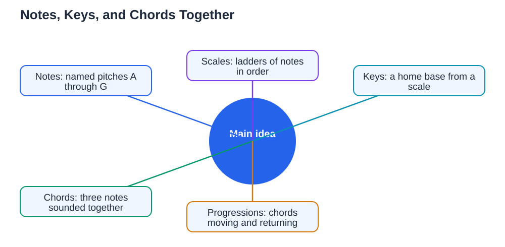

Music theory basics students learn are not a set of dry rules to memorise; they are a simple explanation of how music works, and why the tunes you love sound the way they do. Theory answers questions such as why some notes sound happy together and others sound tense, why a song feels finished at certain moments, and how musicians can play together without confusion. You do not need advanced theory to enjoy music, but a little theory makes learning an instrument faster, reading music easier, and composing your own tunes far more satisfying. This guide explains notes, keys, and chords in plain language, with examples you can try at your instrument or with your voice.

## Music Theory Basics Students Start With: Notes and Pitch

Everything in music theory starts with notes and pitch. Pitch is simply how high or low a sound is, and notes are the named pitches musicians use, from the musical alphabet A through G. When you move from one note to the next letter, you move by a step; when you skip a letter, you move by a leap. Notes also have lengths, which is rhythm, but theory often begins with pitch because pitch patterns are what make melodies recognisable. Two notes with the same letter name but different heights, such as a low C and a higher C, are related by an interval called an octave, and they sound very similar even though one is higher. Learning to name notes confidently, on the staff and on your instrument, is the foundation of all theory that follows. If note names still feel shaky, start with [Reading Music Notes: The Basics](/blog/reading-music-notes-basics.html) and return here when the staff feels familiar.

## Scales: The Ladders That Build Keys

A scale is a ladder of notes in a particular order, and a key is the home base built from a scale. The most familiar scale is the major scale, which has a bright, happy sound and follows a pattern of whole steps and half steps: whole, whole, half, whole, whole, whole, half. A whole step skips one note in between, while a half step moves to the very next note. If you start a major scale on any note and follow that pattern, you build the major key starting on that note. The first note of the scale is called the tonic, and it feels like home: melodies in that key tend to start near it and end on it. Minor scales have a different pattern and a sadder, more thoughtful sound, which is why the same starting note can feel completely different in a major or minor key. Understanding scales helps you predict which notes will sound right in a piece and which notes will sound surprising, which is a powerful tool for reading, playing by ear, and composing.

## Chords: Three Notes Sounding Together

A chord is three or more notes sounded together, and chords are what give music its harmony and emotional colour. The simplest chords, called triads, are built by stacking every other note of a scale: for example, taking the first, third, and fifth notes of a scale together makes the home chord of that key, called the tonic chord. Other chords in the key are built the same way from different starting notes, and each one has its own feeling: some sound stable and restful, while others sound tense and eager to resolve back home. When musicians talk about a chord progression, they mean a sequence of chords, such as moving from the home chord to another chord and back again, which creates a sense of journey and return. Try playing a simple three-note chord on your instrument, then a different chord, and listen to how the mood changes. That feeling of tension and release is the heart of harmony, and recognising it helps you understand songs from the inside.

## Putting Notes, Keys, and Chords Together

Notes, keys, and chords work together like words, sentences, and paragraphs. Notes are the words, a key gives you the set of words that belong together, and chords provide the harmony that supports the melody, like the background of a picture. A melody usually uses notes from its key, moves in steps and leaps along the scale ladder, and ends phrases on stable notes, often the tonic. Chords underneath the melody change at phrase points, creating tension that resolves when the music returns home. When you learn a new piece, try to spot its key, notice which scale its melody follows, and listen for the chords changing underneath. That analysis turns a piece from a string of notes to memorise into a pattern you understand, which makes it easier to learn, remember, and play expressively. It also helps you improvise and compose, because you can choose notes and chords that fit the key instead of guessing. For a first composing project using these ideas, see [Composing Your First Melody](/blog/composing-first-melody.html).

## Learning Theory Little by Little

Theory is best learned in small pieces, connected to music you actually play. After learning a concept, such as a scale pattern or a triad, try it immediately: play the scale, build the chord, and listen to how it sounds. Use theory to explain music you already know, such as working out the key of a favourite simple tune or naming the chords in a short progression. Keep a theory notebook where you write each new idea in your own words with a short example, because explaining an idea simply is the best test of understanding it. Do not rush into advanced topics before the basics feel solid; a firm grasp of notes, scales, keys, and triads will carry you much further than a shaky acquaintance with many topics. When you use AI tools to check theory answers, verify them against your textbook, because AI can make mistakes. And remember, the Lesson Solver tool needs your own free Google AI Studio API key if you use it for study help.

## AI Help: Muse AI

Muse AI is Meta's personal AI assistant, and it can help you learn music theory step by step. You can ask it to explain keys and chords in plain language, or to quiz you gently on scale patterns until they feel familiar.

Join Muse with invite code LTGSWD — in the Muse app, go to Settings > Redeem token and enter the code.

Disclosure: LTGSWD is the author's Muse invite code.

## FAQ

### Do I need theory to enjoy playing music?

No, but a little theory helps a lot. Theory explains why music sounds the way it does, which makes learning pieces faster, reading easier, and composing more satisfying, even at a basic level.

### What is the difference between a scale and a key?

A scale is an ordered ladder of notes, while a key is the home base built from that scale. The key tells you which notes belong together and which note feels like home in a piece.

### How are chords built?

Simple chords called triads are built by stacking every other note of a scale. The first, third, and fifth notes of a scale together make the home chord of that key, and other chords are built the same way from different starting notes.

### Why do some chords sound tense and others sound restful?

Chords sound restful when they feel stable, especially the home chord, and tense when they seem to want to move somewhere else. That tension and release is what gives music its sense of journey and arrival.

### How should I practise theory?

Learn one small idea at a time and try it immediately on your instrument or voice. Write it in your own words with an example, and use it to explain music you already play, rather than memorising definitions alone.

## Conclusion

Music theory is simply the plain-language explanation of notes, keys, and chords: notes are pitches, scales are ladders, keys are home bases, and chords are notes sounding together to create harmony. Learn a little at a time, try it in real music, and theory will become a helpful friend, not a hurdle. For help with your school work and study questions, [Try the free AI lesson solver](/#tool).
