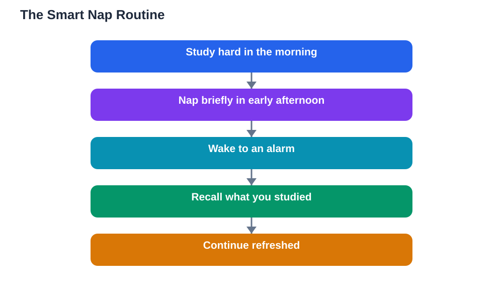

A nap is not laziness. Used well, it is one of the simplest tools for restoring focus and memory during a long study day. The connection between naps and learning is straightforward: a short rest clears mental fatigue, while a long, mistimed nap can leave you groggy and steal your night's sleep. This article explains the difference, so you can nap in a way that helps your learning instead of harming it.

## Naps and Learning: Why Short Rests Refresh the Brain

Studying for hours without a break drains attention. You begin rereading the same lines, making small slips, and feeling your mind wander. A short nap resets that fatigue in a way that scrolling or snacking cannot. You wake with a clearer head, better concentration, and a brain more ready to take in new material. Many students find that a brief rest followed by a short review works better than pushing through exhaustion for another hour.

Naps also support memory. Just as night sleep consolidates learning, a short daytime rest gives the brain a quiet window to stabilise what you studied in the morning. That is why reviewing material, taking a brief nap, and then recalling it afterwards can feel surprisingly effective. The rest is not lost time; it is processing time.

## Short Naps Versus Long Ones

The key difference is depth. A short nap keeps you in light sleep, so you wake easily and feel refreshed. A long nap lets you sink into deep sleep, and waking from deep sleep produces grogginess, confusion, and a heavy-headed feeling that can last a long while. That groggy state, sometimes called sleep inertia, is the reason long daytime naps often feel worse than no nap at all.

Long naps also push into your night's sleep. A deep afternoon sleep reduces the sleep pressure that helps you fall asleep at bedtime, so the night becomes restless and the next day starts tired. The pattern then repeats: a tired student takes a longer nap, sleeps worse at night, and feels worse the next day. Short naps avoid this trap by refreshing you without draining the night's sleep pressure.

## When to Nap for the Best Effect

Timing matters as much as length. The early afternoon is usually the natural dip in alertness, when the body feels heavy and concentration drops. A short nap at that point works with your body clock rather than against it. A nap taken too late in the day, close to evening, is far more likely to delay bedtime and fragment the night.

Plan naps deliberately. Choose a quiet, dim spot, set an alarm, and lie down properly rather than dozing at your desk in a noisy room. Keep the nap short and protect it: tell others you are resting, silence notifications, and avoid screens in the minutes before you lie down. Waking to an alarm after a short rest feels much better than drifting awake from a long, unplanned sleep.

## Naps as Part of a Study Plan

Use naps strategically, not habitually as an escape. A good moment is after a demanding morning of study, before an afternoon review session. Nap, then test yourself on the morning's material while it is freshly consolidated. This sequence, study, short rest, recall, turns the nap into an active part of learning rather than a break from it.

Do not nap to replace a bad night. If you are regularly exhausted, the fix is a steadier nightly routine, not longer daytime sleep. Track your naps for a week alongside your night sleep and morning alertness: if naps are making nights worse, shorten them or move them earlier. And when you study around a nap, verify solutions against your textbook, since AI can make mistakes, and a rested brain still needs accurate material to consolidate.

## What to Do Instead When You Cannot Nap

Sometimes napping is not possible, in a classroom, on a busy day, or in a noisy home. A quiet rest without sleep can still help: close your eyes for a few minutes, breathe slowly, and let your mind idle. A short walk outdoors, a drink of water, and a change of task also restore some focus. These are not full substitutes for a nap, but they beat pushing through exhaustion or scrolling, which only adds stimulation to a tired brain.

The broader lesson is that rest is part of work. Brains, like muscles, perform better with recovery built in. Whether you nap or simply pause, protecting short rest periods during long study days will improve what you learn and how you feel while learning it.

## AI Help: Muse AI

Muse AI is Meta's personal AI assistant, and it can help with this topic by planning a study day that includes a well-timed short rest. Ask it to draft a balanced afternoon schedule with study blocks, a brief nap, and a recall session afterwards.
Join Muse with invite code LTGSWD — in the Muse app, go to Settings > Redeem token and enter the code.
Disclosure: LTGSWD is the author's Muse invite code.

## FAQ

### How long should a study nap be?

Keep it short, staying in light sleep so you wake refreshed rather than groggy. Set an alarm, lie down in a quiet dim spot, and get up promptly when it rings. If you regularly wake groggy, your nap is too long.

### Will napping ruin my night's sleep?

A short early-afternoon nap usually does not, but a long or late nap can delay bedtime and fragment the night. Keep naps brief and early, and protect your regular bedtime. If nights worsen, shorten the nap or move it earlier.

### Is napping better than pushing through tiredness?

For most students, yes. Pushing through heavy fatigue produces slow, error-prone study, while a short rest restores focus and memory. The refreshed study session after a nap usually achieves more than the extra tired hour would have.

### What if I cannot fall asleep for a nap?

A quiet rest still helps. Lie down, close your eyes, and rest without screens for a short period. Even without sleep, the pause lowers fatigue. If you cannot nap regularly, focus on steady night sleep instead.

## Conclusion

Naps help learning when they are short, early, and deliberate. They refresh attention, support memory, and break up long study days without harming the night. Keep them brief, time them well, and let rest do its quiet work for your grades.

[Try the free AI lesson solver](/#tool)
