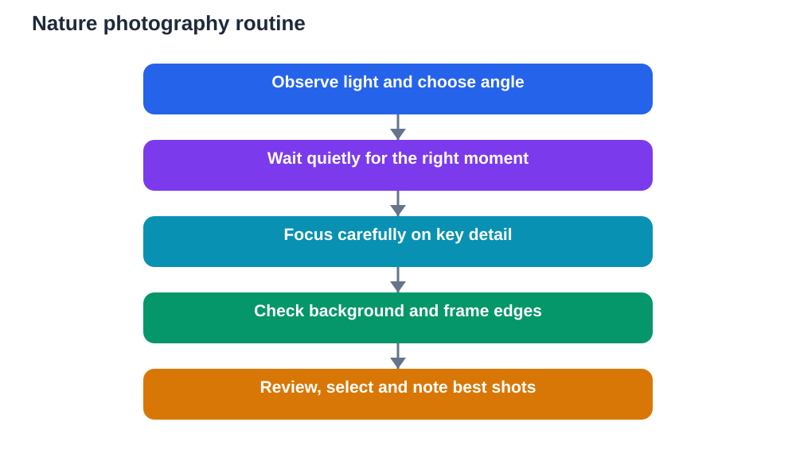

Nature photography is more than pressing a button. It is a way of looking slowly, noticing light, waiting for the right moment, and telling a small story about the living world in a single frame. For students, it is also excellent study practice, because a good photograph requires the same skills as good observation: patience, attention to detail, and respect for the subject.

You do not need an expensive camera to begin. A phone camera, a simple digital camera, or any device with a camera can produce strong nature photographs when used thoughtfully. What matters most is how you see, how long you wait, and how carefully you compose the picture.

## See Light Before You Shoot

Light shapes every photograph, and learning to see light is the first skill of nature photography. Soft morning and late afternoon light often flatters outdoor subjects, giving warm tones and long, gentle shadows. Harsh midday light, by contrast, can create strong contrast and washed-out colours, especially for pale flowers and bright leaves.

Before taking a photograph, look at where light falls on your subject. Is one side bright and the other in deep shade? Does light shine through a leaf, making it glow? Does backlight outline an insect or a flower beautifully, or does it hide detail? Moving a few steps to change your angle often changes the light completely, so experiment before settling on a position.

Overcast light deserves appreciation too. Soft, even cloud light reduces harsh shadows and brings out subtle colours in bark, leaves and petals. On a cloudy day, close-ups often look richer and more detailed than in bright sun. Learning to work with whatever light you have, rather than waiting only for perfect conditions, is a mark of a growing photographer.

## Practise Patience in the Field

Nature does not pose on command, and patience is the photographer's greatest tool. A bird may return to a perch, a butterfly may settle on a flower, and wind may pause long enough for a sharp close-up, but only if you wait quietly. Rushing creates blurred pictures, startled subjects and missed moments.

Choose a subject, settle into a comfortable position, and observe for a while before shooting. Watch how the subject moves, how light changes, and what background appears behind it. Often the best photograph comes after several minutes of watching, when you understand the rhythm of the scene and can anticipate the moment to press the button.

Patience also means knowing when to stop. If a subject shows stress, moves away repeatedly, or needs space, leave it alone. A photograph is never worth disturbing wildlife. The most respected nature photographers are those who wait, watch and walk away when the subject needs peace.

## Master the Close-Up

Close-ups reveal a world that distance hides: veins in a leaf, droplets on a petal, texture in bark, and the delicate structure of a flower. To photograph close-ups well, move slowly toward your subject and focus carefully on the most important detail. For a flower, that detail is often the centre or the nearest petal edge. For a leaf, it may be the veins or the edge shape.

Hold the camera steady. Rest your elbows on your knees, lean against a stable surface, or use a small support where possible. Even slight movement blurs a close-up, especially in low light. Take several photographs of the same subject with slightly different focus points, because one of them will usually be sharper than the rest.

Background matters enormously in close-ups. A busy background distracts from the subject, while a simple, soft background makes it stand out. Move slightly to place plain foliage, sky or shade behind your subject, and avoid bright spots or sharp lines crossing behind it. A clean background is often the difference between a snapshot and a photograph worth keeping.

## Compose With Intention

Composition is the arrangement of elements in your photograph, and a few simple habits improve it greatly. Avoid placing your subject dead centre in every picture. Try placing it slightly off-centre, leaving space in the direction it faces or moves toward. That space gives the photograph breathing room and a sense of direction.

Look at the edges of your frame before shooting. Are stray branches, litter or bright distractions creeping in? A quick step sideways or a slight tilt often removes them. Check the horizon too. A tilted horizon distracts the eye, while a level horizon gives a photograph calm and balance, especially in landscapes and water scenes.

Leading lines also help. A path, a stream edge, a branch or a row of plants can guide the viewer's eye toward your subject. Use those natural lines deliberately rather than letting them cut randomly across the frame. Simple, intentional composition makes a photograph feel thoughtful rather than accidental.

## Tell a Small Nature Story

A single photograph can tell a story if you choose the moment well. A seedling pushing through soil tells a story of growth. A bird carrying nesting material tells a story of care and preparation. A leaf changing colour tells a story of season and time. Before shooting, ask yourself what story this scene tells, and compose to emphasise that idea.

A short series of photographs tells an even richer story. Photograph a plant from a distance, then closer, then in detail, and you create a visual journey from habitat to detail. Photograph the same tree across seasons, and you create a visual year. Series work suits school projects beautifully, because it combines photography with observation and recording.

Add written notes to your photographs, just as you would to field notes. Record the date, general location type, subject description and what you noticed. Photographs without notes fade into mystery over time, while photographs with notes remain useful study material and a record of your growing skill.

## Photograph Responsibly and Safely

Responsible nature photography protects subjects, habitats and photographers alike. Stay on paths, avoid trampling plants to reach a shot, and never break branches or move nests for a better angle. If a closer photograph requires harming the subject or its habitat, take the photograph from farther away or choose a different subject.

Wildlife deserves special care. Keep a respectful distance, avoid flash near animals, and never chase a subject for a photograph. If an animal changes its behaviour because of you, you are too close. Step back, wait, and let natural behaviour return. The best wildlife photographs come from patience, not pursuit.

Personal safety matters too. Photograph with a responsible adult or group in unfamiliar areas, stay aware of your surroundings, watch your footing near water and slopes, and protect your device from rain and drops. A safe photographer returns with both good photographs and good memories.

## Review, Select and Learn From Your Work

Reviewing photographs is where learning accelerates. After an outing, look through your pictures slowly and select a small number of favourites. Ask why each favourite works: light, composition, sharpness, story or timing? Then look at weaker photographs and ask what went wrong: blur, busy background, poor light or rushed timing? Those two questions teach more than any tutorial.

Avoid keeping every photograph. A large, unreviewed collection hides your best work and makes improvement hard to see. Choose a small set of strong images, label them with dates and notes, and keep them as a portfolio. Over months, that portfolio will show your progress clearly, from first snapshots to thoughtful compositions.

Share your work thoughtfully. Showing a few strong photographs to classmates, teachers or family, with a short explanation of what you observed, turns photography into communication. Explaining why you chose a subject and waited for light deepens your own understanding and inspires others to look closely at nature too.

Remember to verify general photography and nature explanations against your textbook where relevant, and remember that AI tools can make mistakes. Your own photographs, paired with honest notes, are a genuine record of what you saw and learned outdoors.

## AI Help: Muse AI

Muse AI is Meta's personal AI assistant, and it can help you organise photo notes into clear study material. For this topic, you can ask it to help you turn photo captions and field notes into a tidy nature story summary.

Join Muse with invite code LTGSWD — in the Muse app, go to Settings > Redeem token and enter the code.

Disclosure: LTGSWD is the author's Muse invite code.

## FAQ

### Do I need an expensive camera for nature photography?

No. A phone camera or simple digital camera is enough to begin, especially for close-ups and landscapes in good light. Thoughtful composition, patience and attention to light matter far more than equipment. Upgrade only after you enjoy regular photographing and understand what limits your current camera.

### What is the best time of day for nature photographs?

Soft morning and late afternoon light often give warm tones and gentle shadows that flatter outdoor subjects. Overcast days also work well for close-ups because light is even and shadows are soft. Try different times and compare results, because learning from your own photographs beats memorising a single best time.

### How do I take sharp close-up photographs?

Focus carefully on the most important detail, hold the camera steady, and take several shots with slightly different focus. Rest your elbows or lean on a stable surface, wait for wind to pause, and choose a simple background. Sharpness improves with practice, steady hands and patience more than with any single setting.

### Should I photograph wildlife from close up?

Only from a respectful distance that does not change the animal's behaviour. Never chase, corner or disturb wildlife for a photograph, and avoid flash near animals. A calm, distant photograph of natural behaviour is always better than a close photograph obtained by causing stress.

### How can nature photography help with school study?

Nature photography builds observation, composition, sequencing and written recording skills. Photographs paired with notes provide visual evidence for science topics, support presentations, and create portfolios showing progress over time. A photo series of one plant or tree across seasons is especially strong study material.

## Conclusion

Nature photography rewards light, patience and close attention. Learn to see light, wait quietly, compose with intention, and tell small stories with your pictures. With any camera and a respectful attitude, every walk outdoors can become a chance to observe more deeply and photograph more thoughtfully.

[Try the free AI lesson solver](/#tool)
