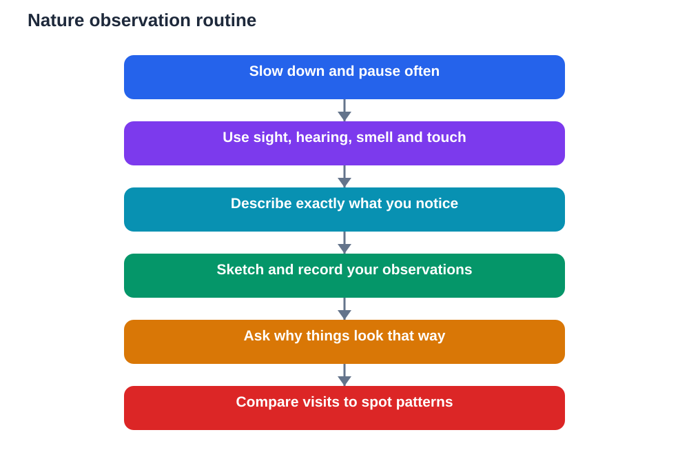

A nature walk looks simple: you walk, you look around, and you enjoy being outside. Yet it can teach observation skills that no indoor lesson can match. Nature is full of patterns, changes, and relationships, but they only reveal themselves to someone who slows down and pays attention. Learning to observe well outdoors trains your eyes, ears, and mind together, and those skills help in every subject where evidence matters.

Many students walk through nature the way they scroll through pictures, glancing and moving on. Real observation is different. It means stopping, noticing, comparing, and recording. It means asking why a leaf looks the way it does, why certain plants grow together, or why birds behave differently in different places. A nature walk done this way becomes a field lesson in curiosity, patience, and careful thinking.

## Slow Down and Use All Your Senses

The first skill of nature observation is slowing down. When you walk quickly, you see shapes and colours but miss textures, sounds, and smells that carry information. Pause often. Stand still for a while and let the place come to you. You will start to notice movement, sounds, and small details that were invisible while you were moving.

Use more than your eyes. Listen for different sounds and try to describe them in words. Notice smells after rain, near plants, or beside water, and think about what might cause them. Feel textures where it is safe and allowed to do so, such as bark, leaves, or soil. Each sense adds a layer of evidence, and together they build a fuller picture of a place than sight alone ever could.

## Describe Exactly What You Notice

Good observers describe before they explain. Instead of writing that a place looks nice, note what you actually see: the shape of leaves, the pattern of light, the colour of soil, or the way water moves. Precise description forces you to look again and check whether your words match reality. It also creates notes that are useful later, because someone else could picture the place from your words.

Try comparing things as you describe them. Is one leaf broader than another? Is one area damper or drier? Is one sound higher, softer, or more repeated than another? Comparisons turn vague impressions into real observations. They also lead naturally to questions, because a difference you notice is often a puzzle worth investigating.

## Record in Words, Sketches, and Counts

Recording is what turns a walk into study. A notebook is your most useful tool. Write short, dated entries about where you are, what the conditions feel like, and what you notice. A quick sketch of a leaf shape, a branching pattern, or a landscape feature can capture information faster than a long paragraph and will jog your memory later.

Where it makes sense, record simple counts or tallies of what you observe, such as how many different leaf shapes you find along a short stretch. Keep such records honest and modest: count only what you actually saw, and note where and how you counted. Careful, small-scale records teach the discipline behind real fieldwork far better than grand claims.

## Ask Why Things Look the Way They Do

Observation becomes learning when you ask why. Why do some plants grow in shade and others in open sun? Why does soil look different in different spots? Why do certain creatures appear at certain times? These questions connect what you see to ideas from your lessons about living things, weather, water, and soil.

Not every question can be answered on the walk, and that is fine. Write the question down and treat it as a starting point for class discussion or textbook checking. A question formed from your own observation is more motivating than a question copied from a page, because you already care about the answer. It also shows a teacher exactly how you are thinking.

## Notice Patterns and Changes Over Time

One walk gives you a snapshot. Repeated walks give you a story. If you visit the same place in different seasons or at different times of day, you will notice changes in plants, sounds, light, and activity. Patterns emerge: some things appear regularly, some change gradually, and some shift suddenly. Recognising patterns is a core scientific skill, and nature is an excellent teacher of it.

Keep your notes organised so you can compare visits. Use the same headings each time, such as place, conditions, plants, animals, sounds, and questions. When you compare entries side by side, changes stand out clearly. You begin to think like someone studying a living place over time, not just someone passing through it once.

## Respect the Place You Observe

Good observation goes hand in hand with respect. Stay on paths where asked, avoid disturbing wildlife, and leave plants and natural objects where they belong unless collecting is clearly allowed. Quiet behaviour helps you observe more, because many creatures become active again once noise fades. Respect also protects the place for the next group of observers.

If you use any digital tool or AI helper to identify or explain something you saw, treat its answer as a suggestion to check, not a final verdict. AI can make mistakes, especially with living things that look similar. Verify important identifications and explanations against your textbook or a trusted source before writing them into homework.

## AI Help: Muse AI

Muse AI is Meta's personal AI assistant, and it can help you build observation skills on a nature walk. You can ask it to suggest what to look, listen, and record for, or to help you turn messy walk notes into a clear, organised summary. It is useful for explaining natural patterns simply and drafting questions to explore further.

Join Muse with invite code LTGSWD — in the Muse app, go to Settings > Redeem token and enter the code.

Disclosure: LTGSWD is the author's Muse invite code.

## FAQ

### What should I bring on a nature walk?

A notebook, a pen, and drinking water are enough to start. A notebook lets you record observations and sketches on the spot, which is far more useful than trying to remember everything later.

### How do I observe without disturbing wildlife?

Move quietly, keep a respectful distance, stay on paths where asked, and avoid touching or collecting unless it is clearly allowed. Quiet, patient watching usually reveals far more than chasing or handling.

### What makes a good nature observation note?

A good note says where you were, what conditions were like, what you actually saw or heard, and what question it raised. Precise, honest description matters more than fancy wording.

### What if I cannot identify something I see?

Describe it carefully, sketch it, and note where and when you saw it. An accurate description is valuable on its own, and it gives you something solid to check later against a textbook or trusted source.

### How does a nature walk help my studies?

It trains observation, description, comparison, and questioning, which support many subjects. It also gives you real examples and patterns to write about, making your learning concrete rather than abstract.

## Conclusion

Nature rewards the observer who slows down, uses every sense, describes precisely, and asks why. A walk done this way is never just a walk. It is practice in paying attention, recording honestly, and thinking about a living world that is always changing. Take your notebook, stay curious, and let each walk sharpen how you see.

[Try the free AI lesson solver](/#tool)
