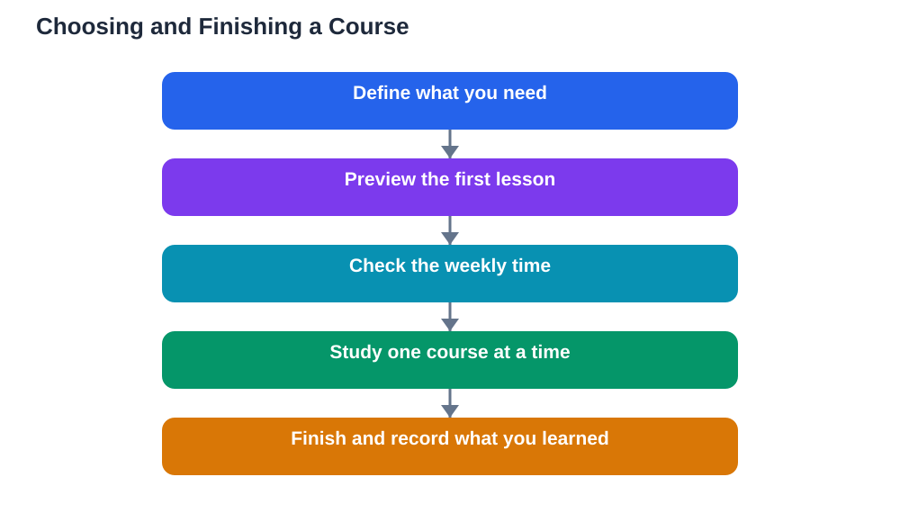

Online courses promise flexible learning on almost any topic, and many of them are excellent. Yet most students have the same experience: they enrol with enthusiasm, watch a few lessons, and quietly stop. The problem is rarely laziness. It is choice. With thousands of courses available, picking the wrong one, or picking too many at once, is easy. This guide shows how to choose online courses wisely, use free options well, and actually finish what you start.

## Online Courses for Students: Start With Your Need

Before browsing courses, write down what you actually need. Are you trying to understand a topic you are studying, learn a new skill, or explore something out of curiosity? Each need points to a different kind of course. A short, focused course suits a single topic you need to understand this term, while a longer structured course suits a skill you want to build over months. Also be honest about your time. A course that asks for many hours a week will fail if your week cannot supply them. Check the course length, the weekly time it expects, and whether the schedule is flexible or fixed. A course that fits your real week is worth far more than a famous course you cannot attend. Choosing with your need and your calendar in front of you prevents the most common mistake: enrolling in a course that was never realistic.

## Free Courses: Preview Before You Commit

Free courses are a gift, but they still cost your time, so preview them before committing. Most platforms let you watch an introductory lesson or read the course outline for free. Use that preview seriously. Watch the first lesson fully: is the teacher clear, are the examples helpful, does the pace suit you? Read the outline and ask whether the topics match what you need, in an order that makes sense. Check what the course asks you to do: watching alone rarely teaches deeply, so look for practice exercises, quizzes, or small projects. Be wary of courses that promise instant mastery or secret shortcuts; real learning takes steady work, and honest courses say so. If a course offers a certificate, remember that the certificate matters far less than what you actually learn. A free course you finish teaches more than a paid course you abandon.

## One Course at a Time, Finished Properly

The biggest enemy of finishing is starting too many courses at once. Each new enrolment feels like progress, but it splits your attention and your week until nothing gets finished. Choose one course at a time as your main course, and give it a fixed slot in your week, just like a class. Treat that slot as an appointment: same time, same place, phone away. Work through the course in order, doing the exercises as you go, rather than skipping ahead to the interesting parts. Skipping ahead feels efficient but leaves gaps that cause confusion later. Keep a simple course notebook: what each lesson taught, what confused you, and one question to carry into the next lesson. When you finish a course, note what you learned and what you want to learn next. That short record turns a finished course into a foundation for the next one, instead of a forgotten tab in your browser.

## Watch for Quality, Not Popularity

A course with huge enrolment numbers is not automatically a good course. Popularity often reflects marketing or a famous name, not teaching quality. Judge a course by its teaching instead. Good signs include clear explanations that build step by step, worked examples, regular practice, and a teacher who anticipates common mistakes. Warning signs include long videos with no practice, vague outlines, and lessons that repeat the same point without adding depth. Read a few honest reviews, but focus on reviews that describe the learning experience, not just the certificate. If you are using a course alongside your textbook, remember that AI-based study tools can also help with exercises, but always verify their solutions against your textbook, since AI can make mistakes. The Lesson Solver tool, for example, needs your own free Google AI Studio API key, and it supports textbook photos in English, Urdu, and Sindhi, which is useful if you study in more than one language.

## Finishing What You Start: Simple Tricks That Work

Finishing a course is mostly about removing friction and adding small rewards. Set a finish date when you enrol, and work backwards to see how many lessons you need each week. Study with a friend or a study group when possible, because a shared schedule is harder to abandon quietly. After each lesson, do something active with it: solve a problem, write a summary, or explain the idea to someone. If you fall behind, do not try to catch up in one giant session; resume with the next lesson and keep going, because a course finished late is still finished. If a course turns out to be genuinely wrong for you after several honest lessons, it is reasonable to stop and choose a better one. But make that decision deliberately, after trying, not on the first day when enthusiasm dips. For planning the weekly rhythm behind any course, see [Setting Learning Goals That Keep You Going](/blog/setting-learning-goals-students.html).

## AI Help: Muse AI

Muse AI is Meta's personal AI assistant, and it can help you choose online courses wisely by comparing course outlines or explaining a topic simply before you enrol. You can ask it to summarise what a course covers, or to suggest questions to check whether a course matches your level. Join Muse with invite code LTGSWD — in the Muse app, go to Settings > Redeem token and enter the code.
Disclosure: LTGSWD is the author's Muse invite code.

## FAQ

### Are free online courses as good as paid ones?

Many free courses are excellent, especially introductory ones, because their quality depends on the teaching, not the price. Paid courses sometimes add certificates, feedback, or structured support, which can be worth paying for. Judge any course by previewing a lesson, checking its outline, and looking for practice activities, rather than by its price tag.

### How do I choose between two similar courses?

Preview the first lesson of each and compare them honestly: which teacher explains more clearly, which outline matches your need better, and which one includes practice? Also compare the time each course asks for, and choose the one that fits your real week. When two courses are close, pick the shorter one first, because finishing it builds momentum for the next.

### How long should an online course take each week?

That depends on the course and your schedule, but a realistic weekly commitment you can keep matters more than a large one you abandon. Many students do well with a few shorter sessions spread across the week rather than one long session. Check the course's expected weekly time before enrolling, and make sure it fits alongside your other study.

### What should I do if I fall behind in a course?

Resume with the next lesson instead of trying to catch up all at once, and adjust your weekly pace if needed. A short review of the previous lesson's notes is usually enough to get back on track. If you have fallen far behind, it is better to restart the current section properly than to skip ahead and build on gaps.

## Conclusion

Choosing an online course well starts with knowing your need and your time, previewing before committing, and then focusing on one course at a time until it is finished. Popularity and price are poor guides; clear teaching, practice, and a schedule you can keep are far better ones. Finish what you start, keep a short record of what you learned, and let each completed course make the next choice easier. The best course is not the most famous one. It is the one you actually finish.

[Try the free AI lesson solver](/#tool)
