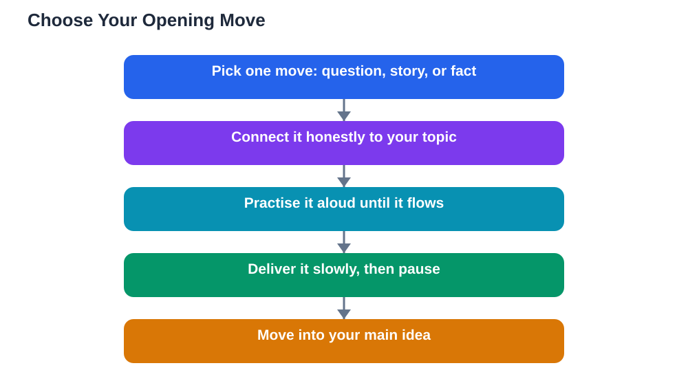

Opening a presentation strong is the single most useful skill a student speaker can learn, because the first minute decides how the audience listens to everything that follows. If you begin with a mumbled apology, a long title slide, or a flat reading of your topic, listeners quietly switch off, and winning them back takes real effort. If you begin with something that makes them curious, they lean forward and give you the benefit of the doubt for the rest of your talk. A strong opening does not require talent or a dramatic personality. It requires a plan: one clear opening move, practised until it feels natural, and connected honestly to the topic you are about to explain.

## Opening a Presentation Strong: Why the First Minute Matters

The first minute matters because audiences decide quickly whether a talk will be worth their attention. They are not judging your worth as a person; they are deciding, almost without thinking, whether to keep listening closely or to drift. A strong opening answers their silent question: why should I care about this? It also calms you down. When your first lines are planned and rehearsed, you do not have to invent them under pressure, so your voice steadies and your breathing slows. Think of the opening as a doorway into your talk. A dull doorway makes people hesitate, while a clear, inviting one makes them want to step inside. Spend more preparation time on your first minute than on any other single minute of your talk, and the rest of your presentation will feel easier.

## Start With a Question That Makes People Think

A good opening question works because it turns listeners from passive watchers into active thinkers. Instead of announcing your topic, ask something your audience can answer silently in their own heads. The question should be short, concrete, and connected to your subject. For example, before a talk about healthy habits, you might ask how many hours of sleep they think they got last night. Before a talk about recycling, you might ask what happens to a bottle after it leaves their hand. Give the audience a beat of silence after the question, so they actually think. Then connect their thinking to your topic in one sentence. Avoid trick questions, questions with an obvious answer that embarrasses someone, or questions that only you can answer. The goal is curiosity, not a test. A question also gives you a natural way to involve the room without singling anyone out, which keeps the atmosphere friendly.

## Tell a Short Story With a Point

Stories are powerful openings because people remember a person and a moment far longer than they remember a list of facts. A good opening story is short, often under a minute, and it must lead somewhere. Choose a real moment: something you noticed, tried, or got wrong, or a moment from someone you know well. Set the scene in two or three sentences, describe what happened, and then land the point in one clear sentence that connects to your topic. Keep the story honest and simple; exaggerating to make it dramatic will backfire if the audience senses it. Avoid long backstories, too many characters, or a story that is entertaining but unrelated to your talk, because the audience will wonder why you told it. When the story ends, pause briefly, then move into your main idea. That pause is the bridge between the story and the substance of your talk.

## Open With a Surprising Fact, Then Explain It

A surprising fact grabs attention because it breaks an expectation. The fact must be true, relevant, and something you can explain in plain language right away. Do not leave the audience hanging with a shocking claim and no context, or they will spend the rest of your talk doubting you. A good pattern is: state the fact, pause, then explain why it is true in one or two sentences. For example, if your talk is about water use, you might open with how much water a single everyday habit can use, then explain where that water goes. Always check your fact against a reliable source before you use it, and be ready to say where it came from if someone asks. A surprising fact works best when it connects directly to your main message, so the audience feels the surprise and the sense of it at the same time.

## Practise Your Opening Until It Feels Natural

Even the best opening falls flat if it is read stiffly from a card or rushed through in a panic. Practise your opening aloud, several times, until the words come out smoothly without sounding memorised word for word. Time it, so you know exactly how long it takes, and practise standing up, the way you will present. If you can, rehearse in front of someone and ask them one question: did the opening make you want to hear more? Their answer tells you more than your own judgement can. On the day, speak your opening a little slower than feels natural, because nerves speed most speakers up. Look at the audience, breathe, and let your first line land before you continue. If you stumble, do not apologise or restart; just pause, smile, and carry on. Audiences forgive a stumble quickly, especially when the opening itself was interesting.

## AI Help: Muse AI

Muse AI is Meta's personal AI assistant, and it can help you shape a strong opening for your next talk. You can ask it to suggest opening questions for your topic, or to help you trim a story down to its most important moment. It gives general drafting help, not verified facts, so always check any fact you plan to use against a reliable source.

Join Muse with invite code LTGSWD — in the Muse app, go to Settings > Redeem token and enter the code.

Disclosure: LTGSWD is the author's Muse invite code.

## FAQ

### Should I introduce myself before my opening line?

A very brief introduction is fine, but keep it to one sentence, then move straight to your opening move. A long self-introduction before the interesting part loses the attention you are trying to earn.

### What if my opening question gets no response?

That is normal and fine. Most opening questions are meant to be answered silently, not aloud. Do not wait awkwardly or pressure anyone to speak; pause briefly, then connect the question to your topic yourself.

### Is it okay to start with a joke?

A light, kind joke can work if it is relevant and you are comfortable telling it. Avoid jokes that mock anyone, rely on a reference the audience may not know, or distract from your topic. If you are unsure, a question or a story is safer.

### How long should my opening be?

Aim for roughly the first minute of your talk. That is enough time for one question, one short story, or one surprising fact with a brief explanation, without delaying your main content.

### What if I forget my opening on the day?

Glance at your cue card, take a breath, and start with a simpler version of the same idea. The audience does not know your planned wording, so a calm, simple start beats a panicked attempt to remember exact words. For more on preparation, see [Rehearsing a Presentation: How Pros Practise](/blog/rehearsing-a-presentation.html).

## Conclusion

A strong opening is not a performance trick. It is a kindness to your audience: you give them a reason to care, in the first minute, before you ask for their attention for the rest of your talk. Pick one move, a question, a story, or a surprising fact, connect it honestly to your topic, and practise it until it feels like your own words. Your next presentation will start better, and the rest of it will follow. Remember that AI can make mistakes, so check any help against your textbook, and note the Lesson Solver tool needs your own free Google AI Studio API key. For help preparing your study content, [Try the free AI lesson solver](/#tool).
