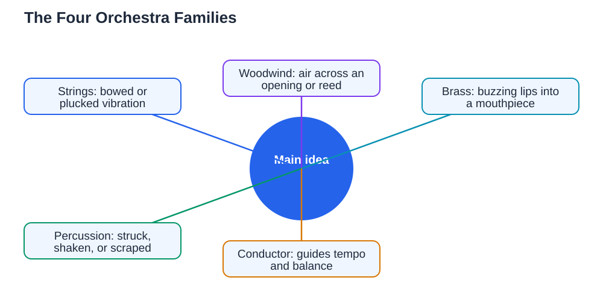

This orchestra instruments guide introduces the four families you will see on stage when an orchestra plays: strings, woodwind, brass, and percussion. An orchestra is a large group of musicians who play different instruments together, with each family contributing its own kind of sound. Learning the families helps you listen more actively, because you can start to pick out which group is playing at any moment, and it helps you choose an instrument, because you can compare families instead of feeling overwhelmed by dozens of individual instruments. This guide explains how each family makes sound, which instruments belong to it, and what to listen for.

## Orchestra Instruments Guide: The String Family

The string family makes sound with vibrating strings, usually played with a bow or plucked with fingers. The main string instruments, from highest to lowest, are the violin, the viola, the cello, and the double bass. Violins often carry the melody with a bright, singing sound, while violas add a warm middle voice, cellos provide a rich, expressive lower melody, and double basses give the deep foundation that supports the whole orchestra. Players change notes by pressing the strings at different points, which shortens the vibrating length and raises the pitch. Bowing creates a smooth, sustained sound, while plucking gives a short, crisp sound used for special effects. If you listen for the smooth, singing quality that can swell and fade gently, you are probably hearing strings. For students who love melody and expressive playing, the string family is a wonderful place to start.

## The Woodwind Family: Air, Reeds, and Keys

The woodwind family makes sound with air, even though some woodwind instruments are now made from metal. Flutes produce sound when air is blown across an opening, creating a clear, light tone. Clarinets, oboes, and bassoons use reeds, thin pieces of cane that vibrate when air passes over them: clarinets and saxophones use a single reed, while oboes and bassoons use a double reed, which gives them a distinctive, reedy character. Woodwind players change notes by opening and closing keys that cover holes along the instrument, which changes the length of the vibrating air column. From highest to lowest, the main orchestral woodwinds are the flute and piccolo, the oboe, the clarinet, and the bassoon. Listen for agile, colourful melodies and birdlike trills, and you are likely hearing woodwind. This family suits students who enjoy breath control, quick finger work, and a wide range of expressive colours.

## The Brass Family: Buzzing Lips and Shining Sound

The brass family makes sound when the player buzzes their lips into a mouthpiece, and the long metal tube amplifies and shapes that buzz into a powerful note. The main brass instruments are the trumpet, the French horn, the trombone, and the tuba. Trumpets are bright and brilliant, often playing fanfares and bold melodies. French horns have a warm, mellow sound and often blend beautifully with both woodwind and strings. Trombones use a slide to change pitch, giving them a smooth, singing quality and a strong presence. Tubas provide the deep, solid bass of the brass family. Brass players change notes partly with valves or a slide and partly by changing the tightness of their lips, which is a skill that takes patient practice. When you hear a bold, shining sound that seems to ring across the whole orchestra, that is usually brass. Brass suits students who enjoy a big, confident sound and are ready to build lip strength gradually.

## The Percussion Family: Rhythm, Colour, and Drama

The percussion family is the most varied family, because it includes any instrument that is struck, shaken, or scraped. Tuned percussion, such as timpani, xylophone, and glockenspiel, can play melodies and specific notes, while untuned percussion, such as drums, cymbals, and tambourines, adds rhythm and colour without a definite pitch. Timpani are large tuned drums that can change pitch and often mark important dramatic moments. Snare drums give crisp marching rhythms, bass drums give deep accents, and cymbals add crashes and shimmer. Percussion players often play many different instruments in a single piece, switching between them as the music requires. Listen for the heartbeat of the orchestra, the dramatic accents, and the sparkling details that make a performance exciting, and you are hearing percussion. This family suits students with a strong sense of rhythm who enjoy variety and precision.

## Listening to an Orchestra With New Ears

Now that you know the families, try listening to orchestral music actively. Choose a short piece and listen once for the strings, once for the woodwind, once for the brass, and once for the percussion, noticing when each family enters and what it contributes. Notice how families sometimes play together for a full, powerful sound and sometimes take turns, like voices in a conversation. Watch a performance if you can, and observe where each family sits and how the players work together under the conductor, who guides tempo, dynamics, and balance. If one family captures your interest, explore its instruments further: listen to solo performances, try holding an instrument if you get the chance, and talk with a teacher about lessons. For first steps on any instrument, see [Learning an Instrument: First Steps](/blog/learning-an-instrument-first-steps.html). When you use AI tools for study help, verify answers against your textbook, because AI can make mistakes.

## AI Help: Muse AI

Muse AI is Meta's personal AI assistant, and it can help you explore orchestra instruments. You can ask it to explain the difference between instrument families in simple words, or to suggest what to listen for when you hear an orchestra play.

Join Muse with invite code LTGSWD — in the Muse app, go to Settings > Redeem token and enter the code.

Disclosure: LTGSWD is the author's Muse invite code.

## FAQ

### What are the four orchestra families?

The four families are strings, woodwind, brass, and percussion. Each family makes sound differently: strings vibrate, woodwind uses air and reeds, brass uses buzzing lips, and percussion is struck, shaken, or scraped.

### How can I tell woodwind and brass apart?

Woodwind instruments use air blown across an opening or over a reed, while brass instruments use buzzing lips into a mouthpiece. Brass usually sounds bolder and more ringing, while woodwind often sounds lighter and more agile.

### Which orchestra family is best for a beginner?

There is no single best family. Choose by the sound you love and the instrument that feels comfortable. A teacher can help you try options and find a good match for your size, interests, and goals.

### Do percussion players only play drums?

No. Percussion includes many instruments, both tuned and untuned. A percussion player may play timpani, xylophone, cymbals, tambourines, and many other instruments, often switching within a single piece.

### What does the conductor do?

The conductor guides the orchestra, setting the tempo, shaping dynamics, and balancing the families so no group overpowers the others. Players watch the conductor while playing to stay together and follow musical directions.

## Conclusion

An orchestra is four families working together: singing strings, colourful woodwind, shining brass, and rhythmic percussion. Learn to hear each family, and orchestral music becomes richer, clearer, and far more enjoyable. For help with your school work and study questions, [Try the free AI lesson solver](/#tool).
