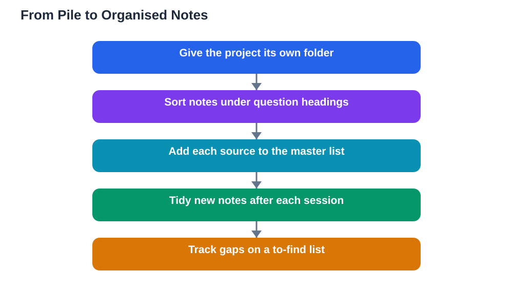

Organising research notes is the difference between a project that writes itself and one that drowns in paper. Many students take perfectly good notes and then lose the benefit of them, because the notes live in one long, unlabelled pile where nothing can be found twice. When writing time arrives, they waste hours hunting for a fact they know they wrote down somewhere, or they give up and rewrite from memory, which is slower and less accurate. A simple organisation system prevents all of this. It does not need fancy tools or complicated rules: a clear folder structure, consistent headings, and a single source list are enough to turn a pile of notes into a working library you can actually use.

## Organising Research Notes: One Folder Per Project

Start by giving each project its own home, whether your notes live on paper or on a device. A single folder, binder section, or notebook division for the project keeps its notes from mixing with other subjects, which is the most common cause of lost material. Inside that home, create a small set of subsections that match your research question, such as background, key ideas, evidence, and differing views. You do not need many subsections; a few broad ones you actually use beat a dozen narrow ones you forget. Name every file or page clearly with the project name and the subsection, so a note can be filed in seconds and found again just as fast. For ideas on sorting study notes generally, see [How to Organise Study Notes](/blog/how-to-organise-study-notes.html).

## Headings That Match Your Research Question

Headings are the signposts of your notes, and the best headings come from your research question itself. If your question asks how something works and what its effects are, use headings for how it works and for its effects, plus headings for background and for views that disagree. When you take a new note, file it under the heading where it will be needed during writing, not under the source it came from. This question-shaped structure pays off twice: first, while researching, because empty headings show you exactly which parts of your question still need sources; and second, while writing, because your notes already sit in an order close to your final piece. Review your headings halfway through research and adjust them if your question has shifted, since headings that no longer match your question will mislead you.

## A Source List That Grows With Your Notes

Alongside your notes, keep one master source list that grows as you research. Every source you use gets one entry with its author, title, date, and link or location, plus a short code you use in your notes. This list serves three purposes at once: it becomes your bibliography with minimal extra work, it lets you check any note's origin in seconds, and it stops you from accidentally using the same source twice under different names. Update the list the moment you start using a new source, not at the end of the project when details are hardest to recover. If a source turns out to be unreliable and you drop it, keep its entry marked as unused rather than deleting it, so you have a record of what you considered and why you set it aside.

## Daily Habits That Keep Notes Tidy

Organisation is less about one big sorting session and more about small daily habits. At the end of each research session, spend a few minutes filing new notes under the right headings, labelling anything unlabelled, and updating your source list. This short tidy-up prevents the backlog that makes organising feel overwhelming, and it doubles as a quick review of what you learned that day. Also keep a simple "to find" list for gaps you noticed: questions still unanswered, headings still empty, or claims still needing a second source. That list turns your next research session into a focused search instead of a random wander. Students who tidy little and often almost never face the dreaded pile, because the pile never gets a chance to form.

## Paper, Digital, or a Mix That Suits You

There is no single right format for organised notes, only the format you will actually maintain. Paper suits students who remember better by handwriting and who like spreading pages out to see connections, but paper needs physical folders and careful labelling to stay searchable. Digital notes suit students who value searching, copying links, and rearranging headings quickly, but they need consistent file names and regular backups to stay safe. Many students use a mix: paper for first reading and thinking, digital for the tidied, final set of notes. Whichever you choose, keep the same heading structure and source codes across formats, so a paper note and a digital note can be matched without confusion. The system matters far more than the tool, and the best system is the one you will still be using in the final week of the project.

## AI Help: Muse AI

Muse AI is Meta's personal AI assistant, and it can help you organise research notes. You can ask it to suggest headings based on your research question or to help you sort a list of note topics into sensible groups.
Join Muse with invite code LTGSWD — in the Muse app, go to Settings > Redeem token and enter the code.
Disclosure: LTGSWD is the author's Muse invite code.

## FAQ

### How should I organise notes for a large project?

Give the project its own folder, divide notes under a few headings drawn from your research question, and keep one master source list with a code for each source. File each note under the heading where it will be needed in writing, and tidy new notes at the end of every research session so nothing piles up unlabelled.

### Is it better to organise notes by source or by topic?

Organising by topic, using headings from your research question, usually works better for writing, because it groups together everything you need for each section of your final piece. Organising by source makes it easy to see what one book said but hard to compare sources. Keep the source list separate so you still know where every note came from.

### What do I do with notes that do not fit any heading?

First check whether the note is truly relevant to your question; if not, set it aside in a clearly marked "maybe" section rather than forcing it into a heading. If several stray notes share a theme, that theme may deserve a new heading. Reviewing stray notes regularly keeps your structure honest and stops irrelevant material from cluttering your writing plan.

### How often should I tidy my research notes?

A few minutes at the end of each research session is enough, and it is far more effective than one large tidy-up at the end. Short, regular tidying files new notes while you still remember them, updates your source list, and reveals gaps early, when there is still time to fill them.

## Conclusion

Organised notes are a gift you give your future self. One folder per project, headings shaped by your research question, a growing source list, and a few minutes of tidying after each session turn scattered notes into a system you can trust. When writing begins, you will spend your time thinking and shaping ideas instead of hunting for lost facts, and that is exactly what good organisation is for.

[Try the free AI lesson solver](/#tool)
