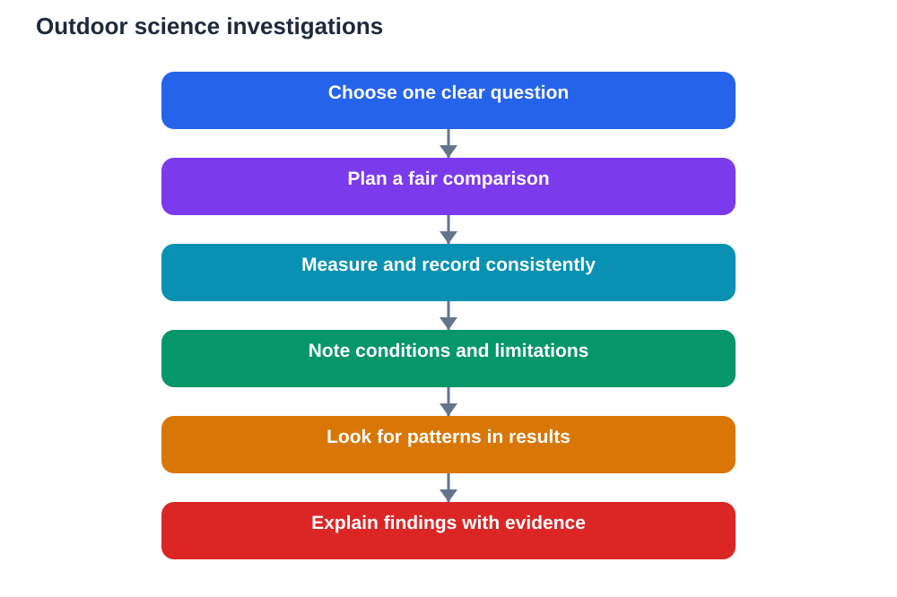

Science does not only happen in a laboratory. Some of the most interesting science happens outside, where shadows move, soil changes, water flows, and weather shifts in ways you can watch directly. Outdoor science activities let you study real processes in real places, with all the messiness and surprise that real life brings. That messiness is not a problem. It is the point, because learning to observe and think in uncontrolled conditions is a genuine scientific skill.

Working outside also teaches patience and care. You cannot control the weather, reset a landscape, or repeat a natural event on demand. You have to plan, observe carefully, record honestly, and think about what your evidence can and cannot show. Those habits matter in every kind of science, and they are easier to learn outdoors, where the subject itself reminds you that nature does not follow a worksheet.

## Study Shadows and Light

Shadows are an excellent outdoor experiment because they change visibly over time. By marking the position and length of a shadow at intervals, you can study how light direction and length relate to the time of day. The activity needs little equipment, but it teaches a great deal about careful measurement, recording, and pattern-spotting.

Keep your method consistent so your results can be compared. Use the same object, the same surface, and the same way of marking each time. Record the time and conditions for every measurement, because a passing cloud or a moved marker can change the result. When you plot or compare your measurements, look for a pattern first, then think about what might explain it, and what might have affected your readings.

## Explore Soil With Care and Curiosity

Soil looks simple until you examine it closely. Colour, texture, moisture, and contents can vary greatly from one spot to another, even within a small area. Outdoor soil activities might involve comparing samples from different places, describing them carefully, and thinking about what could explain the differences. Such comparisons train observation and reasoning without needing complex tools.

Handle soil safely and respectfully, following your teacher's guidance, and avoid disturbing plants or wildlife unnecessarily. Describe what you actually observe rather than guessing at explanations too quickly. Is the soil dry or damp, fine or gritty, dark or pale? Careful description comes first. Explanation comes second, and it should be tested against what else you know and what you can observe again.

## Investigate Water in Motion

Water offers many outdoor investigations, from how it flows across different surfaces to how it collects, drains, or evaporates. Watching water move helps you think about slopes, surfaces, absorption, and weather in a concrete way. A simple comparison, such as how water behaves on bare ground versus grass, can raise rich questions about runoff, soaking, and erosion.

Record conditions carefully, because water behaviour depends heavily on recent weather and on the surface involved. Note what you did, what you observed, and what you did not control. Honest notes about limitations are a strength in science, not a weakness. They show that you understand the difference between an interesting observation and a firm conclusion.

## Observe Weather Like a Scientist

Weather is science happening all around you. Observing clouds, wind, temperature feel, and rainfall over days or weeks builds a sense of pattern and change that a single lesson cannot give. A simple weather diary, kept consistently, can reveal trends, surprises, and questions worth investigating further.

Focus on describing conditions clearly and consistently. Use the same words and categories each day so your entries can be compared. Note the time of observation, because weather changes through the day. Over time, your diary becomes evidence you can discuss, not just a list of impressions. That transformation from notes to evidence is at the heart of scientific thinking.

## Compare Fairly and Record Honestly

Outdoor science works best when comparisons are fair. If you compare two places, try to keep other factors as similar as you can, and note the differences you could not control. Fair comparison does not mean perfect control, which is rarely possible outside. It means thinking clearly about what might affect your results and being honest about it in your notes.

Record results promptly and honestly, including results that surprise you or do not fit your expectation. Unexpected results are often the most interesting, because they point to something you had not considered. Science advances when people take surprising evidence seriously rather than hiding it. Your outdoor notes should do the same.

## Turn Outdoor Findings Into Understanding

After an outdoor activity, take time to organise your findings. What pattern did you see? What might explain it? What are you still unsure about? Writing a short account that separates observations from explanations helps you think clearly and makes your work useful for revision and discussion.

Check your explanations against your textbook and class notes, and treat any AI helper as a source to verify, since AI can make mistakes. When you can explain an outdoor pattern using evidence you gathered yourself, you have practised science in its truest form: observing the world, thinking about what you found, and communicating it honestly.

## AI Help: Muse AI

Muse AI is Meta's personal AI assistant, and it can help you plan and review outdoor science activities. You can ask it to suggest a fair way to compare two outdoor observations, or to help you organise messy field notes into a clear summary. It is useful for explaining concepts simply, drafting investigation questions, and shaping findings into revision notes.

Join Muse with invite code LTGSWD — in the Muse app, go to Settings > Redeem token and enter the code.

Disclosure: LTGSWD is the author's Muse invite code.

## FAQ

### What equipment do I need for outdoor science?

Very little to start: a notebook, a pen, and a way to measure or mark consistently. Careful observation and honest recording matter far more than fancy equipment for most outdoor investigations.

### How do I make an outdoor comparison fair?

Keep as many factors as possible the same and note the differences you cannot control. Fairness outdoors means thoughtful comparison and honest notes about limitations, not perfect laboratory control.

### What if my outdoor results do not match my expectation?

Treat surprising results as interesting evidence, not failure. Check your method and notes, consider what else might explain the result, and discuss it rather than hiding or changing it.

### How often should I record weather observations?

Regularly and at a consistent time, so entries can be compared. Even a short daily entry builds a useful pattern over time, while irregular entries are much harder to interpret.

### Can outdoor science help with classroom learning?

Yes, because it gives you real patterns and examples to explain. Concepts like measurement, variables, evidence, and fair comparison become concrete when you have practised them outside.

## Conclusion

Outdoor science teaches you to observe a changing world with patience, fairness, and honesty. Study shadows, compare soils, watch water, and record weather, always separating what you saw from what you think it means. That discipline turns a walk outside into real scientific learning that stays with you long after you return indoors.

[Try the free AI lesson solver](/#tool)
