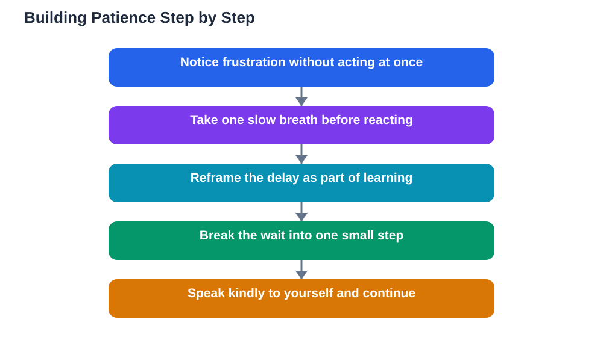

Patience is often treated as a personality trait, something you either have or you do not. In reality, patience is a skill, and like any skill it can be practised and strengthened. Students need patience constantly: waiting for a turn, working through a difficult lesson, dealing with slow progress, or handling a day that does not go as planned. Impatience usually shows up as frustration, rushing, or giving up too soon. Patience, by contrast, gives you room to think clearly, keep going steadily, and respond thoughtfully instead of reacting in the moment. The good news is that small daily practices can build it surprisingly fast.

## Patience Skill Students: Waiting Is a Practice, Not a Waste

Waiting feels like wasted time, but it can become useful practice. When you must wait, whether for your turn, for help, or for a result, notice what waiting feels like in your body: restlessness, tension, or the urge to rush. Simply noticing these feelings, without acting on them immediately, is patience in action. You can use waiting time well by reviewing a note, planning your next step, or simply resting your mind for a moment. Reframing waiting as a short pause rather than an obstacle changes how it feels. Over time, waits that once felt unbearable become ordinary, because you have practised sitting with them many times before.

## Breathe Before You React

Breathing is the simplest patience tool, and it works because it slows your body down before your words catch up. When frustration rises, take one slow breath in, pause briefly, and breathe out slowly. That short gap is often enough to stop a sharp reply or a rushed decision. Practise this breathing when you are calm, so it is ready when you are not. You might link it to a daily cue, such as before starting homework or after a lesson ends, so it becomes a habit rather than something you must remember in a heated moment. A single breath will not solve every problem, but it gives patience a chance to arrive before impatience takes over.

## Reframe Delays as Part of Learning

Delays frustrate us most when we expect everything to move quickly. Reframing a delay means changing the story you tell yourself about it. Instead of "This is taking too long, I am failing," try "This is taking time because it is new, and new things take time." A difficult lesson that needs several attempts is not proof of failure. It is evidence that you are learning something genuinely challenging. When progress feels slow, look back at where you started rather than only at where you want to be. Small improvements, noticed honestly, build the confidence that patience needs. For help with steady study habits, see [How to Take Good Class Notes](/blog/how-to-take-good-class-notes.html).

## Break Big Waits Into Small Steps

Long waits feel hardest when they have no shape. Breaking them into small steps makes patience much easier. If a project will take days, focus only on today's small part. If understanding a topic will take weeks, focus on one idea at a time. Each finished step gives you a small sense of progress, which makes the next wait easier to bear. You can also set gentle checkpoints: after a set amount of focused work, take a short break and notice what you achieved. Patience grows when waiting is divided into manageable pieces, because each piece has a beginning and an end you can actually reach.

## Be Patient With Yourself, Too

Students are often patient with others but harsh with themselves, expecting instant understanding and perfect first attempts. Self-patience means allowing yourself to learn slowly, make mistakes, and try again without harsh self-talk. When you catch yourself thinking "I should know this already," replace it with "I am learning this, and learning takes time." Speak to yourself the way you would speak to a friend who is struggling. This kinder inner voice does not lower your standards. It keeps you working steadily instead of quitting in frustration. Patience with yourself is the foundation for patience with everyone else, and it is worth practising every day.

## AI Help: Muse AI

Muse AI is Meta's personal AI assistant, and it can help you practise patience in a practical way. You can ask it to break a large task into small, manageable steps, or to suggest a calm reframe when a delay feels frustrating. Join Muse with invite code LTGSWD — in the Muse app, go to Settings > Redeem token and enter the code.
Disclosure: LTGSWD is the author's Muse invite code.

## FAQ

### Is patience something you are born with?

No, patience is a skill that can be practised and strengthened. Small daily practices, such as noticing frustration without acting on it, breathing before reacting, and breaking waits into steps, all build patience over time. Like any skill, it improves with regular, gentle practice.

### What can I do when I feel impatient during a lesson?

Take one slow breath, then focus on the smallest next step you can take, such as writing down one question or rereading one paragraph. Reframing the difficulty as part of learning, rather than proof of failure, also helps. If you are still stuck, asking for help early is a patient and smart move.

### How does patience help with studying?

Patience helps you keep working steadily instead of rushing or giving up when a topic feels hard. It lets you review, practise, and improve over time, which is how lasting understanding is built. Impatience often leads to shortcuts that feel fast but fade quickly, while patient study builds knowledge that stays.

### Can patience be practised every day?

Yes, everyday moments are ideal practice: waiting for a turn, working through a hard problem, or handling a change of plan. Each small moment of waiting calmly, breathing before reacting, or reframing a delay strengthens the skill. Short daily practice adds up faster than occasional big efforts.

## Conclusion

Patience is not about passively accepting everything. It is an active skill: noticing frustration, breathing before reacting, reframing delays, breaking waits into steps, and being kind to yourself while you learn. Practise it in small moments each day, and hard days will feel calmer, learning will feel steadier, and you will find you can handle far more than impatience ever allowed.

[Try the free AI lesson solver](/#tool)
