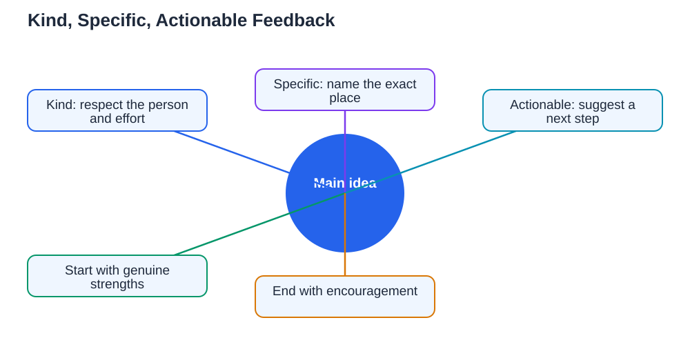

Peer feedback that helps is one of the most valuable things students can give each other, and also one of the easiest to get wrong. A vague comment like "good job" feels nice but teaches nothing, while a blunt comment like "this is wrong" stings without showing how to improve. The feedback that actually moves learning forward has three qualities: it is kind, so the receiver can hear it; specific, so they know exactly what to change; and actionable, so they know the next step. This guide shows how to give feedback with all three qualities, and how to receive it well, so peer review becomes a study tool you look forward to instead of dread.

## Peer Feedback That Helps Is Kind, Specific, and Actionable

The simplest test for peer feedback that helps is to check it against three words: kind, specific, actionable. Kind means the tone respects the person and the effort behind the work, even when the work needs major changes. Specific means it points to an exact place and issue, such as "the second paragraph repeats the first point" rather than "the essay is confusing." Actionable means it suggests a concrete next step, such as "try merging these two paragraphs and adding one example." Feedback missing any one of these fails in a predictable way: kind but vague feedback changes nothing, specific but harsh feedback shuts the person down, and actionable but unclear feedback sends them in the wrong direction. Before you hand back any piece of work, run your comments through this three-part test and rewrite anything that fails it.

## Start With What Works

Always begin feedback with something genuine that works. This is not empty praise to soften the blow, it is information. When you name what works, your friend learns what to keep doing, and they become more willing to hear what needs changing. Be specific here too: "Your opening sentence states the main idea clearly" is useful, while "Nice work" is not. A good structure is to name one or two strengths first, then raise the most important improvement, then end with encouragement or a question. This order matters because people remember the first and last things they hear most clearly. If the work has serious problems, you can still find something honest to praise: a clear heading, a good example, a careful first step. Genuine strengths exist in almost every piece of work, and naming them costs you nothing.

## Point to the Exact Place and Problem

Vague feedback is the most common failure in peer review. Comments like "unclear", "needs work", or "fix this" leave your friend guessing about what is actually wrong. Instead, point to the exact sentence, step, or paragraph and name the problem precisely: "This step uses the wrong sign", "This paragraph introduces two ideas at once", or "This answer does not explain why." If you are reviewing a written answer, underline or circle the exact spot. If you are reviewing spoken work, quote the words back. Precision also protects the friendship, because a comment about one sentence feels fair while a comment about the whole piece feels like a judgement of the person. When you cannot name the problem exactly, say so honestly: "Something feels off in this paragraph but I cannot pin it down yet, let us read it together." That honesty is far more helpful than a confident but wrong diagnosis.

## Suggest a Next Step, Not Just a Verdict

Feedback that only judges is half-finished. Your friend needs to know what to do next, so always pair a problem with a suggestion. "This paragraph repeats the first point" becomes useful when you add "try deleting the repeated sentence and replacing it with an example." "Your calculation goes wrong here" becomes useful with "check the sign when you move this term across." Suggestions do not have to be perfect: your friend can disagree and choose a different fix, and discussing the options is itself good learning. What matters is that the feedback opens a path forward instead of closing the conversation with a verdict. If you are unsure of the right fix, say so and work it out together, checking the textbook when needed. A suggestion offered as an idea, not an order, keeps the partnership equal and the learning active.

## Receive Feedback Without Taking It Personally

Giving good feedback is only half the skill; receiving it well is the other half. When a friend points out a mistake, your first reaction may be embarrassment or defensiveness, and that is normal. The useful response is to pause, thank them, and ask a clarifying question: "Can you show me the exact step?" or "What would a better version look like?" This turns feedback into a conversation instead of a judgement. Avoid arguing about every point in the moment. Note the comments, try the suggested changes, and judge by the result. If feedback feels harsh, it is fair to say so calmly: "I want to hear this, but the wording felt harsh." Good partnerships can handle that conversation, and it makes future feedback better for both of you. Remember that feedback on your work is not feedback on your worth, and every strong student has a long history of corrected mistakes behind them.

## Make Peer Review a Regular Habit

Peer feedback works best as a habit, not a one-off event before a deadline. Build it into your study routine: swap answers after practice questions, read each other's short written work once a week, or check each other's revision notes. Keep the sessions short and focused, reviewing one piece of work at a time rather than everything at once. Agree simple ground rules first, such as the kind-specific-actionable test and a rule against teasing. You can combine peer review with other study methods, such as the [group study roles](/blog/group-study-roles.html) system, where one person acts as challenger, or the advice in [how to give study feedback](/blog/how-to-give-study-feedback.html). Regular, small feedback loops catch mistakes early, when they are easy to fix, instead of letting them harden into habits that are painful to unlearn later.

## AI Help: Muse AI

Muse AI is Meta's personal AI assistant, and it can help you practise giving better peer feedback. You can ask it to help you reword a blunt comment into a kind, specific suggestion, or to draft a checklist of things to look for when reviewing a friend's written work.

Join Muse with invite code LTGSWD — in the Muse app, go to Settings > Redeem token and enter the code.

Disclosure: LTGSWD is the author's Muse invite code.

## FAQ

### How honest should peer feedback be?

Completely honest about the work, and kind in how you say it. Honesty without kindness damages confidence, while kindness without honesty wastes the review. The combination is what helps: name the real problem clearly, in words that respect the effort behind the work.

### What if my friend takes feedback badly?

Stay calm and do not get drawn into an argument. Acknowledge their feelings, restate that you are commenting on the work, and offer to work through the fix together. If strong reactions happen often, agree ground rules before the next review, including how each of you prefers to receive criticism.

### Should I correct every mistake I find?

No. Focus on the most important two or three issues, because a long list of corrections overwhelms and discourages. Fix the errors that change meaning or block understanding first, and leave small details for a later pass if time allows. Prioritising is itself a useful skill.

### Can peer feedback replace a teacher's feedback?

Not entirely, but it complements it well. Peers catch many mistakes and explain in friendly language, while teachers bring expert knowledge and can settle disagreements. Use peer review often, and take unresolved questions to your teacher. The guide on [when to ask teacher help](/blog/when-to-ask-teacher-help.html) explains how to decide when a question needs a teacher.

## Conclusion

Peer feedback that helps is kind, specific, and actionable. Start with genuine strengths, point to exact problems, suggest concrete next steps, and receive criticism as useful information rather than personal judgement. Make peer review a regular, short habit with agreed ground rules, and it will become one of the fastest ways for both of you to improve. When you need step-by-step help understanding a textbook problem before your next review session, [Try the free AI lesson solver](/#tool).
