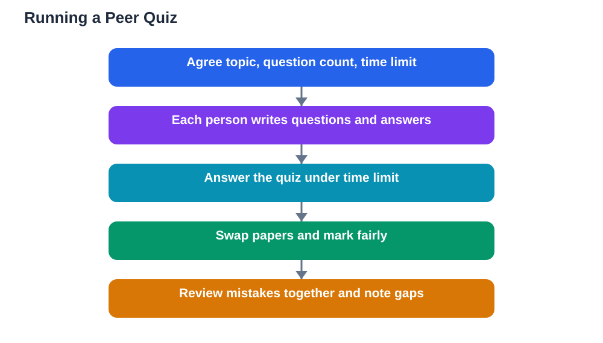

Peer quizzes how to run them well is a question worth answering properly, because a good peer quiz is one of the most effective revision tools there is, while a bad one wastes everyone's time. Testing yourself from memory, rather than rereading notes, is what builds durable recall, and testing each other adds the fun of competition and the benefit of seeing how others think. But peer quizzes only work when the questions are fair, the marking is honest, and the review afterwards turns mistakes into learning. This guide walks through the whole process, from writing questions to swapping papers to reviewing results, so your next peer quiz actually improves everyone's memory.

## Peer Quizzes How to Run Well: Start With a Plan

A well-run peer quiz starts before anyone writes a question. Agree the topic, the number of questions, and the time limit in advance, so everyone prepares the same material and the quiz feels fair. Ten to fifteen questions in twenty minutes is a good size for most groups: large enough to cover the topic, small enough to leave time for review. Decide the format too: short answers test recall best, while multiple choice and true-or-false questions are quicker to mark but easier to guess. A mix works well, with mostly short-answer questions and a few of other types for variety. Finally, agree the rules for marking: honest, kind, and focused on learning rather than winning. When everyone knows the plan, the quiz feels like a game with a purpose rather than a surprise test.

## Writing Questions That Actually Test Understanding

Good quiz questions test understanding, not just memorisation of exact wording. A weak question asks for a definition copied from the book, while a strong question asks the student to use the idea: explain it in their own words, apply it to a new example, or spot a mistake in a worked step. When writing your questions, cover the whole topic rather than only your favourite parts, and include a mix of easy, medium, and hard questions so everyone can score something while still being stretched. Write the answer alongside each question on a separate sheet, because you will need it for marking, and keep the wording clear: a confusing question tests reading skill, not subject knowledge. If you want more guidance on crafting questions, the guide on [how to write good quiz questions](/blog/how-to-write-good-quiz-questions.html) and [how to make your own quiz](/blog/how-to-make-your-own-quiz.html) both offer practical examples you can adapt.

## Swapping Papers and Marking Fairly

Swapping papers is the heart of a peer quiz, and it works best with simple, clear routines. Each person writes their answers on a separate sheet, then passes it to someone else for marking against the answer sheet. Marking should be strict about facts but kind in tone: mark what is wrong, and add a short note where the answer went astray, such as "right idea, wrong sign in step two." Avoid marking down answers that are correct but worded differently from your answer sheet, because understanding matters more than exact phrasing. If a marker is unsure whether an answer counts, the group discusses it together and the textbook settles disagreements. Keep scores private if anyone prefers that, because a quiz that embarrasses people will not be repeated. The goal of marking is accurate feedback, not a public ranking.

## Reviewing Mistakes Together Is Where Learning Happens

The review after a peer quiz matters more than the quiz itself. Go through the questions everyone found hardest, and let the person who got each one right explain their thinking. For questions nobody answered well, work through them together, step by step, checking the textbook as you go. This is where real learning happens, because mistakes made in a quiz and corrected immediately are far less likely to be repeated. Keep a shared list of the ideas the group still finds shaky, and use it to plan the next session. Resist the urge to rush the review or skip it to play another round: a quiz without review is just a score, while a quiz with review is a lesson. If your group tracks scores over time, the guide on [how to track quiz scores and improve](/blog/how-to-track-quiz-scores-and-improve.html) shows how to turn results into a study plan.

## Keep Quizzes Fun, Fair, and Regular

Peer quizzes work best as a regular habit, not a rare event. Run a short quiz at the end of every study session, or once a week on a fixed day, so quizzing becomes part of your routine rather than a special occasion. Vary the format to keep it fresh: one week a written quiz, another week oral quizzing in pairs, another week a team quiz where groups compete. The guide on [oral quizzing with a partner](/blog/oral-quizzing-with-a-partner.html) is a good model for spoken rounds. Keep the tone light and the stakes low: the quiz is a tool for learning, not a judgement, and celebrating improvement matters more than celebrating the highest score. When quizzes are fun, fair, and regular, students look forward to them, and that willingness to be tested is itself a powerful study habit.

## Common Peer Quiz Mistakes to Avoid

A few mistakes spoil otherwise good peer quizzes. The first is writing questions that are too easy or too obscure, which makes the quiz feel pointless or unfair; aim for a spread of difficulty instead. The second is skipping the answer sheet, which leads to arguments during marking and wasted time. The third is turning the quiz into a competition where winning matters more than learning, which discourages weaker students from taking part. The fourth is quizzing only once, right before an assessment, when there is no time left to fix the gaps the quiz reveals. Avoid these four mistakes and your quizzes will stay useful all term. Remember also that quiz questions should come from your actual study material and textbook, and any AI help you use for drafting questions should be checked against the textbook, since AI can make mistakes.

## AI Help: Muse AI

Muse AI is Meta's personal AI assistant, and it can help you run better peer quizzes. You can ask it to turn a set of notes into draft quiz questions, or to suggest a mix of easy, medium, and hard questions on a topic your group is revising.

Join Muse with invite code LTGSWD — in the Muse app, go to Settings > Redeem token and enter the code.

Disclosure: LTGSWD is the author's Muse invite code.

## FAQ

### How many questions should a peer quiz have?

Ten to fifteen questions is ideal for most groups, fitting comfortably into about twenty minutes with time left for review. Fewer than five questions will not cover a topic well, while more than twenty usually leaves no time for the review that makes quizzing worthwhile.

### Should peer quizzes be timed?

Yes, a gentle time limit keeps the quiz focused and realistic, and it trains you to recall under mild pressure. Keep the limit generous rather than stressful, and allow extra time during the review stage, when careful discussion matters more than speed.

### What if one person always wins the quiz?

Rotate who writes the questions, vary the topics, and celebrate improvement rather than just the top score. A group where one person always wins can still work well if that person explains their answers, because teaching the group is valuable for everyone. If winning becomes the focus, reset the tone by making quizzes team-based for a while.

### Can peer quizzes replace solo revision?

No, they complement it. Solo revision builds the knowledge, and peer quizzes test it and reveal gaps. Use both: study alone first, then quiz each other, then return to solo study for the gaps the quiz exposed. This cycle of study, test, and restudy is one of the strongest revision strategies available.

## Conclusion

Peer quizzes how to run them well comes down to a clear plan, fair questions, honest marking, and a proper review of mistakes. Write questions that test understanding, swap papers with kind and accurate marking, and always spend time on the review where the real learning happens. Keep quizzes fun, fair, and regular, and they will become a habit your whole group looks forward to. For step-by-step help with the textbook problems behind your quiz questions, [Try the free AI lesson solver](/#tool).
