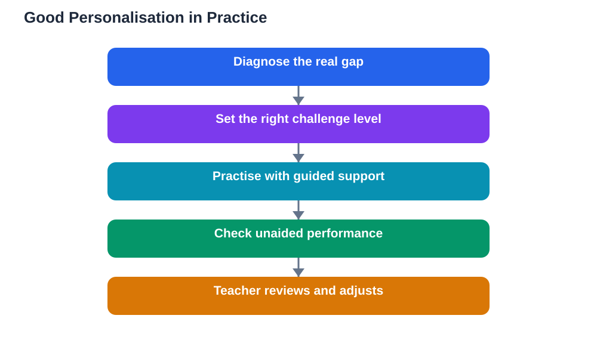

A personalised-learning pilot announced this week uses conversational AI tutors, personalised paths, interactive practice and progress tracking, tailored to each learner's pace and gaps. The promise is attractive: teaching that adapts to the individual instead of marching a whole class at one speed. Personalised AI learning paths can genuinely help, but only when they are built around the right things: accurate diagnosis of gaps, sensible pacing, and real teacher oversight.

Personalisation is an old idea with a new engine. Good teachers have always adjusted: extra practice for a struggling learner, extension for a fast one, a different explanation for a confused one. What AI adds is scale and speed: it can track responses, spot patterns and adjust the next task instantly, for every learner at once. That is powerful, but it is also where the risks begin, because an automated path is only as good as its diagnosis and its goals.

## Pace: The Right Speed, Not Just Your Speed

Pace is the most advertised benefit of personalisation, and the most misunderstood. Learning at your own pace does not mean learning at your most comfortable pace. Real progress requires challenge: tasks slightly beyond current ability, with support. A path that lets a learner cruise through easy material feels pleasant and teaches little. A path that pushes too fast creates frustration and gaps.

Good pacing therefore adapts in both directions. When a learner masters material quickly, the path should advance and deepen, not just accelerate through more of the same. When a learner struggles, it should slow down, revisit foundations, and vary the approach rather than simply repeating the same failed task. Learners should also be able to see and question their pace: why am I on this task, and what will it unlock next? A path that cannot explain itself is hard to trust.

## Gaps First: Diagnosis Before Content

The most valuable thing a personalised path can do is find gaps accurately. A learner's wrong answers are data: they reveal which ideas are missing, which are shaky, and which are confused with something else. A good system uses that data to target the gap directly, with practice that isolates the missing idea before recombining it into harder problems.

But diagnosis from quiz answers alone is limited. A learner may answer correctly by guessing, or fail for reasons unrelated to understanding, such as misreading the question. That is why teacher oversight matters: a teacher who knows the learner can tell the difference between a knowledge gap and a bad day, and can adjust the path accordingly. Personalisation without human judgement mistakes data for understanding.

## Teacher Oversight: The Non-Negotiable Ingredient

Teacher oversight is what turns a personalised path from a content-delivery machine into a teaching tool. Teachers set the goals the path serves, choose the material it draws on, and decide when a learner should leave the path for class discussion, group work or a different kind of practice. They also spot what the system cannot: a learner gaming the path, a confident learner hiding a deep misconception, or a struggling learner quietly disengaging.

Oversight also protects breadth. A path optimised for measurable progress can narrow learning to what is easily tested, squeezing out discussion, creativity and topics that do not fit a quiz format. Teachers keep the curriculum whole. The best personalised systems therefore report to the teacher in useful detail: not just scores, but patterns, stuck points and suggested next steps for human action.

## Screen Time Is Not Learning Time

A common trap is equating time on a platform with learning. A learner can spend hours on a personalised path, answering questions and watching explanations, without building durable understanding. Activity metrics reward completion; learning requires retrieval, struggle and unaided performance. A path that keeps a learner busy is not necessarily keeping them learning.

The test is always unaided performance. After a stretch on a personalised path, can the learner solve fresh problems without it? Can they explain the ideas in their own words? Can they connect this topic to earlier ones? If the answer is no, the path is entertaining rather than teaching, however polished its dashboard looks. And as with any AI helper, its explanations and answers can contain mistakes, so checking against the textbook remains essential.

## Questions to Ask About Any Personalised Platform

Whether you are a learner, parent or teacher evaluating a personalised tool, ask pointed questions. What does it diagnose, and how does it handle guessing or misreading? Can teachers see and override the path? Does it measure unaided retention over time, or only immediate performance? Does it cover the full curriculum or only the easily tested parts? What happens when a learner is stuck for a long time?

Also ask about the learner's own agency. Can learners see their path, understand why tasks were chosen, and request different kinds of practice? A system that treats learners as passengers, moved along an invisible track, teaches dependence. A system that shows its reasoning teaches learners to manage their own learning, which is the skill that outlasts any platform.

## AI Help: Muse AI

Muse AI is Meta's personal AI assistant, and it can support personalised study by helping you identify your own weak topics, explain a gap in simpler words, or plan a practice session around the topics you find hardest. It is a general helper for planning and explanation, not a replacement for a teacher-guided learning path. Join Muse with invite code LTGSWD — in the Muse app, go to Settings > Redeem token and enter the code.
Disclosure: LTGSWD is the author's Muse invite code.

## FAQ

### What makes a personalised learning path good?

Accurate gap diagnosis, pacing that challenges without overwhelming, coverage of the full curriculum, and genuine teacher oversight. A good path also proves itself through unaided performance, not just time spent or tasks completed.

### Is learning at my own pace always better?

Not if your own pace means your most comfortable pace. Good personalisation adjusts in both directions: faster and deeper when you master material, slower and more foundational when you struggle. Challenge is part of pace, not its opposite.

### Can a personalised path replace a teacher?

No. Teachers set goals, interpret data in context, spot problems a system cannot see, and keep learning broad. A path without teacher oversight risks narrowing the curriculum and mistaking activity for understanding.

### How do I know if a personalised platform is actually helping me?

Test yourself without it. Solve fresh problems unaided, explain ideas in your own words, and check retention after a gap of days or weeks. If unaided performance improves and stays improved, the platform is helping.

## Conclusion

Personalised AI learning paths are a genuine opportunity, not magic. Judge them by their diagnosis, their pacing, and their teacher oversight, and always by unaided results. A path that finds your real gaps, challenges you at the right speed, and keeps a teacher in charge will accelerate learning. A path that merely keeps you busy will not, however impressive its dashboard looks.

[Try the free AI lesson solver](/#tool)
