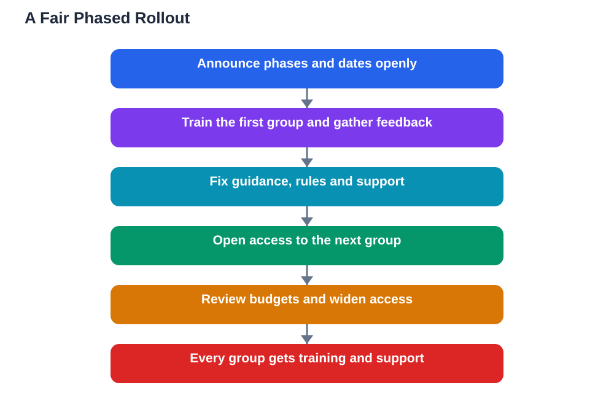

When a large institution introduces a new AI tool, it rarely gives everyone access on the same day, and phased ai access fairness is the question students rightly ask when they find themselves in a later group. Waiting can feel unfair, especially when classmates or colleagues already have the tool and you do not. Yet phases usually exist for practical reasons, not favouritism: training, support, budgets, and safety checks all take time, and a careful rollout protects the very learners who have to wait. Understanding why phases happen helps you judge whether a rollout is genuinely fair, and helps you make the most of the wait instead of simply resenting it.

## Why Rollouts Happen in Phases

A phased rollout is a way of learning while launching. The first group, often staff and experienced researchers, tries the tool, finds its problems, and helps shape the guidance that later users will receive. If something goes wrong, such as confusing instructions, unclear rules about acceptable use, or unexpected costs, it affects a small group first and can be fixed before it reaches everyone. Phases also match how support works in real life: trainers can only run so many onboarding sessions at once, and help desks can only answer so many questions in a week. Releasing a tool to thousands of people at once, without trained helpers ready, would leave most users confused and unsupported. A slower start is often a sign that the institution is taking support seriously, not that it values one group over another.

## Phased AI Access Fairness: What Fair Really Means

Fairness in a phased rollout does not mean everyone gets access on the same day; it means everyone gets a clear path, a fair order, and honest communication about timing. A fair rollout publishes its phases in advance, explains why each group comes when it does, and gives later groups a date to expect rather than an open-ended wait. It also offers something useful in the meantime, such as introductory training, examples of good use, or access to shared guidance, so waiting groups are not simply left behind. Unfairness shows up differently: secret criteria, unexplained delays, or one group quietly keeping permanent priority while others never catch up. If you are in a later phase, fair questions to ask are when your phase begins, what training comes first, and what support will be ready on your start date. Clear answers to those questions are the real test of fairness.

## Onboarding Before Access: Training First for a Reason

Many rollouts require onboarding training before access is granted, and students sometimes see this as an unnecessary hurdle. In practice, it is one of the most useful parts of the process. Good onboarding covers what the tool can and cannot do, how to check its output, how to use it honestly in coursework, and how to protect private information. Learners who skip this step often misuse the tool by accident, trusting answers they should have checked or sharing material they should have kept private. Training first also levels the playing field: when everyone in a group starts with the same guidance, the tool helps learning instead of rewarding only those who already knew how to use it. If your phase includes training, treat it as part of the tool itself, not as a delay standing in front of it.

## Budgets, Restrictions, and the Hidden Costs of AI Tools

Budgets and restrictions are the least visible reason for phasing, but often the most important. Many AI tools charge per use, which means unlimited access for everyone could quickly exhaust the money set aside for the whole year. Phasing lets an institution measure real usage, set sensible limits, and protect access for the rest of the year rather than burning through the budget in the first month. Restrictions can also come from rules about privacy, safety, or the type of work a tool is approved for, and those rules sometimes differ between groups with different responsibilities. This is frustrating when you are waiting, but a rollout that ignores budgets and rules risks losing the tool entirely. A fair system explains its limits plainly, reviews them as usage becomes clearer, and widens access when it safely can.

## AI Help: Muse AI

Muse AI is Meta's personal AI assistant, and it can help you prepare while you wait for access to a new tool. You can ask it to explain phased rollouts in simple terms, or to help you draft polite questions about your phase, training, and start date.

Join Muse with invite code LTGSWD — in the Muse app, go to Settings > Redeem token and enter the code.

Disclosure: LTGSWD is the author's Muse invite code.

## FAQ

### Is a phased rollout unfair to students who come last?

Not necessarily. Fairness depends on transparency, a clear timetable, and equal support when your turn comes, not on everyone starting on the same day. A rollout becomes unfair when later groups get no dates, no training, and no explanation.

### Why do staff and researchers usually get access first?

Because they test the tool, write the guidance, and become the helpers later users will turn to. Their early experience is meant to make the wider launch smoother, and a good rollout uses what they learn to improve training for everyone else.

### What should I do while I wait for my phase?

Use the time well. Complete any available training, read the guidance, practise checking AI output on freely available examples, and note questions you want answered when your access begins.

### Can I ask for earlier access?

Often yes, through an opt-in request or a waiting list, where such a route exists. Ask politely, explain your study need, and accept the answer gracefully, since places in early phases are usually limited by training and support capacity.

### What if my phase keeps getting delayed without explanation?

Ask for an updated date and a reason, in writing if possible. Institutions owe later groups honest communication, and a clear, respectful question often produces the timetable that silence never will.

## Conclusion

Phased access can feel like being left behind, but it is usually how careful institutions learn, train, and budget before opening a tool to everyone. Judge a rollout by its honesty, its timetable, and the support it delivers, not only by its start date, and use the waiting time to build the checking skills that will make the tool genuinely useful when it arrives. For help with your school work and study questions, [Try the free AI lesson solver](/#tool).
