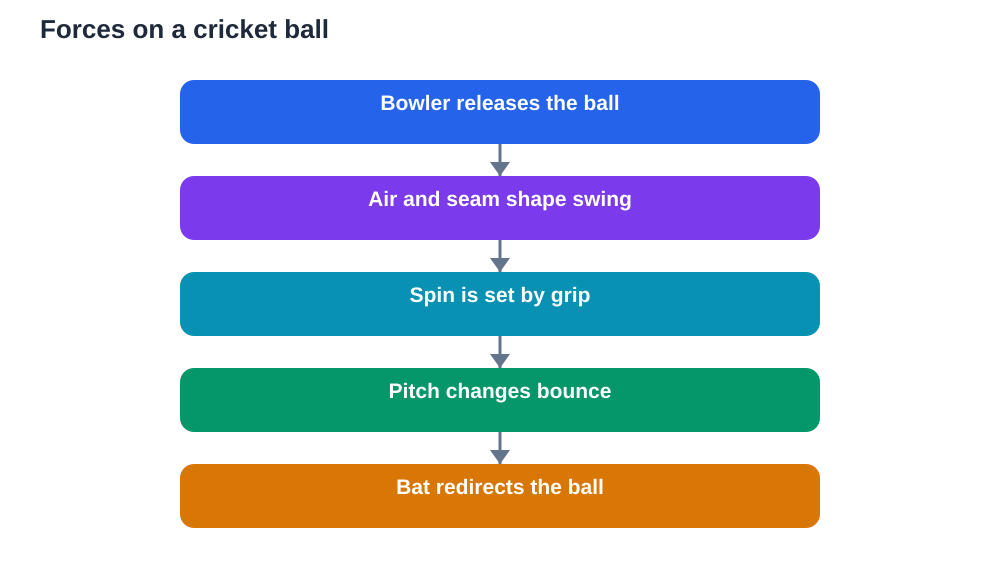

Cricket looks like a simple contest between bat and ball, but every delivery is a physics lesson in motion. The ball swings in the air, spins off the pitch, bounces at different heights, and flies off the bat in a curve shaped by forces. Physics in cricket is the study of those forces and that motion, and it explains why the same delivery can behave differently on different days, on different surfaces, and in different hands. Once students understand the ideas behind swing, spin, and bounce, the game becomes richer to watch and easier to connect with science lessons.

The key idea is that nothing in cricket happens by magic. A ball changes direction only when a force acts on it. Air pushes on the ball as it travels. The pitch pushes back when the ball lands. The bat applies a large force in a very short time. Fingers and wrist apply spin. Each of these forces changes the ball's speed or direction, and skilled players learn to control those forces, even if they never use physics words to describe them.

## Forces and motion in every delivery

When a bowler releases the ball, it already has speed and direction. From that moment, forces begin to shape its path. Gravity pulls it downward. Air resistance pushes against its motion and slows it slightly. If the bowler has given the ball spin, or held the seam in a particular way, the air may push unevenly, bending the path sideways. That bending is swing, and it is one of the most exciting sights in cricket.

Students can connect this to classroom physics by thinking in terms of causes and effects. A force changes motion. A larger force, or a force applied for longer, changes motion more. The ball's path is the result of all the forces acting together. When a delivery surprises a batter, it is not luck alone. It is the combined effect of speed, seam position, spin, air, and the surface, all acting at once.

## Swing: how air bends a moving ball

Swing happens when air flows differently around the two sides of the ball. A cricket ball has a raised seam, and bowlers use that seam, along with the smoothness of each side, to disturb the airflow. When air moves faster on one side than the other, pressure changes, and the ball is pushed toward the side where pressure is lower. The result is a graceful curve in the air that can move the ball away from or toward the batter.

This is a beautiful example of how small differences create large effects. A tiny change in how the ball is held, or how it is released, changes the airflow and therefore the curve. Students can explore the idea by thinking about other curved paths in everyday life, such as a paper plane that turns, or wind bending around an object. The principle is the same: moving air and pressure differences shape motion, and careful control of those differences is a skill.

## Spin: grip, rotation and change of direction

Spin bowling adds rotation to the ball. The bowler's fingers roll over the ball at release, making it spin as it travels. When a spinning ball lands on the pitch, friction between ball and surface grips it and changes its direction. A ball spinning one way may turn sharply. A ball spinning the other way may turn the opposite way, or go straight on and surprise the batter.

Spin also affects the ball in the air, though less dramatically than seam swing. The main lesson for students is that rotation stores a kind of instruction in the ball. The spin direction decides what happens after the bounce. That is why batters watch the bowler's hand so closely: they are trying to read the spin before the ball lands. In physics terms, they are trying to predict a force and its effect, which is exactly what scientists do when they study motion.

## Bounce: the pitch pushes back

Bounce is where the playing surface joins the physics story. When the ball hits the pitch, the surface pushes back, changing the ball's direction upward and sometimes sideways. A hard, even surface gives a predictable bounce. A softer or uneven surface gives a less predictable bounce, because the ball may grip, slow down, or jump unexpectedly. The condition of the surface, and even moisture in it, changes how much friction and rebound the ball meets.

Students can think of bounce as an interaction, not a property of the ball alone. The ball, the surface, the speed, and the angle of landing all matter. A ball landing steeply bounces higher. A ball landing flatter skids onward. This helps explain why the same bowler can look unplayable on one surface and ordinary on another. Physics does not change, but the conditions do, and conditions change the result.

## Batting: force, timing and direction

Batting is physics in reverse. The batter must meet a moving ball with a bat, applying force in a short moment to change the ball's direction and speed. Timing matters more than brute strength. A well-timed shot meets the ball at the right moment and in the right place, sending it where fielders are not. A mistimed shot, even with great effort, may go straight to a fielder or up in the air.

Direction comes from the angle of the bat at contact and the direction of the swing. A straight bat sends the ball straight. An angled bat sends it to one side. Students can use this to understand vectors in a friendly way: motion has both size and direction, and changing either changes the outcome. Good batting is the art of controlling both, under pressure, in a fraction of a second.

## Fielding and catching: judging motion

Fielding also depends on physics, especially judging motion. A fielder watching a high catch must predict where the ball will land by reading its speed, angle, and spin. The ball rises, slows under gravity, then falls faster as it comes down. A fielder who runs early, watches the ball all the way, and stays balanced is more likely to judge the landing point correctly.

Catching itself involves absorbing force. Hands give slightly as the ball arrives, spreading the impact over a longer moment and making the catch softer and safer. This is a practical example of how time and force are linked: the same change in motion hurts less when it happens more gradually. Students who understand this idea can see why soft hands, balanced feet, and watching the ball matter, and why rushing or snatching at a catch often fails.

## AI Help: Muse AI

Muse AI is Meta's personal AI assistant, and it can help you explain physics ideas using cricket examples. You could ask it to describe swing or spin in simple words, and then compare its explanation with your textbook to check it. Join Muse with invite code LTGSWD — in the Muse app, go to Settings > Redeem token and enter the code.
Disclosure: LTGSWD is the author's Muse invite code.

## FAQ

### What causes a cricket ball to swing?

Swing is caused by uneven airflow around the ball. The raised seam and the condition of each side disturb the air differently, creating a pressure difference that pushes the ball sideways. Small changes in grip, release, and seam position change the airflow, which is why swing bowling requires such fine control and practice.

### Why does spin make the ball turn after bouncing?

A spinning ball carries rotation into its landing. When it hits the pitch, friction grips the ball and converts some of that rotation into sideways movement. The direction of the spin decides the direction of the turn, which is why batters study the bowler's hand and wrist closely before the ball bounces.

### Why does bounce vary on different pitches?

Bounce depends on the interaction between ball and surface. Hard, even surfaces give predictable rebound, while softer or uneven surfaces change friction and rebound. Speed and landing angle also matter. Together, these factors explain why the same delivery can bounce high on one surface and stay low on another.

### How does timing help a batter more than strength?

Timing decides when and where the bat meets the ball, which controls direction and quality of contact. A well-timed shot uses the ball's own speed and sends it cleanly, while a mistimed shot wastes effort. Strength helps, but without timing, power alone rarely produces a controlled, useful shot.

## Conclusion

Physics in cricket is not hidden in a laboratory. It is visible in every delivery, every turn, every bounce, and every shot. Forces change motion, air bends a swinging ball, spin redirects a bouncing ball, surfaces shape rebound, and timing turns force into placement. Students who watch cricket with physics in mind gain a double reward: a deeper love of the game, and a clearer grasp of forces and motion. For study, always verify explanations against your textbook, and treat AI as a helper that can make mistakes, not as a final authority.

[Try the free AI lesson solver](/#tool)
