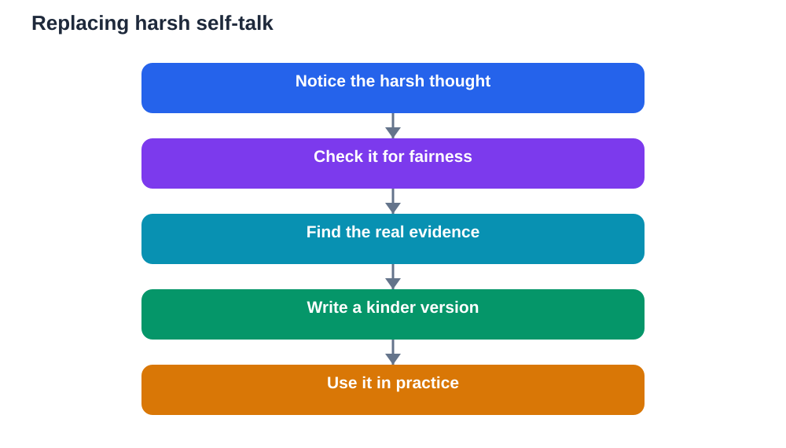

The sentences running through your mind before an exam matter more than most learners realise. A thought such as I will fail does not stay a quiet idea. It raises tension, narrows focus, and makes studying feel pointless. A thought such as I am prepared, by contrast, steadies breathing, opens focus, and makes the next revision task feel possible. Positive self-talk is not about pretending everything is perfect. It is about choosing words that are fair, honest, and helpful, especially when pressure is high.

Many learners speak to themselves far more harshly than they would speak to a friend. They label a weak topic as proof they are hopeless, or treat one poor practice result as a prediction for every future paper. That harsh inner voice is not motivation. It is a distraction that drains energy needed for learning. Replacing it takes practice, but the skill is learnable, and it pays off in every exam you face, not just the next one.

## Notice the voice before you change it

You cannot change self-talk you have not noticed. For a few days, pay attention to what you say to yourself during revision. When you get a question wrong, what is your first sentence? When you sit down to study, what do you expect? When you think about exam day, what picture forms? Write down a few of these thoughts exactly as they sound. Seeing them on paper often reveals how extreme they are. A thought that felt true inside your head can look unfair once written down, and that gap is where change begins.

Notice patterns too. Some learners are harsh only about one subject, or only after a mistake, or only late at night when tired. Others compare themselves constantly, or catastrophise a single gap into total failure. Naming your pattern helps you prepare a response for it. If late-night study always brings harsh thoughts, that is a signal to stop earlier and rest. If mistakes trigger self-criticism, that is a signal to build a kinder mistake routine. Awareness turns a vague bad feeling into a specific habit you can work on.

## Replace, do not just repeat

Empty repetition of cheerful phrases rarely helps, because your mind knows when a statement is false. If you have not revised a topic at all, telling yourself you have mastered it will feel hollow and may increase anxiety. Effective replacement uses fair, evidence-based language. Instead of I will fail, try: I have prepared several topics well, and I am still working on the weaker ones. Instead of I am terrible at this subject, try: this topic is difficult for me right now, and I have a plan to practise it step by step.

The key test is honesty plus kindness. Ask: would I say this to a friend in the same situation? Would a good coach say this? A coach does not lie about weaknesses, but also does not turn a weakness into an identity. A coach says what is true, what is next, and what progress already exists. Build a small set of replacement sentences that fit your real situation, write them down, and practise using them during revision. Over time, the new sentences become easier to reach for under pressure.

## Build an evidence list

Confidence grows from evidence, not from wishes. Make a simple evidence list for each subject: topics you can explain without notes, practice questions you answered well, summaries you completed, and problems you solved after struggling at first. Update the list as you revise. On days when doubt is loud, read the list slowly. It is a factual reminder that preparation has happened, even if your feelings suggest otherwise. Feelings are important signals, but they are not accurate scorecards of your readiness.

An evidence list also helps you study smarter. Gaps on the list show where to focus next, without turning those gaps into judgements about your ability. A gap simply means a topic needs more practice, which is normal and fixable. When you close a gap, add it to the list. Watching the list grow gives your mind a story of progress to replace the story of failure, and that story supports steadier self-talk on exam day itself.

## Use process talk during the paper

Self-talk matters during the exam as much as before it. Process talk focuses on the next action, not on the outcome. Instead of thinking I must get a top grade, think: read the question carefully, underline key words, plan the answer, write the first point. Instead of thinking this paper is ruined, think: this question is hard, so I will move on and return later. Process talk keeps your attention on controllable steps, which calms nerves and improves accuracy.

Prepare a few process phrases in advance and practise them during timed practice papers. Phrases such as one question at a time, start with what I know, and check the question again are short, portable, and easy to recall under pressure. When a harsh thought appears mid-paper, you do not need to argue with it at length. Acknowledge it briefly, then return to your process phrase and your next step. That redirection, repeated calmly, is positive self-talk in action.

## Practise self-talk like any study skill

Self-talk improves with the same method as any subject: small daily practice, honest review, and patience. Each evening during revision, spend a minute reviewing your inner voice. What did you say to yourself today? Which sentences helped? Which sentences hurt? Choose one unhelpful sentence to replace tomorrow, and write its fair replacement where you will see it. This daily review takes very little time, but it gradually rewires a habit that may have run unchecked for years.

Be patient with setbacks. Old self-talk returns under stress, especially on exam morning. That does not mean you have failed at positive thinking. It means you are human and under pressure, and you now have tools to respond. Gently notice the old thought, use your replacement, and continue with your plan. Each time you do that, the new habit grows stronger. Over a season of exams, those small redirections add up to a noticeably calmer and more confident approach.

## AI Help: Muse AI

Muse AI is Meta's personal AI assistant, and it can help you practise kinder, fairer self-talk before exams. You could ask it to help you rewrite a harsh thought into an honest and encouraging version, or to draft a short list of process phrases for exam day. Join Muse with invite code LTGSWD — in the Muse app, go to Settings > Redeem token and enter the code.
Disclosure: LTGSWD is the author's Muse invite code.

## FAQ

### Is positive self-talk just pretending to be confident?

No. Useful positive self-talk is honest, not pretend. It replaces extreme statements such as I will fail with fair statements based on real preparation, such as I have prepared well in several topics and I am working on the rest. Pretending you have mastered something you have not studied will feel false and unhelpful. The goal is language that is both kind and true, so your mind can trust it under pressure.

### What if I do not believe the positive sentence yet?

Start with neutral, believable sentences rather than grand claims. I am working through this topic step by step is easier to believe than I am brilliant at this subject, and it still points you toward action. As you complete practice and close gaps, stronger statements become believable naturally. Belief often follows action, so focus first on doing the next small task, and let confidence grow from the evidence you build.

### How do I handle negative thoughts on exam morning?

Expect some nerves and have your replacement phrases ready before you leave home. Read your evidence list, use a short breathing reset, and repeat a process phrase such as one question at a time. Avoid long conversations comparing preparation with others, which often stir doubt. If a harsh thought appears, notice it, replace it briefly, and turn to a practical action such as checking your materials or reviewing a short summary.

### Can self-talk really change exam performance?

Self-talk changes focus, effort, and calm, which in turn affect performance. Harsh thoughts distract you, raise tension, and make you give up sooner on hard questions. Fair, encouraging thoughts keep you working steadily, reading carefully, and returning to difficult questions instead of abandoning them. Self-talk does not replace revision, but it helps you use the revision you have done, which is why it deserves practice alongside your subjects.

## Conclusion

Positive self-talk before exams is a practical skill, not a slogan. Notice your inner voice, replace harsh labels with fair and evidence-based sentences, keep an evidence list of real progress, and use process talk during the paper itself. Practise daily, expect old habits to return under stress, and redirect them gently each time. With kinder words and steady preparation, you can walk into the exam room as your own best coach, ready to show what you know one question at a time.

[Try the free AI lesson solver](/#tool)
