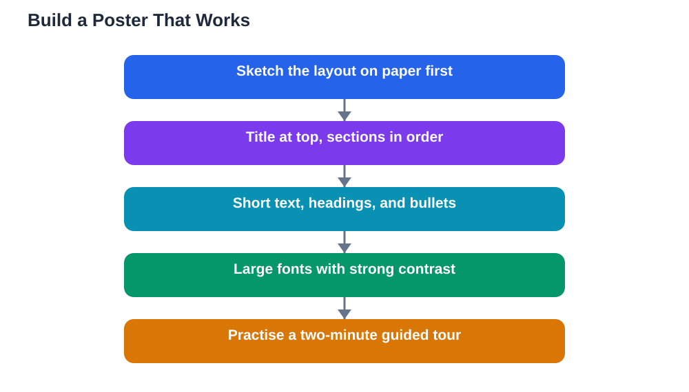

This poster presentations guide is for any student who has been asked to turn a project into a poster and then talk about it, often while standing beside it as people walk past. A poster talk is different from a classroom speech: your audience is close, they can read while you speak, and they may join or leave at any moment. That makes the poster itself half of your presentation. A clear layout, readable fonts, and a short spoken walkthrough will do more for you than a beautiful design that nobody can follow. This guide covers all three, so your poster works hard even before you say a word.

## Poster Presentations Guide: Plan the Layout First

Start with layout, not decoration. A good poster reads in a clear order, usually top to bottom and left to right, so a viewer can follow your story without guidance. Divide the space into a few sections: a clear title at the top, a short introduction, the main content in the middle, and a conclusion or takeaway at the bottom. Keep each section short, using headings, short paragraphs, and bullet points rather than long blocks of text. Leave generous empty space between sections, because a crowded poster looks like work to read, and people walking past will skip it. Sketch your layout on paper before you build it, and check that the order makes sense to someone who has never seen your project. If a section does not earn its space, cut it or merge it with another.

## Fonts, Colours and Readability

Readability decides whether your poster gets read at all. Use a large, clear font for the title, a medium size for section headings, and a body size that can be read comfortably from a couple of steps away. Stick to one or two fonts for the whole poster, and use bold sparingly for emphasis. Choose strong contrast between text and background, and avoid light text on a light background or busy patterns behind words. Use colour to organise, not to decorate: one main colour for headings, one accent for key points, and a plain background keeps the poster calm and professional. Check your poster at full size before printing, standing back from the screen to see whether the title and headings still read clearly. A poster that looks good close up but blurs at a distance will lose its audience before they arrive.

## Talking Through Your Poster

When someone stops at your poster, give them a short guided tour rather than reading the whole thing aloud. Start with a one-sentence summary of your project, then walk through the sections in order, pointing to each as you mention it. Keep your tour to a couple of minutes at most, because the visitor can read the details themselves. Speak to the person, not to the poster, and glance at them as you talk. End with your main finding or takeaway, and invite a question. If several people arrive at once, welcome them all, give the same short tour, and let the conversation grow naturally. If someone asks about a part of the poster you did not cover, walk them to that section and explain it there. Your job is to be a friendly guide to your own work, not a narrator of every word on the board.

## Preparing for Poster Questions

Poster questions tend to be practical and specific: why you chose a method, what surprised you, what you would do differently. Prepare short answers for the most likely ones, and think about the weak points of your project honestly, so a challenging question does not catch you off guard. Keep a notebook or a copy of your project nearby, so you can check a detail instead of guessing. If you do not know an answer, say so and promise to check, just as you would after a classroom talk. Practise your short tour aloud at least once, ideally standing beside a printed poster or a mock-up, so the gestures of pointing and turning feel natural. On the day, stand beside your poster rather than in front of it, keep water nearby, and smile at people passing by. A welcoming presenter attracts far more visitors than a perfect poster alone.

## FAQ

### How much text should go on a poster?

As little as you need to tell the story. Short paragraphs, headings, and bullet points beat long blocks of text, because visitors read posters while standing, and they will skip anything that looks like an essay.

### What makes a good poster title?

A good title is short, clear, and tells the viewer what the project is about. Avoid clever wordplay that hides the topic, and make the title the largest text on the poster so it can be read from a distance.

### Should I read my poster aloud to visitors?

No. Visitors can read it themselves. Give a short spoken tour that highlights the main points in order, then invite questions and let the conversation take over.

### What if nobody stops at my poster?

Stay welcoming and visible: stand beside the poster, look up, and greet people warmly. A friendly presenter attracts visitors, while someone looking at their phone signals that they do not want to talk.

### How do I handle a question I cannot answer at my poster?

Answer honestly, say you will check, and offer to follow up. You can also point to the part of your poster that relates to the question, which often helps both of you find the answer together. For handling questions in general, see [Handling Questions After Your Presentation](/blog/handling-questions-presentation.html).

## Conclusion

A good poster presentation is a partnership between a clear board and a friendly guide. Plan the layout so the story reads in order, keep fonts large and colours calm, and practise a short tour you can give with confidence. Do that, and your poster will attract visitors, start conversations, and show your work at its best. Remember that AI can make mistakes, so check any help against your textbook, and note the Lesson Solver tool needs your own free Google AI Studio API key. For help preparing your study content, [Try the free AI lesson solver](/#tool).
