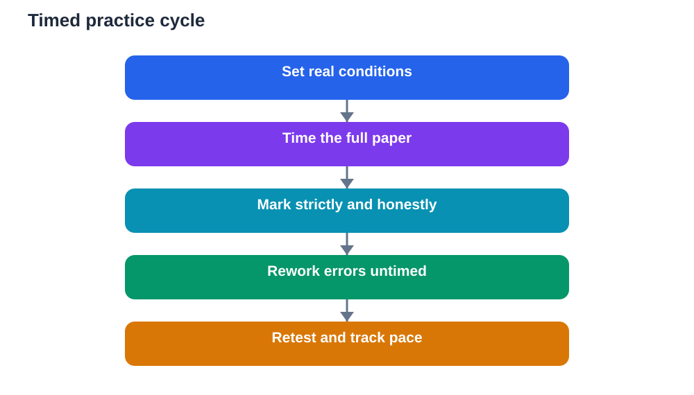

Knowing material at home and performing under exam conditions are two different skills. At home, you can pause, check notes, take breaks, and think without a clock. In an exam hall, time is fixed, notes are closed, and pressure is real. Learners who only practise in relaxed conditions often discover this gap too late, when the clock forces rushed answers and panic. Practising under time at home closes the gap. It trains pace, focus, and decision-making, so exam day feels familiar rather than shocking.

Timed practice is not about speed for its own sake. It is about learning how long different questions take, how to start quickly, when to move on, and how to finish with time to check. These are skills that only appear under realistic conditions. A learner who has sat several timed papers knows their own rhythm: how much time to give a long question, when a short question deserves a quick answer, and what to do when stuck. That self-knowledge is a quiet form of confidence, earned through rehearsal.

## Set up real conditions

Real conditions start with the environment. Choose a quiet desk, clear away notes and textbooks, and gather only the materials allowed in the real exam. Silence notifications, put your phone away, and tell family members you are not to be disturbed for the practice period. Sit upright at a desk rather than lounging, since posture affects focus. Small details matter, because the closer practice feels to the real hall, the more transferable the learning becomes.

Use a proper timer, visible but not distracting, and decide the total time before you begin. Match the real exam length if you can, or use a shorter paper with proportional time. Read instructions as you would in the hall, and start when the timer starts. Do not pause the timer for breaks, snacks, or checking a note. If you need the toilet or water, that time counts, just as it would in the hall. Strictness now prevents surprises later, and it teaches you to work within limits rather than wishing them away.

## Learn your pace question by question

Pace is learned, not guessed. During timed practice, notice how long different question types take you. Some learners write long answers slowly and run out of time for later questions. Others rush short answers and make careless errors. A practice paper reveals your pattern. After marking, review not only correctness but timing: which questions consumed too long, which were rushed, and where time was wasted. That review turns a single paper into pacing guidance for the next one.

Build a simple time plan from this evidence. Divide total time by sections or questions, allowing a margin for checking at the end. During practice, check the clock at planned points, not constantly, and adjust gently if you are behind. If a question is taking far longer than planned, mark it and move on, returning later if time remains. This discipline feels difficult at first, especially for perfectionist learners, but it protects marks across the whole paper. A paper with all questions attempted steadily usually outperforms a paper with one perfect answer and several blanks.

## Practise starting and moving on

Two moments decide many papers: starting well and moving on wisely. Starting well means reading instructions carefully, scanning the paper briefly if allowed, and beginning with a confident question to build momentum. Timed practice lets you rehearse this opening until it feels automatic. You learn to resist the urge to start with the hardest question, and to use early success as fuel for harder sections. A calm, confident start lowers anxiety for the rest of the paper.

Moving on is equally important. In untimed practice, you can wrestle with a hard question indefinitely, but in a timed paper that habit is costly. Practise a move-on rule: after a genuine attempt and a brief pause, if the question remains stuck, mark it clearly and continue. Return later with fresh eyes and clues from other questions. Each timed session strengthens this decision muscle, so on exam day moving on feels like strategy, not surrender. Learners who master moving on often finish more of the paper, and finish it more calmly.

## Mark honestly and learn from errors

Timed practice only helps if marking is honest. Mark strictly, using correct methods and complete answers, not generous partial credit for ideas you meant to write. Compare your answers with your textbook or a reliable solution guide, and verify steps you are unsure about, remembering that AI tools can make mistakes and your textbook remains the check. Sort errors into groups: knowledge gaps, method mistakes, misreading, and time pressure. Each group points to a different remedy, and that diagnosis is where improvement happens.

After marking, rework the questions you missed, without time pressure, until you understand the correct method. Then practise similar questions under time again. This cycle, timed attempt, honest marking, untimed learning, retimed attempt, is the engine of progress. It is tempting to skip the learning step and simply sit another paper, but without it you repeat the same errors faster. Slow learning between timed sessions is what makes the next timed session better.

## Build stamina gradually

Exam stamina, the ability to focus for a full paper, also needs training. If you only practise in short bursts, a long paper can feel exhausting halfway through. Build stamina gradually: start with shorter timed sections, then extend to full papers as your focus improves. During a long practice, use planned micro-pauses: a slow breath, a sip of water, a stretch of shoulders, then back to work. These pauses cost seconds and save focus, and they are far better than pushing through fatigue until errors multiply.

Take care of the basics that support stamina. Practise at a similar time of day to the real exam if possible, after eating and sleeping normally. Avoid practising timed papers when exhausted, since that teaches poor habits rather than good pace. After a full timed paper, rest properly before reviewing it. Reviewing while tired leads to harsh self-judgement and missed learning. A rested review, with clear notes on pace and errors, turns one practice paper into lasting improvement for the next.

## AI Help: Muse AI

Muse AI is Meta's personal AI assistant, and it can help you plan timed practice at home. You could ask it to help you divide a practice paper into timed sections, or to create a checklist for setting up realistic exam conditions. Join Muse with invite code LTGSWD — in the Muse app, go to Settings > Redeem token and enter the code.
Disclosure: LTGSWD is the author's Muse invite code.

## FAQ

### How often should I practise under timed conditions?

Begin with one timed paper or section per week, increasing as the exam approaches if your schedule allows. Balance timed practice with untimed learning: timed sessions reveal gaps, and untimed sessions fix them. Too many timed papers without learning between them can exhaust you and repeat errors. A steady rhythm of timed attempt, honest marking, focused learning, and retimed attempt works better than daily timed papers alone.

### What if I always run out of time?

Analyse where time goes, rather than simply trying to write faster. Check whether long questions consume too much time, whether you stall on hard questions, or whether checking eats your margin. Build a time plan per section, practise moving on from stuck questions, and rehearse starting with confident questions. Pace improves with deliberate timed practice, especially when each paper ends with a timing review, not just a score.

### Should I use notes during timed practice?

No, timed practice should be closed-book, matching real conditions as closely as possible. Using notes during a timed paper hides gaps and gives a false sense of readiness. Keep notes for the learning phase after marking, where you study correct methods and rework errors. The separation matters: timed practice tests recall and pace, while untimed study builds knowledge. Mixing them weakens both purposes.

### What if timed practice makes me more anxious?

Start gently with shorter timed sections and build up gradually, rather than jumping straight to full papers. Use breathing pauses, a clear time plan, and a move-on rule to keep pressure manageable. Remember that mild anxiety during practice is useful training: it teaches you to perform while nervous, so real exam nerves feel less overwhelming. If anxiety remains severe, talk to a teacher or trusted adult about extra support and strategies.

## Conclusion

Practising under time at home turns exam day from a shock into a rehearsal you have already performed. Set real conditions, learn your pace, practise starting and moving on, mark honestly, and build stamina gradually. Each timed paper teaches you something no untimed session can: how you actually perform when the clock runs. With that knowledge, you can walk into the hall with a plan, a pace, and the calm that comes from having done this before.

[Try the free AI lesson solver](/#tool)
