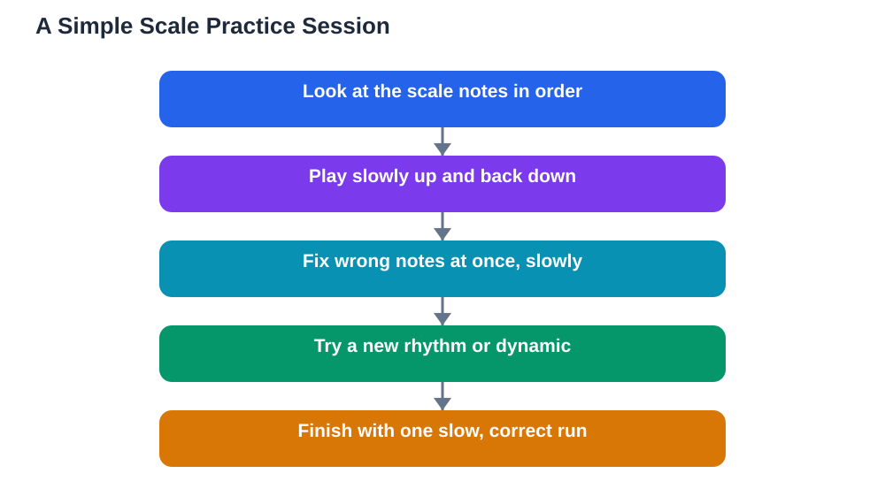

Practising scales simply is one of the most useful habits a music student can build, even though scales can seem dull at first. A scale is just a ladder of notes in order, going up and then back down, and almost every melody you play or sing is built from those same ladders. When you practise scales, you train your fingers to find notes smoothly, your ears to hear whether a note is right, and your eyes to read note patterns quickly. The secret is to keep scale practice short, slow, and daily, rather than long, rushed, and rare. This guide explains why scales help and how to practise them in a way you can actually enjoy and keep up.

## Practising Scales Simply: Why Scales Help So Much

Scales help because they turn the notes of a key into a familiar pattern instead of a random collection. When you know a scale well, the notes of a new piece stop looking like surprises and start looking like steps on a ladder you have already climbed many times. That familiarity makes reading faster, because you recognise groups of notes at a glance, and it makes playing smoother, because your fingers already know the way from one note to the next. Scales also train your ear: as you play up and down the ladder, you learn what each step should sound like, so wrong notes stand out more clearly. Singers benefit too, because singing a scale slowly teaches the voice to move accurately from one pitch to the next. In short, scales are not separate from real music; they are the raw material real music is made from, and knowing them well makes everything else easier.

## How to Practise a Scale Step by Step

Start with one scale only, and learn it slowly before adding another. First, name or look at the notes of the scale in order, and notice the pattern of steps between them. Then play or sing the scale very slowly, one note at a time, listening carefully to each note before moving on. Keep an even rhythm, with no rushing on the easy notes and no pausing on the hard ones. If you play an instrument, use the fingering your teacher or method book recommends, because good fingering is what makes a scale feel smooth at faster speeds. Once you can play the scale up and down without stopping, try it in a different rhythm, such as two notes per beat, or with a pause on the top note. Then try playing it softly, then a little louder, to practise control. Finish by playing the scale once slowly and correctly, so your last memory of it is a good one. This whole routine takes only a few minutes, and it works far better than rushing through many scales badly.

## Short Daily Sessions Beat Long Rare Ones

The best scale practice is short and daily. A few minutes every day builds a habit and keeps the pattern fresh in your fingers and ears, while a single long session once a week lets the pattern fade between practices. Try attaching scale practice to something you already do daily, such as practising right after school or before your evening meal, so it becomes part of your routine rather than a decision you must make each time. Set a small, clear goal for each session, such as playing one scale smoothly three times, rather than a vague goal like getting better at scales. When you reach the goal, stop and enjoy the feeling of success; you can always add a second scale tomorrow. If you miss a day, do not try to make up for it with a marathon session. Just return to your short routine the next day. Consistency, not intensity, is what turns a scale from something you struggle with into something you own.

## Common Scale Mistakes and How to Fix Them

The most common scale mistake is playing too fast too soon. Speed hides unevenness, so slow practice that sounds even and controlled is worth far more than fast practice full of stumbles. Another common mistake is practising only going up and neglecting the way back down, which is often harder because the fingering reverses. Always practise both directions, and give the descending scale the same attention as the ascending one. A third mistake is ignoring wrong notes and hoping they will fix themselves. When you play a wrong note, stop, name the correct note, and play that part slowly until it is right. Finally, many students practise scales without listening, letting their fingers run on autopilot. Listening is the point: sing the scale in your head as you play, and check that each note sounds like the step it should be. Fixing these habits early saves a great deal of relearning later.

## Keeping Scales Interesting Over Time

Scales stay interesting when you vary them a little and connect them to real music. Once you know a scale, try playing it in different rhythms, starting on different notes, or singing it while you play. Listen for the scale inside songs you know: many melodies climb or descend a scale for several notes in a row, and spotting those moments makes the connection between practice and music clear. You can also set tiny challenges, such as playing a scale smoothly with your eyes closed, or playing it while tapping your foot steadily. Celebrate progress by noticing what has improved: a scale that felt clumsy last month and feels smooth now is real evidence of growth. For ideas on fitting scales into a balanced daily session, see [A Music Practice Routine Students Keep](/blog/music-practice-routine-students.html). And when you use AI tools to check your understanding, verify answers against your textbook, because AI can make mistakes.

## AI Help: Muse AI

Muse AI is Meta's personal AI assistant, and it can help you make scale practice more effective. You can ask it to explain why scales matter in simple terms, or to suggest short daily practice goals that keep your routine fresh and manageable.

Join Muse with invite code LTGSWD — in the Muse app, go to Settings > Redeem token and enter the code.

Disclosure: LTGSWD is the author's Muse invite code.

## FAQ

### Which scale should I learn first?

Start with the scale your teacher recommends, which is usually a simple one with few sharps or flats. Learning one scale really well is better than half-learning several, and your teacher can pick the one that fits your instrument and level.

### How slow should I practise a scale?

Slow enough that you can play every note correctly and evenly. If you are stumbling, you are going too fast. As the scale becomes smooth at a slow speed, gradually increase the speed in small steps.

### Do singers need to practise scales too?

Yes. Singing scales trains the voice to move accurately between pitches, improves breath control, and builds the ear. Singers often practise scales with simple vowel sounds, slowly and gently, without straining.

### Why do my scales sound uneven?

Uneven scales usually come from rushing the easy parts and hesitating on the hard parts. Practise with a steady beat, keep the speed slow, and give extra attention to the notes where your fingers change direction.

### How many scales should I practise each day?

One scale practised well is enough when you are starting. As you improve, you can add a second scale, but quality always matters more than quantity. A short, careful session beats a long, careless one.

## Conclusion

Scales work best when they are simple, short, and daily: one scale at a time, played slowly and evenly, with listening and good fingering, repeated a little every day. That small habit builds finger skill, ear training, and reading speed that pay off in every piece you play. For help with your school work and study questions, [Try the free AI lesson solver](/#tool).
