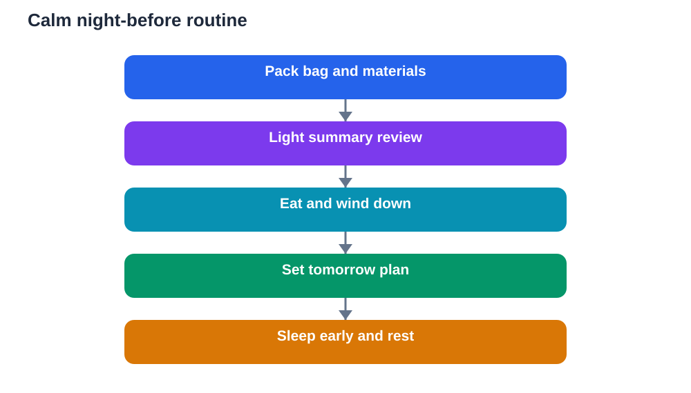

The night before an exam sets the tone for the morning after it. A calm, organised evening helps you sleep better, wake clearer, and arrive without rushing. A frantic evening, by contrast, leaves you tired, scattered, and more anxious before the paper even begins. The good news is that a useful night-before routine is simple. It does not require hours of extra study. It requires packing, light review, and rest, in that order, with plenty of time left for winding down.

Many learners make the same mistake the night before: they try to learn everything they missed, stay up late, and wake exhausted. Last-minute cramming rarely adds much new knowledge, and it often costs sleep, which is exactly what memory needs. A better approach treats the night before as consolidation and preparation, not as a rescue mission. You review what you already know, organise what you need, and protect your sleep so your brain can do its best work tomorrow.

## Pack everything the evening before

Packing early removes a whole set of morning worries. Gather everything you need for the exam: pens, pencils, eraser, ruler, and any other permitted materials, plus water and a small snack if allowed. Place them in your bag and check each item once, rather than trusting memory in a morning rush. Lay out your clothes, charge any device you may need for travel, and keep your bag by the door. If you need an identification card or admission slip, put it in the bag now, not in a pocket you might forget.

A packed bag also calms the mind. When everything is ready, there is less to think about in the morning, and fewer chances for a small forgotten item to trigger a large wave of stress. Make a short written checklist if it helps, and tick items off as you pack. That visible completion signals to your brain that preparation is handled, which makes it easier to relax later in the evening. Small organisation now buys calm later, and calm is valuable on exam day.

## Review lightly, not frantically

Light review means revisiting summaries, not learning new material. Read through your short notes, key formulas, important definitions, or a list of topics you have already studied. Try recalling main points from memory before checking your notes, but keep the session short and low-pressure. The aim is to refresh and reassure, not to test yourself harshly or discover gaps that send you into a panic. If you find a weak spot, note it for a brief look in the morning, but do not start a long new study session late at night.

Set a clear stopping time for review, and keep it. An hour of calm review is far more useful than three hours of anxious cramming. When the time ends, close your books deliberately. That closing act tells your mind that study time is over and rest time has begun. Learners who protect this boundary usually sleep better and recall better, because a rested brain organises memory during sleep. Trust the weeks of preparation behind you, and let the final evening be a gentle top-up, not a marathon.

## Eat well and wind down

Your evening meal and wind-down routine matter more than they seem. Eat a normal, satisfying meal rather than skipping food or eating something unusual that might upset your stomach. Drink enough water during the evening, but avoid large amounts of caffeine late in the day, since it can delay sleep. After dinner, choose calming activities: a short walk, light stretching, music, or time with family. Avoid intense discussions about the exam, comparisons with other learners, and endless scrolling through messages that stir worry.

Create a wind-down hour before bed. Dim bright screens, put revision materials away, and do something relaxing. A warm shower, slow breathing, or reading something unrelated can help your mind shift out of study mode. If worried thoughts keep appearing, write them on paper along with a brief plan for tomorrow, then set the paper aside. Writing worries down often loosens their hold, because your mind no longer needs to hold them all at once. The goal is a mind that feels settled enough to fall asleep without a long struggle.

## Sleep early and protect it

Sleep is not wasted time before an exam. During sleep, your brain consolidates what you have learned, organising memories so they are easier to recall. A full night of sleep also improves attention, reading accuracy, and patience with hard questions. Going to bed early is therefore a study strategy, not a luxury. Aim for your normal bedtime, or slightly earlier, rather than a dramatically different time that leaves you restless. Keep your room cool, dark, and quiet, and set an alarm with enough margin for a calm morning.

If you struggle to fall asleep because of nerves, do not lie awake rehearsing worst cases. Try slow breathing, relax your muscles from head to toe, or picture yourself walking calmly through tomorrow step by step: waking, eating, travelling, sitting down, and starting with a familiar question. This mental rehearsal is both calming and useful, because it prepares you for the real sequence. If sleep still takes a while, stay patient. Resting quietly still helps, and you can perform well even after a slightly restless night, especially when preparation has been steady.

## Plan tomorrow in advance

A short tomorrow-plan removes morning decisions that cause stress. Decide what time you will wake, what you will eat, when you will leave, and how you will travel. Allow extra time for delays, so a slow bus or a traffic jam does not become a crisis. Decide what light review, if any, you will do in the morning, and keep it short. Decide your first move in the exam hall too: breathe, read instructions carefully, and start with questions you know. When tomorrow is already planned, tonight feels safer, because you are not facing an unknown morning.

Share your plan with a family member if that helps, so someone else knows your timing and can support you. Then let the plan rest. You do not need to keep rechecking it all evening. One clear plan, written down, is enough. The night before is about closing the day well: bag packed, light review done, body fed, mind winding down, and sleep protected. Do those things, and you give tomorrow the best possible start.

## AI Help: Muse AI

Muse AI is Meta's personal AI assistant, and it can help you plan a calm night before an exam. You could ask it to help you make a packing checklist, or to turn a long topic into a short summary for light evening review. Join Muse with invite code LTGSWD — in the Muse app, go to Settings > Redeem token and enter the code.
Disclosure: LTGSWD is the author's Muse invite code.

## FAQ

### Should I study all night before an exam?

No. Studying all night usually harms more than it helps, because sleep is essential for memory and focus. A tired mind reads slowly, recalls poorly, and panics more easily. Light review in the early evening, followed by a proper night of sleep, is a far stronger strategy. Trust your earlier preparation, and remember that one exhausted night cannot replace steady revision, but it can undo its benefits.

### What if I realise I have not revised an important topic?

Note it calmly and give it a short, focused look, rather than starting a long cramming session. Read a summary, work through one or two examples, and move on. You cannot master a whole topic late at night, and trying will only raise anxiety and cost sleep. In the morning, a brief glance at the same summary may help, and during the paper you can answer what you know and return to harder parts later.

### How early should I go to bed the night before?

Aim for your normal bedtime, or a little earlier if you can settle easily at that time. A sudden, much earlier bedtime can leave you lying awake and frustrated. The key is a regular, protected sleep window, not a heroic early night. Avoid screens and stimulating activity in the final hour, use slow breathing to wind down, and set an alarm that leaves generous time for a calm morning routine.

### What should I do if I cannot fall asleep from nerves?

Stay calm and rest quietly rather than forcing sleep or returning to study. Try slow breathing and muscle relaxation, and picture tomorrow step by step in a calm way. Avoid checking the time repeatedly, which only adds pressure. Even a restless night still leaves you able to perform, especially with steady preparation behind you. If sleeplessness before exams is a regular problem, talk to a trusted adult about longer-term sleep habits.

## Conclusion

Preparing the night before an exam is about finishing well, not starting over. Pack your bag, review lightly, eat normally, wind down, and protect your sleep. Plan tomorrow in advance, then let the evening close. When morning comes, you will wake with your materials ready, your mind rested, and your energy saved for the paper itself. That calm start is one of the simplest advantages you can give yourself, and it begins tonight.

[Try the free AI lesson solver](/#tool)
