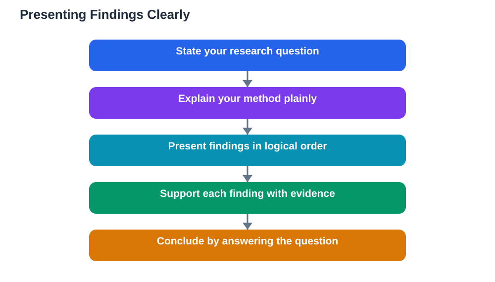

Presenting research findings clearly is a skill that matters as much as the research itself, because findings no one can follow might as well not exist. Whether you are giving a talk, writing a report, or making a display, your audience needs a path through your work: what you asked, how you investigated it, what you found, and what it means. A clear structure gives them that path, and plain language keeps them on it. The best presentations are not the ones with the most material, but the ones where every part earns its place and the main message stays visible from start to finish. This guide shows how to build that kind of presentation, step by step.

## Presenting Research Findings: Start With Your Question

Every clear presentation opens by reminding the audience what you set out to learn. State your research question in plain words near the start, and explain briefly why it interested you or why it matters. This opening does two jobs: it gives listeners a reason to pay attention, and it gives them a standard for judging everything that follows. Without it, even good findings feel disconnected, because the audience does not know what problem they solve. Keep this opening short and focused, and avoid front-loading background that belongs later. A good test is whether a listener who heard only your first minute could say what your project was about and why you undertook it. If they could, your opening has done its job, and the rest of your presentation can build on it.

## Explain Your Method in Plain Language

After your question, explain briefly how you investigated it, in language a non-specialist can follow. Say what kinds of sources you used, how you chose them, and how you organised and checked your notes, without drowning the audience in procedural detail. Your method section earns trust: it shows that your findings rest on a careful process rather than on a few convenient facts. Be honest about limits too, such as a part of your question that had fewer sources available, because acknowledging a limit strengthens credibility far more than hiding it. Keep this section proportional: a short project needs only a short method explanation, and the audience's patience is better spent on findings than on process. For the research steps behind this stage, see [Research for a School Project: A Step-by-Step Plan](/blog/research-for-school-project.html) within this series.

## Present Findings in an Order That Tells a Story

Findings land best when they follow a logical order, not the order in which you happened to discover them. Group related findings together under clear headings or spoken signposts, and move from the most important or most basic finding toward more detailed or surprising ones. Within each group, state the finding plainly first, then give the evidence that supports it, then say briefly what it means. That finding, evidence, meaning pattern keeps each point self-contained and easy to follow. Use simple visuals where they genuinely help, such as a diagram showing a process or a comparison of two approaches, but keep visuals clean and explain each one aloud rather than assuming the audience will read it for you. Cut findings that do not help answer your question, however interesting they seemed during research, because extra material dilutes the message your audience should remember.

## End With a Conclusion That Answers the Question

A strong conclusion returns directly to your research question and answers it in light of your findings. Summarise your main findings in a few sentences, state what they suggest, and note any question that remains open for further investigation. Avoid introducing new evidence in the conclusion, since new material at the end confuses listeners who thought the argument was complete. Also avoid overstating what your findings prove: say what your evidence supports, note where it is limited, and let that honesty make your conclusion more believable. A conclusion that answers the question plainly gives your audience a satisfying sense of completion and a clear takeaway to remember. If your project used the Lesson Solver tool for textbook exercises, remember the same honesty rule: verify its solutions against your textbook, keep in mind that AI can make mistakes, and note that the tool needs your own free Google AI Studio API key.

## Practise Delivery, Not Just Content

Clear content still needs clear delivery, and delivery improves with practice more than with talent. Rehearse your presentation aloud at least once from start to finish, timing yourself and noting where you stumble or rush. Practising aloud reveals sentences that look fine on paper but trip the tongue, sections that run long, and transitions that need a clearer signpost. Speak slowly enough for listeners to absorb each point, look up from your notes regularly, and pause briefly after important findings so they have time to land. If you use slides or a display, keep text short and let your spoken words carry the explanation, since audiences cannot read dense slides and listen at the same time. A calm, practised delivery tells your audience that you understand your own work, which is the most persuasive message of all.

## AI Help: Muse AI

Muse AI is Meta's personal AI assistant, and it can help you prepare a presentation. You can ask it to help you turn a rough outline into clear spoken points or to suggest simpler wording for a section that feels tangled.
Join Muse with invite code LTGSWD — in the Muse app, go to Settings > Redeem token and enter the code.
Disclosure: LTGSWD is the author's Muse invite code.

## FAQ

### How should I structure a research presentation?

A clear structure is question, method, findings, and conclusion. Open with your question and why it matters, explain your method briefly, present findings in a logical order with evidence, and close by answering your question and noting what remains open. This shape works for talks, reports, and displays alike.

### How much detail should I include about my method?

Include enough for the audience to trust your process, but no more. Say what kinds of sources you used, how you chose and checked them, and any important limits, all in plain language. Detailed procedures belong in a written appendix or handout, not in the main presentation, where findings deserve the most time.

### What makes research findings hard to follow?

Common problems are missing structure, findings in discovery order rather than logical order, unexplained visuals, and conclusions that introduce new material or overstate the evidence. Fix these with clear headings or signposts, a finding-evidence-meaning pattern, explained visuals, and a conclusion that answers the original question plainly.

### How can I handle nerves when presenting?

Preparation is the best remedy: rehearse aloud from start to finish, time yourself, and practise the opening until it feels familiar, since a confident start settles nerves. Speak slowly, pause after key points, and remember that the audience wants you to succeed. Small notes with headings are fine; reading every word aloud usually sounds less natural.

## Conclusion

Presenting research findings clearly comes down to respect for your audience: give them your question first, explain your method honestly, order your findings so they tell a story, answer your question in the conclusion, and practise delivery until it feels natural. When structure, plain language, and honest limits work together, your audience will follow your argument with ease and remember your main message long after you finish. That is the real measure of a successful presentation.

[Try the free AI lesson solver](/#tool)
