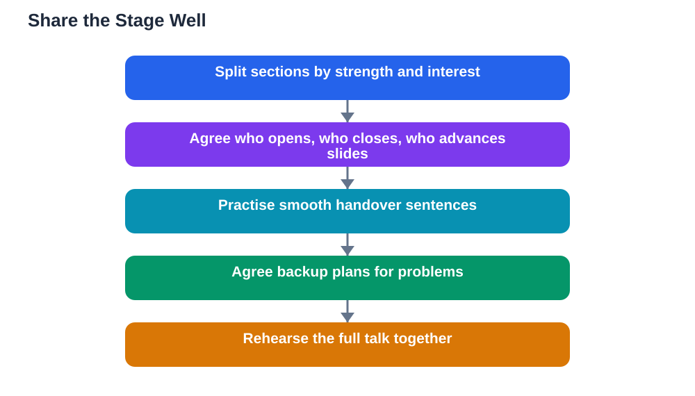

Presenting with a partner can be one of the most enjoyable kinds of school talk, and one of the most awkward when it goes wrong. A good pair presentation feels like a conversation: two voices, a shared story, and smooth handovers that keep the audience engaged. A bad one feels like two separate talks glued together, with one person doing most of the work and the other standing silently. The difference comes down to planning: splitting parts fairly, rehearsing handovers, and agreeing backup plans before the day. This guide shows you how to share the stage so that both partners shine and the audience gets one clear talk, not two competing ones.

## Presenting With a Partner: Split the Talk Fairly

Start by splitting the talk into sections, then assign them by strength and interest rather than simply cutting the time in half. One partner might be better at explaining ideas, while the other is stronger at telling stories or handling questions. Match sections to those strengths, but keep the split roughly fair, so neither partner feels like an assistant to the other. Write down who covers each section, including the opening and the closing, and agree on it early. A shared outline, visible to both partners, prevents the classic problem of both preparing the same section or neither preparing a section. Also agree on how slides will work: who advances them, who stands where, and what happens during the other person's sections. When both partners know the whole talk, not just their own part, the presentation feels unified, and each person can support the other naturally.

## Handovers That Sound Smooth

Handovers are the moments where pair presentations most often stumble. A smooth handover is a short bridge sentence that connects the section just finished to the section coming next. For example, the first speaker might end with a sentence that sets up the next idea, then name their partner and the topic they will cover. Practise these bridges until they sound natural, because an awkward handover, such as a silent shuffle or a mumbled name, breaks the audience's attention. Agree on physical cues too: a nod, a step forward, or a gesture towards the slides can signal a change without words. During the other person's section, stay present: stand nearby, look at the audience, and avoid checking your phone or whispering. Your attentive presence tells the audience that this is one team, not two strangers sharing a stage.

## Backup Plans for When Things Go Wrong

Things go wrong in pair talks more often than in solo talks, simply because there are more moving parts. Agree backup plans before the day, so a problem becomes a small adjustment rather than a crisis. If one partner is absent, the other should know the whole talk well enough to cover the essentials, even in shortened form. If slides fail, agree who will keep talking while the other fixes the problem, or whether you will continue without slides. If one partner forgets a point, the other can step in gently with a prompt, such as asking a question that leads back to the missing idea. These rescues only work if you have discussed them in advance and if both partners feel safe helping each other without embarrassment. A team that plans for problems looks calm when they happen, and that calm impresses an audience more than a flawless talk does.

## Rehearsing Together

Rehearsing together is non-negotiable for a pair presentation. Rehearse the full talk, in order, with both partners present, at least a few times. Time the whole talk, and check that each section fits its share of the time. Pay special attention to handovers, to the opening, where both partners should be introduced, and to the closing, where you should finish together rather than trailing off separately. Give each other honest, kind feedback after each run: what was clear, what was rushed, and what needs fixing. Rehearsing together also builds trust, which is the real foundation of a good pair talk. When you trust your partner to cover their part and to rescue you if needed, you relax, and a relaxed pair is far more engaging than two nervous individuals. On the day, arrive early, check the room together, and take a breath before you begin.

## AI Help: Muse AI

Muse AI is Meta's personal AI assistant, and it can help you plan a partner presentation. You can ask it to suggest a fair way to split a talk into sections, or to help you draft smooth handover sentences between speakers. It gives general planning help, not verified answers, so always check your content against your textbook before presenting.

Join Muse with invite code LTGSWD — in the Muse app, go to Settings > Redeem token and enter the code.

Disclosure: LTGSWD is the author's Muse invite code.

## FAQ

### How should we split a talk between two people?

Split it into sections first, then assign them by strength and interest, keeping the workload roughly fair. Agree the split early, write it down, and make sure both partners know the whole talk, not just their own part.

### What makes a good handover between partners?

A short bridge sentence that connects the finished section to the next one, plus a clear mention of the next speaker. Practise handovers in rehearsal, and add a physical cue, such as a nod or a step forward, to make the change feel natural.

### What if my partner does most of the talking?

Talk about it kindly before the next rehearsal, and reassign sections so the balance is fair. A good pair talk needs both voices, and most imbalance comes from unclear planning, not from bad intentions.

### What if one partner is absent on the day?

If you planned for it, the present partner can deliver a shortened version of the whole talk. That is why both partners should know the full outline, even if they only present part of it normally.

### How do we handle questions as a pair?

Agree beforehand who answers which kind of question, or take turns answering. If one partner does not know an answer, the other can step in, and if neither knows, say so honestly and promise to check. For question techniques, see [Handling Questions After Your Presentation](/blog/handling-questions-presentation.html).

## Conclusion

Sharing the stage works when you plan as a team: split the talk fairly, practise smooth handovers, agree backup plans, and rehearse together until the talk feels like one story told by two voices. Do that, and presenting with a partner becomes not just easier, but genuinely enjoyable. Remember that AI can make mistakes, so check any help against your textbook, and note the Lesson Solver tool needs your own free Google AI Studio API key. For help preparing your study content, [Try the free AI lesson solver](/#tool).
