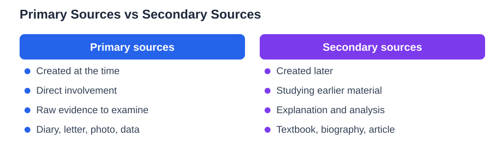

Primary vs secondary sources is a distinction that confuses many students at first, yet it becomes simple once you focus on one question: was this source created at the time by someone directly involved, or was it created later by someone describing what happened? The first kind is a primary source, and the second is a secondary source. Both kinds are valuable, and strong projects usually use both, but they do different jobs. Primary sources give you direct evidence to examine, while secondary sources give you context, explanation, and the views of people who have studied the evidence. Learning to tell them apart helps you judge what each source can and cannot prove.

## Primary vs Secondary Sources: The Time and Involvement Test

The simplest test for telling sources apart looks at timing and involvement. A primary source comes from direct experience or from the time being studied: a diary entry, a letter, a photograph, an original speech, a set of measurements, or a document produced during the events themselves. A secondary source comes later, written by someone who studied those events or materials and is explaining, analysing, or summarising them, such as a textbook chapter, a biography, or an article about a past event. Notice that the same kind of item can change categories depending on what you are studying: a newspaper report written during an event can be a primary source for studying that event, while a newspaper article written years later about the same event is a secondary account. Always ask what the source is evidence of, not just what form it takes.

## Examples That Make the Difference Clear

Examples help more than definitions, so consider a few everyday cases. A scientist's own laboratory notebook is a primary source for their experiment, while a textbook summary of that experiment is a secondary source. A letter written by a traveller during a journey is primary, while a modern book about that journey is secondary. A photograph taken at an event is primary evidence of what the camera captured, while a caption written much later explaining the photograph is secondary commentary. A speech delivered on the day is primary, while an essay analysing that speech is secondary. In each pair, the primary item is closer to the event itself, and the secondary item adds explanation at one step of distance. Keep these pairs in mind when you sort your own sources, and remember that closeness to the event is the key, not age alone or format alone.

## Why Primary Sources Matter in a Project

Primary sources matter because they let you do original thinking instead of only repeating what others concluded. When you read a diary entry, examine a set of measurements, or study a photograph yourself, you can form your own observations and notice details a textbook might have skipped. That direct contact also lets you test secondary claims: if a later account says one thing and the original evidence suggests another, you have found a genuinely interesting tension to discuss. Primary sources do have limits, of course. A single eyewitness may have seen only part of an event, may remember imperfectly, or may have had a personal viewpoint that coloured their account. That is why careful students treat primary sources as evidence to examine critically, not as automatic truth, and why they compare several primary sources whenever possible.

## Why Secondary Sources Are Still Essential

Secondary sources are essential because no student can start every project from raw evidence alone. Good secondary sources gather scattered primary material, explain background, define difficult terms, and show how different pieces of evidence fit together. A textbook chapter can orient you in a new topic in an evening, while reading only original documents might take weeks to reach the same understanding. Secondary sources also show you how other thoughtful people have interpreted the evidence, which helps you develop your own view by agreeing, disagreeing, or adding a new angle. The caution with secondary sources is to check their quality: look for authors with knowledge of the subject, clear references to primary material, and fair treatment of views they disagree with. A secondary source that hides its evidence or ignores counterarguments deserves scepticism. For background on judging any source, see [Checking Sources for School Work](/blog/checking-sources-school-work.html).

## Using Both Kinds Together in Your Project

The strongest projects combine both kinds deliberately. Use secondary sources early to learn the background, find the key questions, and discover which primary sources exist. Then turn to primary sources for direct evidence on the points that matter most to your question, and quote or describe them carefully in your own words. Finally, return to secondary sources to check your interpretation against the views of others and to frame your findings clearly. When you write, make the distinction visible to your reader: say plainly when you are reporting what a primary source shows and when you are drawing on a later account's interpretation. That honesty strengthens your argument, because readers can see exactly what rests on direct evidence and what rests on expert discussion. For a related guide to historical material, see [Historical Sources: Primary and Secondary](/blog/historical-sources-primary-secondary.html).

## AI Help: Muse AI

Muse AI is Meta's personal AI assistant, and it can help you practise telling sources apart. You can ask it to explain the difference with fresh examples, then test yourself by sorting your own source list into primary and secondary groups.
Join Muse with invite code LTGSWD — in the Muse app, go to Settings > Redeem token and enter the code.
Disclosure: LTGSWD is the author's Muse invite code.

## FAQ

### What is a primary source?

A primary source is material created at the time being studied by someone directly involved or present, such as a diary, letter, photograph, original speech, set of measurements, or document from the period. It gives direct evidence you can examine yourself, though it still needs critical reading because any single witness sees only part of an event.

### What is a secondary source?

A secondary source is material created later by someone who studied the events or evidence and is explaining, analysing, or summarising them, such as a textbook chapter, biography, or article about a past event. It provides context and interpretation, and its quality depends on the author's knowledge, evidence, and fairness to differing views.

### Can the same item be primary for one project and secondary for another?

Yes, because the category depends on what you are studying, not only on the item itself. A report written during an event is primary evidence for that event, but the same report used to study how people wrote about events later could serve a different role. Always ask what question the source is being used to answer.

### Do I need both kinds of sources in a school project?

Using both kinds usually produces a stronger project. Secondary sources give background and show how others interpreted the evidence, while primary sources let you examine direct evidence and form your own observations. Combining them shows that you understood the topic and thought about the evidence, rather than only repeating one account.

## Conclusion

Primary and secondary sources are partners, not rivals. Primary sources bring you close to the evidence, secondary sources bring context and interpretation, and together they let you build an argument that is both grounded and well informed. Learn to sort your sources by timing and involvement, use each kind for what it does best, and tell your reader clearly which kind supports each point. That clarity is the mark of careful, honest research.

[Try the free AI lesson solver](/#tool)
