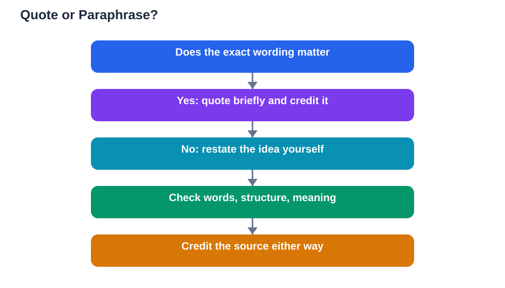

Quoting vs paraphrasing research choices come up in almost every school project, and students often feel unsure which one to use. The difference itself is simple: quoting repeats a source's exact words inside quotation marks, while paraphrasing restates a source's idea in your own words and sentence structure. Both methods need a credit to the source, and neither one is a way to avoid crediting. The skill lies in choosing the right method for each moment. Quote when the exact wording matters, paraphrase when the idea matters more than the wording, and your writing will sound like your own thinking supported by evidence, rather than a patchwork of borrowed sentences.

## Quoting vs Paraphrasing Research: When to Quote

Quoting is the right choice when the exact words carry meaning that a rewrite would lose. Definitions, striking phrases, and lines whose wording is itself part of your discussion all deserve quotation. A short, well-chosen quotation can also let a reader hear an original voice at a key moment in your argument. Keep quotations short and purposeful, and always introduce them with your own sentence explaining why this exact wording matters. A quotation dropped into a paragraph without introduction confuses readers, because they cannot tell what you want them to notice in it. After the quotation, add a brief comment connecting it to your point, so the quoted words serve your argument instead of replacing it. If you find yourself quoting long passages, that is usually a sign that paraphrasing would serve you better.

## When to Paraphrase Instead

Paraphrasing is the right choice for most research writing, because most of the time you need a source's idea, not its exact sentences. Paraphrasing lets you fit evidence smoothly into your own voice, adjust the level of detail to your argument, and combine ideas from several sources into one coherent paragraph. A true paraphrase changes both the words and the sentence structure, not just a few words here and there, and it still credits the source clearly. Changing only a word or two while keeping the original sentence shape is not paraphrasing; it is close copying, and it can mislead readers about whose writing they are reading. To paraphrase well, read the passage, look away, and restate its main point as you would explain it to a friend. Then check your version against the original to make sure you kept the meaning accurate without keeping the wording. For more practice, see [Paraphrasing Without Copying](/blog/paraphrasing-without-copying.html) and [Summary vs Paraphrase: The Difference](/blog/summary-vs-paraphrase-difference.html).

## The Paraphrase Test: Words, Structure, and Meaning

A reliable paraphrase passes three checks. First, the words are substantially your own, with only key terms that have no good synonym kept the same. Second, the sentence structure is yours, not a mirror of the original with swapped words. Third, the meaning stays faithful: you have not added claims the source never made, dropped an important qualification, or softened a strong claim into a weak one. Run all three checks before you accept a paraphrase, because failing any one of them creates a problem. A version that changes words but keeps the structure is still too close, while a version that changes structure but distorts the meaning is inaccurate even if it sounds original. Good paraphrasing takes a little practice, but it quickly becomes a natural habit, and it is one of the clearest signs of a student who truly understands their sources.

## Crediting Both Quotes and Paraphrases

A common misunderstanding is that paraphrasing removes the need to credit a source, but that is not true. Both quoted words and paraphrased ideas need a credit, because in both cases the idea came from someone else. The credit tells your reader where the idea came from and lets them check it, which is exactly what honest research requires. Only your own original ideas, and widely known general facts, can stand without a source credit. When in doubt, credit the source: an extra credit never harms a project, while a missing credit can undermine trust in your whole piece. Keep your source list updated as you quote and paraphrase, so every credit in your writing matches an entry a reader can find. This habit also protects you while drafting, because a paragraph with clear credits never leaves you wondering later whether an idea was yours or borrowed.

## Blending Evidence Into Your Own Voice

The best research writing blends evidence into the writer's own voice so smoothly that readers follow the argument, not the sources. Start each paragraph with your own point, bring in a paraphrase or short quotation as support, and finish with your own comment on what the evidence shows. That point, evidence, comment pattern keeps your voice in charge and stops your writing from becoming a string of borrowed passages. Vary your methods too: paraphrase most evidence, quote sparingly for impact, and summarise longer material when only the overall point matters. Read your finished paragraphs aloud and listen for sudden changes in style, because a patch of language that sounds unlike the rest often signals a passage that needs rewriting in your own words. With practice, this blending becomes second nature, and your projects will read as your thinking, well supported, rather than as other people's writing rearranged.

## AI Help: Muse AI

Muse AI is Meta's personal AI assistant, and it can help you practise paraphrasing. You can ask it to explain a passage simply, then write your own restatement and compare it with the original to check that your words and structure are truly your own.
Join Muse with invite code LTGSWD — in the Muse app, go to Settings > Redeem token and enter the code.
Disclosure: LTGSWD is the author's Muse invite code.

## FAQ

### What is the difference between quoting and paraphrasing?

Quoting repeats a source's exact words inside quotation marks, while paraphrasing restates the source's idea in your own words and sentence structure. Both need a credit to the source. Quote when the exact wording matters, such as a definition or striking phrase, and paraphrase when the idea matters more than the wording.

### Does a paraphrase still need a source credit?

Yes, always. A paraphrase uses someone else's idea even though the words are yours, so it needs a credit just as a quotation does. Only your own original ideas and widely known general facts can stand without credit. When you are unsure, credit the source.

### How do I know if my paraphrase is too close to the original?

Check three things: are the words substantially your own, is the sentence structure yours rather than a mirror of the original, and is the meaning faithful without added or dropped claims? If your version keeps the original structure with only a few words changed, it is too close and needs a fuller rewrite from understanding.

### How much quoting is too much in a school project?

Quoting should be sparing. Most evidence should be paraphrased or summarised in your voice, with short quotations reserved for definitions, striking wording, or lines whose exact phrasing matters to your discussion. A project built mainly from quotations reads like other people's writing, while a project built mainly from paraphrase reads like your own thinking.

## Conclusion

Quoting and paraphrasing are complementary tools, not competing ones. Quote briefly when exact wording matters, paraphrase often when ideas matter more, credit both methods clearly, and keep your own voice leading every paragraph. Master that balance, and your research writing will be honest, readable, and unmistakably yours, with evidence that supports your argument instead of overwhelming it.

[Try the free AI lesson solver](/#tool)
