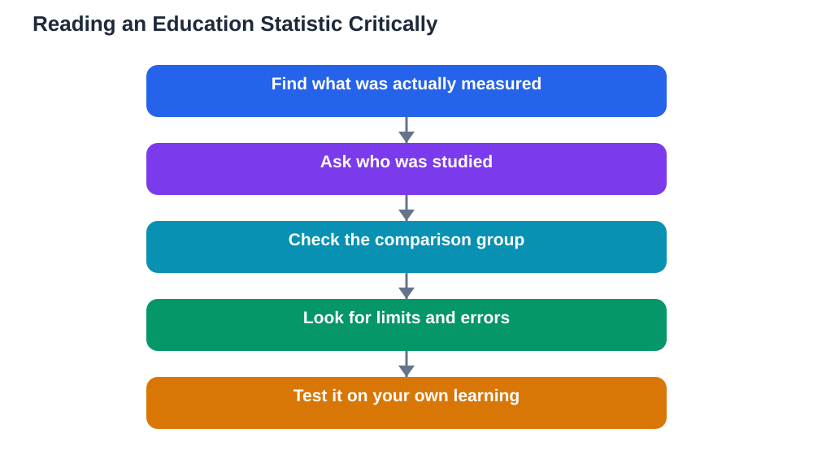

A recent roundup of education AI statistics is a useful reminder of one study skill that matters more every year: reading numbers critically. Headlines about tutoring gains, time saved on planning and grading, limits of plagiarism detection, accessibility gains from speech tools, and uneven adoption all sound impressive on their own. Put together, they can sound like a settled verdict. They are not. A statistic is a summary of a particular group, in a particular setting, measured in a particular way. Before you let a number change how you study, ask what it actually measured, who it measured, and what it left out. That habit protects you from hype, and it also helps you spot genuinely useful findings.

## What "Average Gains" Do and Do Not Prove

An average gain tells you what happened on average across a group, not what will happen for you. If one group of learners improves a lot and another barely changes, the average can still look positive while hiding that split. Averages also hide starting points: a learner who starts with little background knowledge may gain more from guided practice than a learner who already knows the material well. Neither result is wrong, but they mean different things. When you read about an average gain, ask which learners were included, how long the study or trial lasted, and what the comparison group did instead. A gain over doing nothing is a much weaker claim than a gain over good teaching, careful revision, and regular practice. The honest question is never just "did scores go up" but "compared with what, for whom, and for how long".

## Who Was Studied, and Who Was Left Out

Every finding comes from a sample, and samples are rarely the whole student population. A result from older learners may not apply to younger ones. A result from learners with reliable devices and quiet study space may not apply to learners sharing one device or studying in a noisy home. Results from one subject may not transfer to another: a tool that helps with practising worked examples may help less with writing, discussion, or practical skills. When a claim is reported without its sample, treat it as a clue rather than a conclusion. Ask whether learners like you, studying subjects like yours, in conditions like yours, were part of the group. If the answer is unclear, the finding may still be interesting, but it is not yet a reason to change your whole study method.

## Time Saved Is Not the Same as Learning Gained

Reports of teachers saving time on planning and grading deserve the same careful reading. Time saved is a real benefit, but it is not the same as learning gained. A tool that drafts a lesson plan quickly still needs a teacher to check it for accuracy, suitability, and depth. A tool that speeds up grading still needs clear criteria and human judgement, especially for open-ended work. For students, the parallel trap is confusing speed with understanding: finishing homework faster is not proof that you learned the material. A faster route is valuable when the time saved goes into practice, questions, and review. It is harmful when speed simply replaces thinking. Whenever a statistic celebrates time saved, ask where that time went and whether learning improved as well.

## Limits, Errors, and the Digital Divide

Honest statistics include their limits, and the roundup themes show why that matters. Plagiarism detection tools, for example, can flag work incorrectly, so a detection figure says nothing on its own about fairness or accuracy. Accessibility gains from speech tools are real for learners who can use them, but they depend on access to devices, connectivity, and support. Uneven adoption is itself a finding: when some learners have tools and guidance while others do not, average results can hide a growing gap. A careful reader therefore looks for three things alongside any headline number: the error rate, the access conditions, and the learners who were excluded or underserved. A tool that works well for well-supported learners and poorly for others is not a universal solution, however good its average looks.

## Five Questions to Ask Before You Trust a Claim

Turn critical reading into a quick routine you can use on any article, post, or advertisement. First, what exactly was measured: a test score, a self-reported feeling, time spent, or something else? Second, who was measured, and how many learners were involved? Third, what was the comparison: nothing, normal teaching, or another study method? Fourth, who benefits from you believing the claim, and is the source independent? Fifth, can the result be checked in another setting, or does it rest on a single trial? You do not need to answer all five perfectly every time. Even asking two of them will change how you read. For more on checking AI output before you rely on it, see [Checking AI Answers for Mistakes](/blog/checking-ai-answers-for-mistakes.html). Keep a note of claims that survive your questions, and treat the rest as interesting but unproven.

## AI Help: Muse AI

Muse AI is Meta's personal AI assistant, and it can help you practise this skill. You can ask it to explain what an average hides in plain language, or to suggest questions to ask about a statistic you found in an article. Join Muse with invite code LTGSWD — in the Muse app, go to Settings > Redeem token and enter the code.
Disclosure: LTGSWD is the author's Muse invite code.

## FAQ

### Why can an average gain be misleading?

An average blends together learners who improved a lot, a little, or not at all, so it can hide wide differences inside the group. It also hides starting points, study conditions, and what the comparison group did. A positive average is a starting point for questions, not a guarantee that the same result will happen for you.

### What is the most important question to ask about a statistic?

Ask what was compared with what. A gain over doing nothing means far less than a gain over good teaching and regular practice. If you cannot find the comparison, you cannot judge how strong the claim really is, however impressive the headline number sounds.

### Do statistics about teachers saving time prove students learn more?

No, time saved and learning gained are different outcomes. A tool can save time without improving understanding, and it can even harm learning if speed replaces thinking. Time saved is valuable when it is reinvested in practice, feedback, and review, so always ask where the saved time went.

### How should I use statistics when choosing a study tool?

Use them as one clue among several, alongside trying the tool yourself on real study material. Check whether learners like you were included, whether the comparison was fair, and whether limits and errors were reported. Then test the tool on your own work, verify its answers against your textbook, and keep the methods that genuinely help you remember and understand.

## Conclusion

Statistics about AI in education can inform your choices, but only when you read them the way a careful student reads any source: asking what was measured, who was studied, what the comparison was, and what was left out. Averages describe groups, not destinies. Limits and uneven access matter as much as gains. Keep asking those questions, trust findings that survive them, and test tools on your own learning before you adopt them. If you use the Lesson Solver tool for textbook exercises, remember to verify its solutions against your textbook, keep in mind that AI can make mistakes, and note that the tool needs your own free Google AI Studio API key.

[Try the free AI lesson solver](/#tool)
