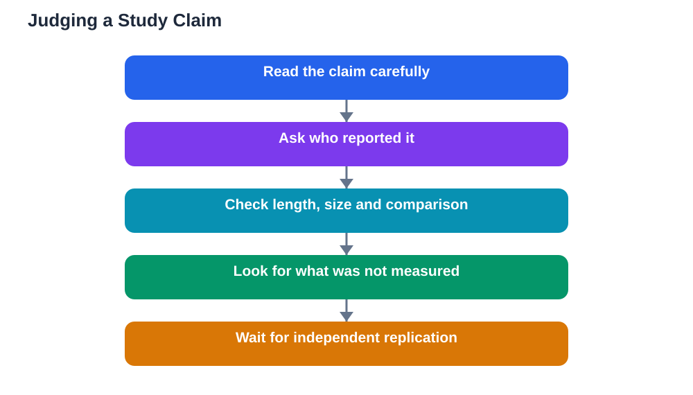

When a new learning tool is announced, impressive study claims usually follow close behind. Recently reported research alongside a guided-learning announcement is a good example: early results suggested learners using guided AI support did better than learners using standard online resources alone, and a classroom pilot across several subjects was described in positive terms. Reading AI study claims critically means pausing before accepting such headlines, and asking what the study actually showed, and what it did not.

This skill matters far beyond one announcement. Learners, parents and teachers are bombarded with claims about tools that promise faster learning, better grades and deeper understanding. Some of those claims rest on solid evidence. Many rest on short, small or selective studies. Knowing the difference protects your time, your money and your study habits.

## Why Short Trials Deserve Caution

A short trial can show that something works in the short term while saying little about lasting learning. Enthusiasm for a new tool often boosts effort temporarily: learners try harder because the experience is novel, teachers pay extra attention, and everyone involved wants the trial to succeed. That novelty effect fades. A tool that shines for a few weeks may look ordinary over a full term, once the excitement wears off and the real work of revision begins.

Short trials also rarely measure what matters most. A quick improvement on a practice quiz is not the same as durable understanding months later, or the ability to apply an idea to unfamiliar problems. The most valuable outcomes in education are slow ones: retention, transfer and independent skill. A brief study simply cannot measure those, however well it is run.

## Who Reported the Result, and Why It Matters

Always ask who conducted and reported the study. Results reported by the company selling the tool deserve extra scrutiny, not because they are necessarily false, but because the reporter has an interest in a positive story. Independent evaluation, where researchers have no stake in the product, carries more weight. Peer review, where other experts check the methods before publication, adds further weight still.

Also ask what was compared. A new tool beating standard online resources alone is a modest claim: almost any structured, interactive help might beat unstructured resources. The stronger question is whether it beats good existing teaching, such as a teacher-led lesson or a well-designed textbook exercise, by a meaningful amount. Headlines rarely make that distinction, but critical readers should.

## The Questions to Ask About Any Study

A practical checklist helps. How long did the study run, and how many learners took part? Short and small studies are starting points, not conclusions. Were learners assigned randomly, or did volunteers and enthusiastic early adopters dominate? Did the study measure lasting learning or only immediate performance? Were the results reported in full, including anything that did not work?

Also watch for what is missing. If a report mentions only the most successful subject or the most engaged class, ask about the rest. If it describes gains without describing the comparison group clearly, the claim is incomplete. Absence of detail is not proof of a weak study, but it is a reason to wait for a fuller report before changing your study habits.

## What Strong Evidence Looks Like

Strong evidence has a recognisable shape. It comes from longer studies, repeated in different classrooms, by independent researchers, measuring retention and transfer rather than immediate scores alone. It reports both successes and failures, describes the learners and conditions honestly, and survives replication: other teams trying the same approach get similar results. That standard takes time to meet, which is why genuinely proven tools are rarer than heavily promoted ones.

Until that standard is met, the sensible response to a new claim is interested patience. Try the tool if it is available and approved, use it in the guided, attempt-first way that good learning requires, and judge it by your own unaided progress over weeks, not by a headline. Your own experience, checked against your textbook and your test results, is evidence too, and it is the evidence that matters most for you.

## Avoiding the Hype Trap in Your Own Study

Hype harms learning when it changes behaviour for the wrong reasons. A learner who abandons a proven routine for a fashionable tool may lose weeks of steady progress. A school that buys into an unproven claim may spend resources that could have funded teacher time or books. The antidote is simple: let new tools earn their place. Keep what works, test what is new alongside it, and promote a tool to a central role only after it has proven itself in your own practice.

This attitude is not scepticism for its own sake. It is respect for evidence. The best learning science welcomes new ideas and insists they prove themselves, and learners who think that way will be harder to mislead by any future announcement.

## AI Help: Muse AI

Muse AI is Meta's personal AI assistant, and it can help you practise critical reading by summarising a claim in plain language or listing the questions you should ask about a study before trusting it. It can explain research terms simply, but it cannot verify a study's quality for you. Join Muse with invite code LTGSWD — in the Muse app, go to Settings > Redeem token and enter the code.
Disclosure: LTGSWD is the author's Muse invite code.

## FAQ

### Why should I be cautious about short trials?

Short trials capture novelty and immediate performance, not lasting learning. Enthusiasm fades, and the outcomes that matter most, such as retention and the ability to apply ideas to new problems, take longer to measure than a brief trial allows.

### Does a company-reported study mean the result is false?

No, but it means extra caution is warranted. A company has an interest in positive results, so independent replication and peer review matter. Treat a vendor-reported result as a promising lead, not a settled conclusion.

### What is the strongest sign that a learning tool really works?

Longer, independent studies in varied classrooms that measure retention and transfer, report full results including failures, and are replicated by other researchers. A single short trial, however positive, does not meet that standard.

### How should I judge a new tool for my own study?

Try it alongside your existing routine, use it in a guided and attempt-first way, and judge it by your own unaided progress over several weeks. If your independent performance improves and stays improved, the tool has earned its place.

## Conclusion

Big claims deserve careful reading, especially when the trials behind them are short. Ask who reported the result, what was compared, how long it ran, and what was actually measured, and wait for independent, longer evidence before letting a headline reshape your study routine. Critical reading is not cynicism; it is the habit that keeps your learning grounded in what genuinely works.

[Try the free AI lesson solver](/#tool)
