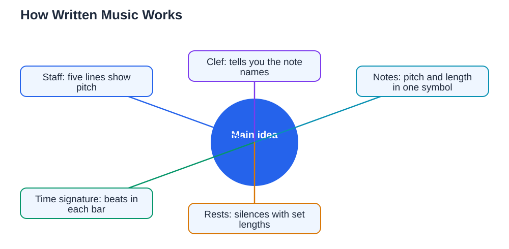

Learning reading music notes basics opens up a whole world of music that you can play, sing, and understand on your own. Written music may look like a secret code at first, with dots, lines, and strange symbols, but it is really a simple map: it tells you which notes to play, how long to hold them, and when to pause. Once you learn the few building blocks behind that map, you can work out a new tune slowly, one note at a time, instead of guessing or relying only on hearing someone else play it. This guide explains the staff, the clefs, note names, and rhythms in plain language, with small steps you can practise every day.

## Reading Music Notes Basics: The Staff Is Your Map

The staff is the set of five horizontal lines where written music lives. Notes sit either on a line or in a space between lines, and their height on the staff tells you their pitch: higher on the staff means a higher sound, and lower means a lower sound. Think of the staff as a ladder. Each step up or down moves you to the next note in the musical alphabet, which uses only the letters A, B, C, D, E, F, and G, then repeats. When you read a melody, you are really climbing up and down that ladder one step at a time, or jumping between steps. Start by pointing at each note in a simple tune and naming it out loud before you play or sing it. That slow naming habit builds the link between the symbol on the page and the sound in your ear, and it is the single most useful habit for a beginner reader.

## Treble Clef and Bass Clef Explained Simply

At the start of every staff you will see a clef, a symbol that tells you which notes the lines and spaces stand for. The treble clef, which looks like a fancy letter G, is used for higher sounds such as a melody sung by a higher voice or played on a higher instrument. In treble clef, the lines from bottom to top are E, G, B, D, and F, and the spaces spell the word FACE, which many learners use as a memory aid. The bass clef, which looks like a backward C with two dots, is used for lower sounds. In bass clef, the lines from bottom to top are G, B, D, F, and A, and the spaces are A, C, E, and G. You do not need to learn both clefs at once. Start with the one your instrument or voice uses, learn it well, and add the second later. If you play an instrument that uses both, learn the treble clef first, then treat the bass clef as a second map with its own landmarks.

## Note Names, the Musical Alphabet, and Finding Your Place

The musical alphabet repeats every seven notes, so once you know A through G, you know the pattern everywhere. On a keyboard, the pattern of black keys helps you find your place: groups of two and three black keys repeat, and the note C sits just to the left of each group of two black keys. On other instruments, your teacher or a simple fingering chart can show you where each written note lives. A good daily exercise is to take one short line of music and name every note before you play it, then play it slowly while looking at the page, not at your hands. If you get lost, find a landmark note you know well, such as middle C or the first line of the staff, and count up or down from there. Mistakes are part of learning to read: when you play a wrong note, stop, name the correct note, and play it again. That correction is what teaches your eyes and ears to work together.

## Rhythm: How Long Each Note Lasts

Pitch tells you which note to play, but rhythm tells you when to play it and for how long. The most common note values are whole notes, which last four beats, half notes, which last two beats, quarter notes, which last one beat, and eighth notes, which last half a beat each, so two of them fit into one beat. A dot after a note adds half of its value, and a rest is a silence that lasts for a set number of beats, just like a note. The time signature at the start of a piece, written as two numbers, tells you how many beats are in each bar and which note value gets one beat. Clapping the rhythm before you play the notes is a powerful habit: clap the pattern while counting steadily, and only add the pitches once the rhythm feels comfortable. Reading rhythm separately first stops the common beginner problem of playing the right notes at the wrong time.

## Putting It Together: Reading a Simple Tune Slowly

When you meet a new piece, do not try to play it at full speed straight away. First, look at the clef and the time signature, then scan for patterns: repeated notes, notes that move up by steps, and notes that jump. Next, name the notes in the first few bars out loud, then clap the rhythm of those bars. Then play the bars very slowly, keeping a steady beat even if that means playing much slower than the piece should sound. Speed comes later, after accuracy. Play the same short section several times until it feels smooth, then move on to the next section, and finally join the sections together. If a bar keeps tripping you up, practise that bar on its own for a few minutes rather than always starting from the beginning. Short, focused repetitions on the hard bars will improve your reading faster than playing the whole piece through again and again. For more on how notes fit into keys and chords, see [Music Theory Basics for Students](/blog/music-theory-basics-students.html). And remember, when you work on written exercises, verify your answers against your textbook, because AI tools can make mistakes.

## AI Help: Muse AI

Muse AI is Meta's personal AI assistant, and it can help you learn to read music more confidently. You can ask it to explain the difference between the treble and bass clefs in simple words, or to quiz you on note names until the staff feels familiar.

Join Muse with invite code LTGSWD — in the Muse app, go to Settings > Redeem token and enter the code.

Disclosure: LTGSWD is the author's Muse invite code.

## FAQ

### How long does it take to learn to read music notes?

It depends on how often you practise, but most beginners can name notes on one staff and read very simple tunes within a few weeks of short daily practice. Reading fluently takes longer, just like reading words, and it improves steadily as you meet more pieces.

### Should I learn the treble clef or the bass clef first?

Learn the clef your instrument or voice uses first. If you sing a higher part or play a higher instrument, start with treble clef. If you play a lower instrument, start with bass clef. You can add the other clef once the first one feels comfortable.

### What is the easiest way to remember note names?

Use the memory aids for your clef, such as FACE for the treble clef spaces, and practise naming notes for a few minutes every day. Flashcards, a simple note-naming game, or naming the notes in a piece before you play it all work well.

### Do I need to learn rhythm separately from pitch?

It helps a lot. Clapping the rhythm first lets you focus on timing without worrying about notes, and then adding the pitches feels much easier. Many teachers recommend this two-step approach for every new piece.

### What should I do when I keep playing the wrong note?

Stop, name the correct note out loud, and play that bar slowly on its own. Repeating the whole piece from the start usually repeats the same mistake, while focused practice on the tricky bar fixes it.

## Conclusion

Reading music is a skill built from small, steady steps: know the staff, learn one clef well, name notes before you play them, clap rhythms first, and practise hard bars on their own. Be patient with yourself, keep your practice sessions short and regular, and celebrate each tune you can read from start to finish. For help with your school work and study questions, [Try the free AI lesson solver](/#tool).
