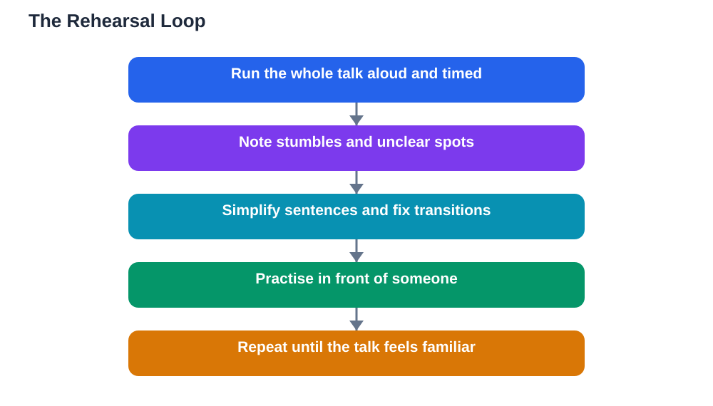

Rehearsing a presentation is the step that separates a talk that merely exists from a talk that works. Many students prepare slides and notes, then deliver the talk for the first time in front of the class, which is like performing a song you have only read on paper. Professional speakers rehearse because they know that familiarity frees the mind: when the words and the order feel known, you can focus on the audience instead of on survival. Good rehearsal is not about memorising every word. It is about practising aloud, timed, and in front of someone, so that surprises happen in rehearsal, where they are harmless, rather than on the day.

## Rehearsing a Presentation the Way Pros Practise

Professional rehearsal starts early and repeats in short sessions rather than one panicked run-through the night before. Begin by rehearsing the whole talk aloud as soon as you have a draft, even if it is rough. The first run shows you where your ideas are unclear, where transitions are missing, and which sentences trip your tongue. Fix those spots, then rehearse again. Each round should feel smoother than the last, and you should notice your timing settling into a comfortable range. Rehearse in chunks too: practise the opening until it flows, then the middle sections, then the closing, before putting the whole talk together again. This mix of full runs and focused fixes is far more effective than repeating the easy parts and avoiding the hard ones.

## Rehearse Aloud and Timed

Silent reading is not rehearsal, because speaking takes longer than reading and reveals problems that silent reading hides. Always rehearse in your real speaking voice, standing up if possible, with your notes and slides in hand. Time every full run, and compare it with your time limit. If you run long, cut content rather than planning to speak faster, because speeding up on the day makes you harder to follow and more nervous. If you run short, add an example or a clearer explanation, rather than padding with filler. Timing also teaches you where your talk breathes: note the spots where you naturally pause, and protect those pauses, because they help the audience follow you. A timed rehearsal gives you a realistic picture of your talk, and that realism is calming.

## Practise in Front of Someone

Rehearsing alone is useful, but rehearsing in front of someone is where the real improvement happens. An audience, even of one trusted person, changes how you speak: you project more, you notice unclear explanations, and you feel a mild version of the nerves you will feel on the day. Ask your listener for specific feedback, not just whether it was good. Useful questions include: which part was hardest to follow, where did I speak too fast, and did the opening make you want to hear more? Listen to the answers without defending yourself, and fix one or two things before your next run. If no one is available, record yourself and listen back, paying attention to pace, filler words, and clarity. The goal is not a perfect performance in rehearsal, but honest information about what needs work.

## Fix What the Rehearsal Reveals

Rehearsal is only useful if you act on what it reveals. Keep a short list of fixes after each run: a sentence to simplify, a slide to split, a transition to add, a section to shorten. Work through the list before the next rehearsal, and check whether the fix actually helped. Pay special attention to recurring stumbles, because a spot you stumble over three times in rehearsal will almost certainly trouble you on the day. Simplify those spots ruthlessly: shorter sentences, clearer words, and a simpler order usually solve the problem. Also rehearse your recovery moves, such as glancing at your notes or moving to the next point, so that a slip on the day feels like a normal part of speaking rather than a crisis. By the final rehearsal, your talk should feel familiar, not memorised word for word, and you should know it well enough to adapt if something changes.

## AI Help: Muse AI

Muse AI is Meta's personal AI assistant, and it can help you rehearse more effectively. You can ask it to suggest simpler wording for a sentence you keep stumbling over, or to help you plan a rehearsal schedule across several days. It gives general planning help, not verified answers, so always check your content against your textbook before presenting.

Join Muse with invite code LTGSWD — in the Muse app, go to Settings > Redeem token and enter the code.

Disclosure: LTGSWD is the author's Muse invite code.

## FAQ

### How many times should I rehearse a presentation?

There is no magic number, but a few full runs aloud, plus focused practice on tricky sections, is a good target. Quality matters more than quantity: each rehearsal should end with a short list of fixes that you actually make.

### Is it better to rehearse the night before or over several days?

Over several days is better, because sleep helps your brain consolidate what you practised. Short rehearsals spread across days beat one long session the night before, which usually adds stress rather than confidence.

### What if I cannot find anyone to practise in front of?

Record yourself on your phone and listen back, or rehearse in front of a mirror to check your posture and gestures. Even speaking aloud to an empty room is far better than silent reading.

### Should I rehearse with my slides and notes?

Yes, always. Rehearsing without them hides timing problems and transition issues. Use the exact notes and slides you will use on the day, so the rehearsal matches the real performance as closely as possible.

### What if my rehearsal goes badly?

A bad rehearsal is useful information, not a prediction. Note what went wrong, fix one or two things, and rehearse again. Most talks improve noticeably between the first and second full runs. For calming your nerves on the day, see [Speaking to Your Class With Confidence](/blog/speaking-to-class-confidently.html).

## Conclusion

Rehearsal is where confident presentations are made. Practise aloud, timed, and in front of someone, fix what each run reveals, and spread your rehearsals over several days. When the day arrives, you will not be delivering your talk for the first time. You will be delivering a talk you already know, and that familiarity is the quiet source of confidence. Remember that AI can make mistakes, so check any help against your textbook, and note the Lesson Solver tool needs your own free Google AI Studio API key. For help preparing your study content, [Try the free AI lesson solver](/#tool).
