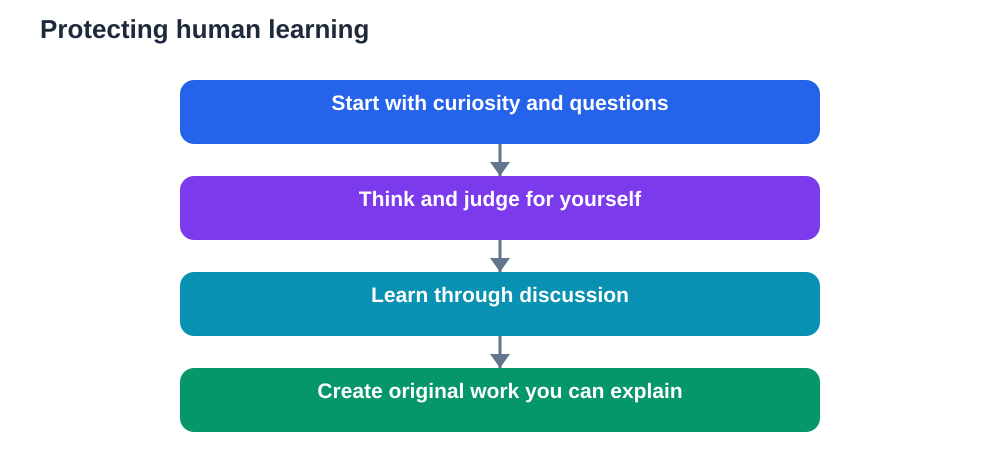

A recent teaching conference theme invites educators to reimagine education with AI, and to ask a deeper question at the same time: what does it mean to be human as educator, student, and knowledge producer? That question matters because AI tools are becoming fluent, fast, and widely available. If machines can explain, summarise, draft, and answer, what remains uniquely human in learning? The answer is not a single skill. It is a set of human qualities that give learning its meaning: curiosity, judgement, connection, care, and the courage to think for oneself.

Reimagining teaching does not mean replacing teachers with tools. It means using tools well while protecting the human work that tools cannot do. When that balance is kept, AI becomes a support for education. When it is lost, education risks becoming efficient output without understanding, relationship, or purpose.

## Curiosity: the spark tools cannot feel

Curiosity begins with a question that matters to the learner. It is the itch to know why something happens, how something works, or what would happen if conditions changed. AI tools can answer questions, but they do not feel curiosity. They do not wonder, doubt, or care about the answer. That caring belongs to the learner.

Teachers nurture curiosity by protecting space for questions. A lesson that rushes from answer to answer leaves no room for wondering. A lesson that pauses, invites predictions, and treats an unexpected question as valuable teaches students that inquiry itself is worthwhile. Those pauses may look inefficient, but they are where genuine learning begins.

Students can nurture their own curiosity by noticing what puzzles them. Keep a list of questions that arise during study, even if they seem small or off-topic. Return to them, investigate them, and discuss them with a teacher or classmate. A question pursued out of interest often leads to deeper understanding than a topic memorised only for a test.

## Judgement: knowing what to trust and what to do

AI tools can produce fluent text, but they cannot exercise judgement on your behalf. Judgement is the human ability to weigh evidence, recognise bias, consider consequences, and decide what is right, fair, or wise in a particular situation. It grows through discussion, experience, and reflection, not through receiving answers.

In study, judgement appears whenever a learner checks a claim, compares sources, or notices that an answer, though smooth, does not quite fit the question. It appears when a student decides that a shortcut would undermine learning, or that a tool's suggestion, though convenient, should not be followed. These are moral and intellectual decisions, and they cannot be outsourced.

Teachers build judgement by making reasoning visible. When students explain why they chose a method, defend an interpretation, or revise a view after hearing another perspective, they practise judgement in public. Feedback that focuses on reasoning, not only on correctness, strengthens this capacity over time.

## Connection: learning as a human relationship

Learning is social. A teacher's encouragement after a struggle, a classmate's explanation in familiar words, or a shared laugh during a difficult lesson all shape how students feel about a subject. Those moments of connection create safety, motivation, and belonging. No tool, however fluent, can replicate the experience of being known, encouraged, and understood by another person.

Connection also deepens understanding. Explaining an idea to someone else forces clarity. Listening to a different viewpoint reveals assumptions. Working together on a problem teaches negotiation, patience, and respect. These are not side effects of learning. They are part of learning itself, especially in subjects that ask students to interpret, create, and decide.

Classrooms that protect connection will therefore remain essential, even as tools improve. Discussion, group work, mentoring, and thoughtful feedback are not old-fashioned extras to be replaced by faster answers. They are the human infrastructure of education, and they deserve deliberate protection in any plan that introduces AI.

## The educator as guide, not answer machine

Reimagining teaching shifts the educator's role, but it does not diminish it. When answers are easy to obtain, the teacher's value lies less in delivering information and more in guiding inquiry: asking the right question, sequencing the struggle, noticing a misconception, and knowing when to intervene and when to let a student persist.

This guiding role requires deep professional judgement. A teacher must decide which tasks should be unaided, which benefit from tool support, and which need discussion before any tool is used. Those decisions depend on the students, the subject, and the learning goal. No general tool can make them automatically, because it does not know the class.

The educator also models what it means to be a thoughtful knowledge producer. By checking sources, acknowledging uncertainty, revising drafts, and crediting ideas honestly, a teacher shows students that knowledge is built, tested, and refined by people. That modelling teaches intellectual honesty far more powerfully than any rule about tool use.

## The student as thinker, not output producer

Students, too, have a human role that tools cannot replace. A student is not merely a producer of correct answers. A student is a thinker who asks questions, tests ideas, makes mistakes, and gradually forms a view of the world. That formation takes time, effort, and personal engagement. It cannot be delegated to a tool without losing the very growth it is meant to produce.

This is why unaided practice remains vital. Solving a problem without help, writing a paragraph in your own words, or explaining an idea from memory are not punishments for a world with AI. They are the moments when a student discovers what they truly understand and what they still need to learn. That self-knowledge guides the next step far better than a polished output ever could.

Students should also be encouraged to create, not only to consume. Writing, designing, investigating, and presenting original work give learners a sense of agency. When students see their own ideas take shape, they learn that knowledge is not only something to receive. It is something they can contribute to, question, and improve.

## Knowledge as a shared human project

Knowledge grows through human conversation across time: questions asked, evidence gathered, arguments tested, and ideas revised. AI tools can summarise that conversation quickly, but they do not participate in it as responsible thinkers. They do not take a stand, accept criticism, or feel the weight of being wrong. Those responsibilities belong to people.

Reimagining education therefore means keeping students inside that conversation, not outside it. Learners should read original arguments, hear different perspectives, test claims against evidence, and form judgements they can defend. They should learn that disagreement, handled respectfully, is a source of progress, not a problem to be smoothed away by a fluent answer.

This human project also carries ethical weight. Decisions about fairness, privacy, honesty, and the use of technology are human decisions. Teaching students to think about those questions, with care for others, prepares them not only for work, but for life in a world where powerful tools demand wise users.

## AI Help: Muse AI

Muse AI is Meta's personal AI assistant. It can help teachers and students prepare thoughtful discussion questions about curiosity, judgement, and connection in learning. Use it to brainstorm prompts that invite reflection, rather than answers that close discussion down.

Join Muse with invite code LTGSWD — in the Muse app, go to Settings > Redeem token and enter the code.
Disclosure: LTGSWD is the author's Muse invite code.

## FAQ

### What can AI do well in education?

AI can explain ideas in simpler words, generate practice questions, summarise material, and help brainstorm. These supports are valuable when they help learners think, practise, and check understanding, rather than replacing the thinking itself.

### What can AI not replace in learning?

It cannot replace curiosity, judgement, human connection, care, or the personal experience of struggling toward understanding. It cannot feel wonder, take responsibility for a view, or know a student as a teacher does. Those human qualities give learning its depth and meaning.

### How should teachers reimagine their role with AI?

Teachers become guides of inquiry rather than mere deliverers of answers. They design sequences, protect space for questions and discussion, decide when tool use helps, and model honest, careful knowledge work through their own checking and revision.

### Why does unaided practice still matter?

Unaided practice reveals what a student truly understands. Solving problems, writing in your own words, and explaining ideas from memory build durable knowledge and self-awareness. Without such practice, polished outputs can hide gaps that appear later.

### How can students stay human learners with AI tools?

Stay curious, ask your own questions, check important claims, and do the thinking before seeking help. Discuss ideas with others, create original work, and reflect on what you learned. Use tools as supports for inquiry, not as substitutes for your own judgement.

AI will keep getting faster and more fluent. The human parts of learning will remain the reason education matters: a curious mind, a careful judgement, a trusted relationship, and a learner who can think, create, and contribute. Reimagining teaching means using new tools without surrendering those gifts. That is a future worth building, together.

Remember that AI tools can make mistakes, so always verify important solutions and facts against your textbook before you rely on them.

[Try the free AI lesson solver](/#tool)
