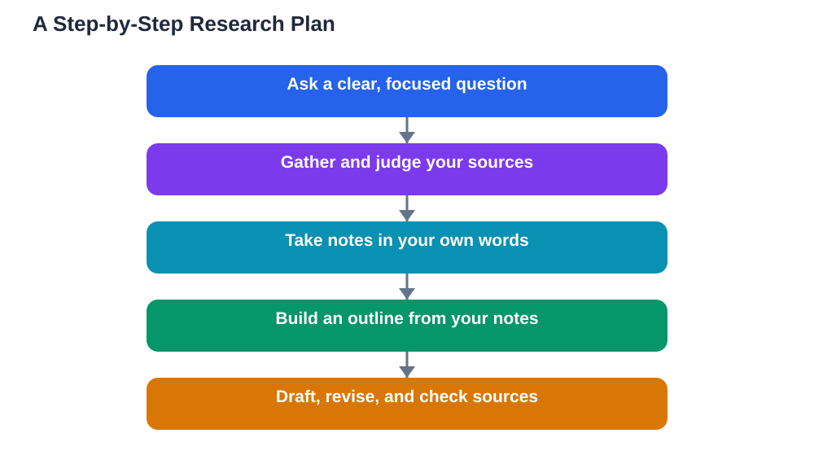

Research for a school project feels much less overwhelming when you follow a clear plan instead of diving straight into searching. Many students start by collecting facts at random, then struggle to shape them into a finished piece, because collecting without a plan produces a pile rather than a project. A step-by-step plan fixes this by giving each stage its own job: first a question, then sources, then notes, then an outline, then a draft. Each stage builds on the last, so by the time you start writing, you already know what you want to say and what evidence supports it. This guide walks through that plan in order, with practical tips for each stage.

## Research for a School Project: Start With Your Question

Every good project begins with a research question, not a search box. Take time to narrow your broad topic into a clear, focused question that fits your time and length, using tests for clarity, focus, and researchability. A strong question acts like a compass for everything that follows: it tells you which sources are relevant, which notes are worth keeping, and what your final piece must explain. Write your question down where you can see it during research, and return to it whenever you feel lost. If early reading shows your question needs adjusting, adjust it early and update your notes to match. Students who skip this stage often research twice as long for half the result, because without a question, every source looks equally important and none of them quite fits together.

## Find Sources Before You Take Detailed Notes

Once your question is set, gather your sources before you dive into detailed note-taking. Start with your library and its databases, then move to vetted websites, and keep a running source list with author, title, date, and link or location for each one. Skim each source first to judge its relevance and reliability, setting aside anything weak or off-topic before you invest time in notes. This skim-first approach saves hours, because detailed notes on a source you later discard are wasted effort. Aim for a balanced set: background sources that explain the topic, and evidence sources that support your main points, including sources that disagree with each other where the topic is debated. When your source set feels solid, you are ready to read closely and take notes with purpose. For help judging sources, see [Finding Reliable Sources for a School Project](/blog/finding-reliable-sources.html) within this series, and for a general checklist, see [How to Evaluate Sources](/blog/how-to-evaluate-sources.html).

## Take Notes That Are Ready for Writing

Note-taking is the bridge between reading and writing, and notes built for writing look different from notes built for collecting. For each source, write the main ideas in your own words using keywords, label every note with its source, and add your own reactions clearly marked. File each note under a heading drawn from your research question, so notes for each section of your final piece already sit together. Also keep a short "to find" list for gaps: unanswered parts of your question, empty headings, or claims that still need a second source. Review your notes after each session and tidy them while they are fresh, because a small daily tidy prevents the pile that makes writing painful. Good notes do not just record what you read; they record what you thought about it, and that thinking becomes the backbone of your draft.

## Build an Outline Before You Write a Draft

An outline is a short plan of your final piece, and it is the stage students most often skip and most often regret skipping. A simple outline lists your introduction, your main sections in order, the key point of each section, and the evidence that supports it, plus a conclusion that answers your research question. Building it forces you to decide the order of your argument before you commit to full sentences, which is far easier to revise than a finished draft. Check your outline against your question: does every section help answer it, and is anything important missing? Also check it against your notes: does every section have evidence ready, or do you need one more research session for a thin section? An outline that passes both checks makes drafting straightforward, because writing becomes filling in a structure you already trust.

## Draft, Revise, and Check Your Sources

With an outline ready, write your first draft without worrying about perfection. Focus on getting your argument down in order, using your notes and paraphrasing evidence in your own words, with short quotations only where exact wording matters. Then revise in passes: first for structure and argument, checking that each section answers part of your question; next for clarity, cutting repetition and explaining ideas plainly; and finally for accuracy, checking quotations, credits, and your bibliography against your sources. Read the draft aloud at least once, because hearing it reveals awkward sentences and sudden style changes that silent reading hides. If you use the Lesson Solver tool for textbook exercises along the way, remember to verify its solutions against your textbook, keep in mind that AI can make mistakes, and note that the tool needs your own free Google AI Studio API key. The same verify-before-trusting habit belongs in every stage of research.

## AI Help: Muse AI

Muse AI is Meta's personal AI assistant, and it can help you plan a school project. You can ask it to help you turn a broad topic into a question, suggest outline headings, or explain a difficult idea simply while you draft.
Join Muse with invite code LTGSWD — in the Muse app, go to Settings > Redeem token and enter the code.
Disclosure: LTGSWD is the author's Muse invite code.

## FAQ

### What is the best order for a school research project?

A reliable order is question first, then sources, then notes, then outline, then draft, then revision. Each stage builds on the last: the question guides source choices, sources feed notes, notes shape the outline, and the outline makes drafting straightforward. Skipping stages usually creates rework later.

### How long should I spend on each stage?

The balance matters more than exact timing. Give real time to the question and the outline, because weaknesses there cause the most rework, and protect time at the end for revision and source checking. Research and note-taking take the largest share of the middle, but stop gathering when your outline sections each have solid evidence.

### What should I do if I get stuck halfway through?

Go back one stage rather than pushing forward blindly. If writing feels hard, your outline may need work; if your outline feels thin, your notes may have gaps; if your notes feel scattered, your question may need narrowing. Stepping back one stage usually reveals the fix faster than struggling at the stage where the problem surfaced.

### How do I know when my research is finished?

Your research is ready when every section of your outline has evidence, your main points are supported from more than one source where possible, and your "to find" list holds no gap that would change your argument. Further searching beyond that point usually adds volume without improving the project, so move on to drafting.

## Conclusion

A school research project becomes manageable when it follows a plan: a clear question, a solid set of sources, notes written for writing, an outline you trust, and a draft revised in passes with sources checked. No stage needs to be perfect on its own, because each stage supports the next. Follow the plan, keep your notes honest and organised, and your finished project will show the steady thinking that good research is really about.

[Try the free AI lesson solver](/#tool)
