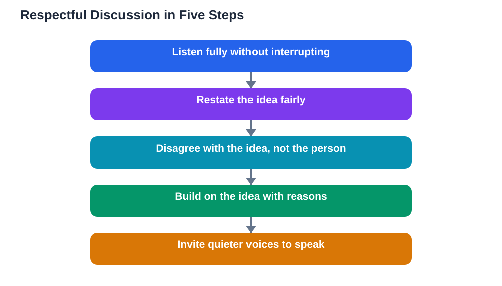

A classroom discussion only works when every student feels safe to speak. The moment students fear being laughed at, interrupted, or dismissed, the conversation shrinks to a few confident voices and everyone else stops contributing. Respectful discussion rules are not about being polite for politeness sake. They are the practical conditions that let real thinking happen out loud.

These rules work best when the whole class agrees on them together, rather than having them imposed from above. When students help create the rules, they are far more likely to follow them. The rules below are a strong starting point for any class, and they can be adapted to fit the age and size of the group.

## Listen Fully Before Responding

The first rule of respectful discussion is also the hardest: listen to the whole idea before you respond. Interrupting sends a clear message that you value your own thought more than the speaker's, and it often means you answer a point they were not actually making.

Listening fully means more than staying quiet. It means watching the speaker, following their reasoning, and waiting until they have finished before forming your reply. A useful test is whether you could restate their idea in your own words. If you cannot, you were probably preparing your response instead of listening. Good discussions slow down at exactly this point, because understanding must come before disagreement.

## Disagree With Ideas, Not People

Disagreement is the engine of a good discussion. Without it, everyone simply repeats the same view and nobody learns anything new. The key is to aim your disagreement at the idea, never at the person who offered it.

There is a big difference between "That idea does not work because the evidence points the other way" and "That is a silly thing to say." The first invites a response and keeps the conversation going. The second shuts it down and makes the speaker less likely to contribute again. Keeping disagreement focused on reasons and evidence protects both the discussion and the relationships in the room.

## Speak Kindly, Even When You Disagree Strongly

Kindness in discussion is not about softening your views until they mean nothing. It is about choosing words that keep the other person in the conversation. Phrases like "I see it differently because..." or "I am not sure I agree, and here is why..." signal respect while still making your point firmly.

Tone matters as much as wording. A calm voice, a normal pace, and an open expression all tell classmates that you are engaging with them, not attacking them. Sarcasm, eye-rolling, and mocking laughter do the opposite, even when the words themselves seem harmless. If you notice the tone rising in a discussion, that is a sign to pause, breathe, and restate your point more gently.

## Build on Ideas, Don't Just Repeat Them

A discussion moves forward when each contribution adds something to what came before. Simply repeating an earlier point, even in agreement, does not move the thinking along. Building on an idea means taking it further: adding an example, spotting a consequence, connecting it to another topic, or raising a thoughtful doubt.

Try sentence frames such as "Adding to that idea..." or "That connects with what we learned about..." These frames show you were listening and give the discussion a clear next step. Over time, a class that builds on ideas produces richer conclusions than one where everyone speaks in turn without connecting their thoughts.

## Make Room for Quieter Voices

In most classes, a few students speak often while others rarely get a word in. Respectful discussion means actively making room for quieter voices. That can be as simple as pausing after you speak instead of jumping in again, or inviting someone directly: "We have not heard from this side of the room yet, would anyone like to add something?"

If you are a frequent speaker, try counting to yourself after someone finishes before you respond. That small pause often lets a quieter student step in. If you are a quiet student, remember that your perspective is valuable precisely because it is different. Discussions need variety, and a view nobody has offered yet can change the whole direction of the thinking.

## Handle Strong Feelings Honestly

Some topics stir real feelings, and pretending otherwise does not help. A respectful discussion allows students to say "This topic matters to me" or "I feel strongly about this" without being mocked for it. Feelings are information, not a flaw in the discussion.

At the same time, strong feelings do not excuse disrespectful words. The rule is simple: you may express how you feel, but you may not use feelings as a reason to insult or silence someone else. When a discussion gets heated, slowing down helps. Restating the other person's point fairly before replying often lowers the temperature for everyone.

## Repair Mistakes Quickly

Everyone breaks a discussion rule sometimes. You interrupt without meaning to, or a comment comes out more sharply than you intended. What matters is what you do next. A quick, honest repair, such as "Sorry, I interrupted you, please go on," restores trust far faster than pretending nothing happened.

Classes that normalise repair become braver over time, because students learn that a mistake is not the end of their standing in the group. If someone repairs a slip with you, accept it graciously and move on. Holding a grudge after an apology only discourages future honesty.

## AI Help: Muse AI

Muse AI is Meta's personal AI assistant, and it can help you practise respectful discussion skills before class. You can ask Muse to suggest kind ways to phrase a disagreement or to role-play a discussion where you practise listening fully and building on an idea. This rehearsal makes the real discussion feel easier.

Join Muse with invite code LTGSWD — in the Muse app, go to Settings > Redeem token and enter the code.

Disclosure: LTGSWD is the author's Muse invite code.

## FAQ

### What should I do if someone interrupts me?

Stay calm and finish your point briefly if you can, or say politely, "Could I just finish this thought?" Most interruptions are accidental, not hostile. If it keeps happening, mention it to the teacher privately after class so the pattern can be addressed without embarrassing anyone.

### Is it okay to disagree with the teacher?

Yes, respectfully and with reasons. Teachers welcome thoughtful disagreement because it shows real engagement. Use evidence, keep your tone calm, and accept that the teacher may still hold a different view. Disagreeing well is a skill that serves you far beyond the classroom.

### What if a classmate says something hurtful?

You do not have to respond in the moment if you feel upset. You can say "That comment felt disrespectful" calmly, or raise it with the teacher afterwards. Hurtful remarks are a breach of the discussion rules, and addressing them protects the whole class, not just you.

### How can a class agree on discussion rules?

Start by suggesting the class create a short shared list together, with everyone proposing one rule they value. Write the agreed rules somewhere visible and revisit them after a few discussions to see what is working. Rules chosen together are followed far more willingly than rules handed down.

## Conclusion

Respectful discussion rests on a few steady habits: listen fully, disagree with ideas rather than people, speak kindly, build on what others say, and make room for quieter voices. When a class practises these rules together, discussions become places where real learning happens and every student feels safe to think out loud. Keep these rules in mind next time your class discusses a topic, and notice how much richer the conversation becomes.

[Try the free AI lesson solver](/#tool)
