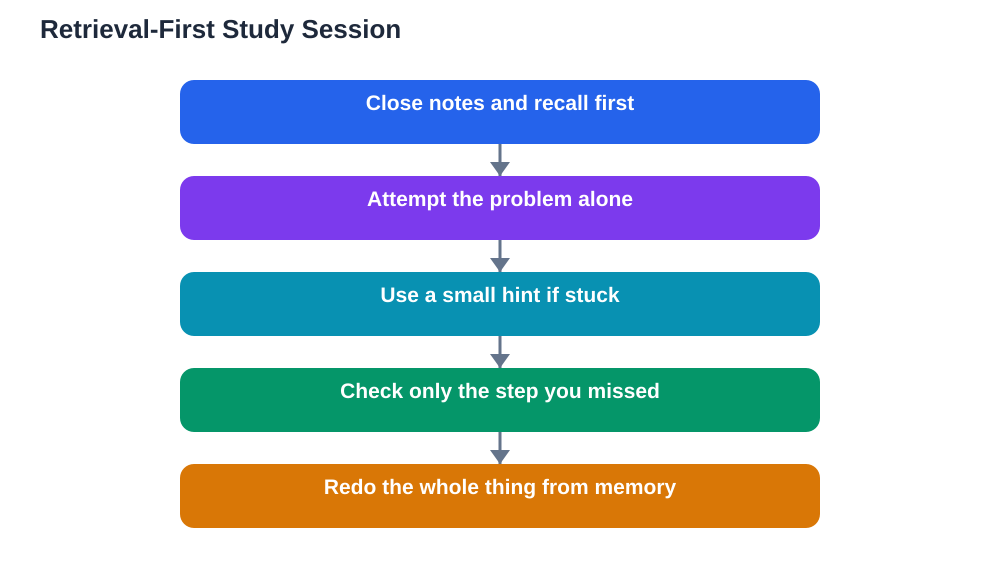

A newly launched AI tutor for exam study is built around an idea that many students find counterintuitive: it refuses to hand over answers, and instead prompts learners to retrieve information themselves. Ask it a question, and it answers with a question, a hint, or a partial clue. The design targets a well-known trap called the fluency illusion, where reading a clear answer feels like learning it, even though the knowledge vanishes when you need it alone. The tutor's bet is that a little productive struggle now saves a lot of forgetting later. The evidence behind retrieval practice supports that bet, and you can apply the same principle with or without any tutor at all.

## The Fluency Illusion: Why Easy Answers Feel Like Learning

Reading is fluent, and fluency feels like mastery. When you read a worked solution, your brain recognises each step and nods along, creating a warm sense that you understand. But recognition is not recall. In an exam, nobody shows you the solution to recognise; you must produce it from memory, under time pressure, starting from a blank page. That gap between recognising and producing is where many capable students lose marks. They studied by reading and rereading, felt confident, and then discovered in the exam hall that the knowledge was never really theirs. Retrieval practice closes that gap by training the exact skill the exam measures: pulling an answer out of your own memory, without prompts.

## How a Retrieval-First Tutor Works

A retrieval-first tutor reverses the usual chatbot pattern. Instead of answering, it asks. It might ask you to state the first step of a solution before it confirms anything. It might give you a clue — a definition, a keyword, a related example — and ask you to complete the reasoning. It might ask you to explain an idea in your own words, then point out the part you missed. When you are genuinely stuck, it gives a slightly bigger hint rather than the answer, and then asks you to finish. This can feel slower and more frustrating than a normal chatbot, and that frustration is partly the point: effort during study is a signal that memory is being strengthened, not a sign that the method is failing. For a fuller guide to the method, see [Active Recall Study Method Explained](/blog/active-recall-study-method-explained.html).

## Turning Any Study Session Into Retrieval Practice

You do not need a special tutor to study this way. Start every revision session by closing your notes and writing down what you remember about the topic, even if the page stays half blank. Then open your notes, fill the gaps, and try again later the same day. When you practise problems, cover the solution and attempt each step before peeking; peek only at the step you are stuck on, then cover it again and redo the whole problem. When you read a chapter, stop every few pages and summarise from memory before continuing. Use flashcards the hard way: try to recall the answer before turning the card, and mark honestly whether you really knew it. These small changes convert passive review into retrieval training, and they work with any subject.

## Hints, Not Answers: A Practical Ladder

When you are stuck, use a ladder of hints instead of jumping to the answer. First hint: reread the question and underline what it is actually asking. Second: recall a related example or a similar problem you have solved before. Third: ask for the first step only, or the key definition involved. Fourth: look at a worked example of a similar problem, then return to yours without copying it. Only after working through the ladder should you look at the full answer — and when you do, close it immediately and redo the problem from scratch. If you cannot redo it, you have not learned it yet, and that is useful information, not failure. Repeat the problem the next day, and the day after, until the retrieval becomes smooth.

## Studying for Exam Day, Not for Study Evening

The ultimate test of any study method is simple: does it work when the help is gone? Design your revision to resemble exam conditions more and more as the exam approaches. Practise without notes, without the tutor, and within a time limit. Mix topics together rather than studying them in neat blocks, because exams mix topics too, and choosing the right method is part of the skill. Space your retrieval sessions across days rather than cramming them into one evening, because each return visit strengthens memory more than another hour on the same day. A retrieval-first tutor can coach this process, but the principle is yours to keep: think first, check second, and let the struggle do its work.

## AI Help: Muse AI

Muse AI is Meta's personal AI assistant, and it can support retrieval-first study. You can ask it to quiz you with hints rather than answers, or to turn a topic into short recall questions you can attempt before checking your notes. Join Muse with invite code LTGSWD — in the Muse app, go to Settings > Redeem token and enter the code.
Disclosure: LTGSWD is the author's Muse invite code.

## FAQ

### What is the fluency illusion?

It is the false confidence that comes from recognising a clear answer while reading it. Recognition feels like understanding, but it fades when you must produce the answer alone. Retrieval practice fights the illusion by training you to recall answers from memory, which is what exams actually require.

### Why does a tutor that withholds answers help more?

Because the effort of retrieving an answer strengthens the memory of it. A tutor that gives answers removes that effort, so the knowledge stays shallow. A tutor that gives hints keeps you thinking, and the thinking is what builds lasting recall.

### How do I use retrieval practice without a special tutor?

Close your notes and write what you remember, cover solutions while attempting problems, and summarise chapters from memory before moving on. Use flashcards by recalling before turning the card, and repeat the same material across several days rather than in one session.

### Is retrieval practice slower than rereading?

It feels slower at first, because it is harder, but it saves time overall. Rereading often needs many repetitions to stick, while retrieval sessions build stronger memory in fewer sessions. The struggle during study is a sign the method is working, not failing.

## Conclusion

The best tutor is not the one that answers fastest but the one that makes you think first. Retrieval practice turns the fluency illusion into real recall: attempt before you check, hints before answers, and practice under conditions that resemble the exam itself. Whether you use a retrieval-first tutor or simply change how you revise, the rule stays the same — the learning belongs to the person doing the retrieving, and that person is you. If you use the Lesson Solver tool for textbook exercises, remember to verify its solutions against your textbook, keep in mind that AI can make mistakes, and note that the tool needs your own free Google AI Studio API key.

[Try the free AI lesson solver](/#tool)
