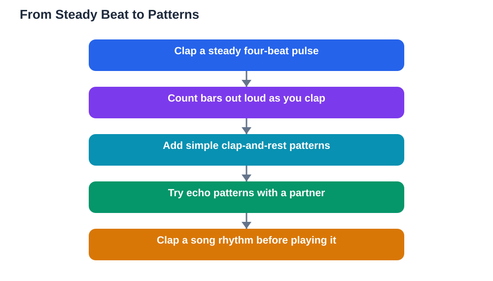

Rhythm clapping exercises are one of the best ways to build musical timing, and you do not need an instrument to start. Rhythm is simply the pattern of sounds and silences in time: the steady beat underneath a song, and the longer and shorter notes that dance on top of it. When you clap rhythms, you train your body to feel that beat and to keep it steady even when the pattern gets tricky. That skill helps with singing, playing an instrument, and reading music, because almost every musical problem is really a rhythm problem in disguise. These exercises start simple and grow gently, so you can build confidence one pattern at a time.

## Rhythm Clapping Exercises: Start With a Steady Beat

Every rhythm exercise begins with a steady beat, like the ticking of a clock. Sit comfortably, tap your foot gently, and clap once on every beat while counting one, two, three, four, then repeating. Keep the claps even, with no rushing and no slowing down. If you have a metronome app or a ticking clock, use it at a slow, comfortable speed to keep yourself honest. Once a steady four-beat pattern feels easy, try clapping on every beat while counting in threes instead, which gives a gentle swaying feel used in many songs. The goal at this stage is not speed but steadiness: a slow, even beat is far more musical than a fast, uneven one. Practise the steady beat for a minute or two at the start of every session, because it warms up your timing the way stretching warms up your muscles.

## Bars, Beats, and Counting Out Loud

Music is grouped into bars, and each bar holds a set number of beats. In the most common pattern, each bar holds four beats, and you count one, two, three, four before the next bar begins. Counting out loud while you clap is essential at first, because it stops you from guessing and helps you feel where each bar starts. Try this: clap on beat one only, then rest for beats two, three, and four, and repeat. Then clap on beats one and three. Then clap on all four beats. Each version teaches you to place your claps exactly on the beat rather than somewhere near it. When that feels solid, try clapping twice as fast for one bar, with two even claps inside a single beat, then return to one clap per beat. Saying the counts aloud, even in a whisper, keeps your timing anchored while your hands learn the new pattern.

## Easy Patterns You Can Clap Today

Once the steady beat is comfortable, patterns make practice fun. Start with a simple pattern: clap, clap, rest, clap, repeated over four beats. Then try clap, rest, clap, clap. Then try two quick claps followed by one long clap, keeping the total length of each bar the same. The trick is to keep the underlying beat going in your foot or in your head while your hands play the pattern, so the pattern sits on top of the beat instead of replacing it. Another good exercise is echo clapping: one person claps a short pattern and the other repeats it exactly, like a musical conversation. Start with patterns of four beats, then stretch to eight beats as you improve. Echo games build listening as well as timing, because you must hear the pattern clearly before you can repeat it. If a pattern feels hard, slow it right down, count it out loud, and build the speed up gradually.

## Clapping Rests, Accents, and Longer Patterns

Rests are silences, and they are just as important as sounds. A pattern with a rest in it, such as clap on beat one, silence on beat two, clap on beats three and four, teaches you to keep counting through the silence instead of rushing to the next sound. Practise by holding your hands still during the rest but keeping the count going in your head, so the silence lasts exactly one beat. Accents add shape: clap the first beat of each bar a little louder, and the other beats more softly, and you will hear the bar structure clearly. Longer patterns come from joining two short patterns together, for example a four-beat pattern followed by a different four-beat pattern, making an eight-beat phrase. Practise each half separately, then join them, and keep the beat steady across the join. If you stumble, go back to the slower speed and rebuild. Steady progress beats fast, sloppy attempts every time.

## Turning Clapping Into Playing and Singing

Clapping is not just a warm-up; it is a direct preparation for playing and singing. Before you learn a new song or piece, clap its rhythm while counting, and only then add the notes or words. You will find that the notes fall into place much more easily when the rhythm is already in your body. Try clapping the rhythm of a song you know well, then singing it while tapping the beat on your knee. Notice how the words line up with the beats, and where the longer notes stretch across more than one beat. You can also use clapping to fix a tricky bar in a piece: take the bar out, clap it slowly until it feels natural, then play it. When you practise this way, you are building a skill that transfers to every instrument and every song. For a routine that includes rhythm work every day, see [A Music Practice Routine Students Keep](/blog/music-practice-routine-students.html). And if you use AI tools for study help, remember to verify solutions against your textbook, since AI can make mistakes.

## AI Help: Muse AI

Muse AI is Meta's personal AI assistant, and it can help you practise rhythm in a fun way. You can ask it to suggest new clapping patterns at your level, or to explain bars and beats in simple language you can follow while you practise.

Join Muse with invite code LTGSWD — in the Muse app, go to Settings > Redeem token and enter the code.

Disclosure: LTGSWD is the author's Muse invite code.

## FAQ

### Do I need an instrument to practise rhythm?

No. Your hands, feet, and voice are all you need. Clapping, tapping, and counting build the timing skills that every instrument relies on, so starting without an instrument is a real advantage.

### What if I keep speeding up when I clap?

That is very common. Slow down, count out loud, and tap your foot on every beat. A metronome or a steady ticking sound can help you hear when you rush, and practising slowly is the fastest way to fix it.

### How long should I practise clapping each day?

A few focused minutes are enough, especially when you are starting. Five minutes of careful clapping beats a long, careless session, and you can add time as patterns become easier.

### Can clapping really help me play an instrument better?

Yes, because timing problems cause most beginner mistakes. When your body already knows the rhythm, your fingers or voice only have to handle the notes, which makes learning a piece much smoother.

### What is the difference between beat and rhythm?

The beat is the steady pulse underneath the music, like footsteps. Rhythm is the pattern of longer and shorter sounds played on top of that pulse. Clapping exercises train you to feel both at the same time.

## Conclusion

Good rhythm starts with a steady beat, grows through simple patterns, rests, and accents, and becomes a tool you use before you play or sing anything new. Keep your practice slow, count out loud, and enjoy the feeling of a pattern clicking into place. For help with your school work and study questions, [Try the free AI lesson solver](/#tool).
