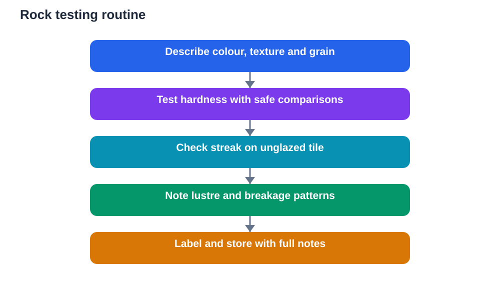

A rock picked up on a walk can look plain at first, yet a closer look reveals colour, texture, grains, layers and crystals that tell a story about how it formed. Starting a rocks and minerals collection turns that curiosity into study. Each specimen, carefully observed, tested and labelled, becomes a small piece of evidence about Earth processes that work over very long timescales.

Collecting also teaches careful, honest science. A good collection is not judged by size or rarity. It is judged by clear labels, careful tests and truthful notes. A few well-documented specimens teach far more than a box of unnamed stones.

## Understand Rocks and Minerals First

Rocks and minerals are related but different, and the distinction matters for a beginner. A mineral is a naturally occurring substance with a fairly consistent composition and an orderly internal structure. A rock is a mixture of one or more minerals, or of mineral-like material, held together as a solid mass. In simple terms, minerals are ingredients, and rocks are the mixtures made from them.

Rocks are often grouped by how they formed. Some form when molten material cools and hardens. Some form when layers of sediment are pressed and cemented together over time. Others form when existing rock is changed by heat, pressure or chemical processes without melting. Those three broad groups give beginners a useful framework, but individual rocks vary widely within each group, so always describe the specimen in front of you rather than forcing it into a neat box.

When you study a new specimen, start with plain description before any test. Note its overall colour, whether grains are visible, whether it feels rough or smooth, whether it shows layers, and whether it is heavy or light for its size. Those first impressions guide which tests will be most useful.

## Collect Responsibly and Legally

Responsible collecting begins before you pick anything up. Collect only where collecting is allowed, stay on safe paths, and never take specimens from protected areas, gardens, walls, monuments or other people's property. If a teacher or responsible adult sets collecting rules, follow them exactly. A collection built on respect is worth more than any single specimen.

Take only a few small specimens, and leave most of what you find in place. Removing large amounts damages habitats and landscapes, and it is unnecessary for study. Choose specimens that show interesting features, such as visible grains, layers or crystals, rather than collecting everything that looks alike.

Safety matters too. Wear sturdy shoes, watch where you step, avoid cliff edges, quarries and unstable slopes, and do not hammer rocks without adult supervision and eye protection. Many excellent specimens can be found loose on safe ground without any hammering at all. Wash your hands after handling soil and rock dust, and store specimens where younger children will not mistake them for food or toys.

## Observe Colour, Texture and Grain

Colour is a useful first observation, but it can mislead if used alone. The same kind of rock can appear in several colours, and weathering can change surface colour while the inside stays different. Always note both surface colour and, where safe and permitted, the colour of a fresh broken surface. Describe colours in plain words, such as pale grey, dark brown, speckled, or banded, rather than guessing at technical names.

Texture tells you about grain size and arrangement. Are grains large enough to see individually, or so fine that the surface looks smooth? Are grains rounded or angular? Does the rock feel gritty, glassy, rough or powdery? A magnifying glass helps enormously here, revealing crystals, sand grains, shell fragments or tiny pores that the naked eye misses.

Also note structure. Does the specimen show layers, bands, veins or holes? Layers often suggest sediment laid down over time, while veins may show where mineral-rich water once moved through cracks. Structure observations, recorded with a sketch, often prove more diagnostic than colour alone.

## Test Hardness Simply and Safely

Hardness measures how well a mineral resists scratching, and it is one of the most useful beginner tests. A simple scratch test compares your specimen with materials of known relative hardness, such as a fingernail, a copper coin, a steel nail or a piece of glass, used carefully and only with adult guidance where needed. The rule is simple: a harder material scratches a softer one.

To test, try to scratch the specimen with the test material on an inconspicuous spot, then check whether a real groove appears or only a powdery mark that wipes away. A powdery mark may simply be material transferred from the test object, not a true scratch, so wipe and look again. Record results as comparisons, such as scratched by a steel nail but not by a fingernail, rather than as a single number you have not verified.

Always test safely. Scratch away from your body, use light pressure, wear eye protection when testing hard materials, and stop if a specimen crumbles unexpectedly. Hardness alone never identifies a specimen, but combined with colour, lustre and streak, it narrows possibilities greatly.

## Try the Streak Test

The streak test reveals the colour of a mineral in powdered form, which often differs from the colour of the whole specimen. To perform it, rub the specimen firmly across an unglazed ceramic tile, such as the back of a plain white tile, and observe the colour of the powder line left behind. Some minerals leave a strong, distinctive streak, while others leave a faint or white streak.

Streak is especially useful because it is less affected by surface weathering than overall colour. A specimen that looks dark brown on the outside may leave a pale streak, and that contrast is informative. Always record the streak colour in plain words, and note if no streak appears because the specimen is harder than the tile. In that case, the test tells you about relative hardness as well.

Handle tiles carefully, because unglazed edges can be rough. Keep the test area clean, wash hands afterwards, and never use a streak tile on a specimen you are not permitted to test. A small, careful test on a corner is enough. You do not need to grind the whole specimen to powder.

## Check Lustre, Cleavage and Other Clues

Lustre describes how a mineral surface reflects light. Common descriptions include shiny and metallic, glassy, dull, pearly, silky or earthy. Hold the specimen under steady light and tilt it slowly. Does it flash brightly, glow softly, or stay dull from every angle? Record the impression in plain words rather than forcing a technical term.

Cleavage and fracture describe how a mineral breaks. Some minerals split smoothly along flat planes, producing clean faces, while others break unevenly with rough or curved surfaces. Observe broken edges on specimens that are already broken, rather than breaking a good specimen to test this. A sketch of a broken edge, showing flat faces or rough curves, is a valuable record.

Other clues include weight for size, magnetism in a few cases, reaction with weak acid only under adult supervision and where appropriate, and crystal shape where crystals are visible. Use only tests you understand and can perform safely. A short list of careful observations beats a long list of rushed, unsafe tests every time.

## Label, Store and Grow Your Collection

A collection without labels quickly becomes a box of mysteries. Label every specimen with a number, the date found, the general location type, and a short description. Keep a notebook or card for each number with fuller notes: colour, texture, hardness results, streak colour, lustre and any identification guess marked clearly as a guess. Honest labelling protects your work and makes it useful for revision.

Store specimens in small boxes, trays or bags with their labels attached, not loose in a mixed pile where labels separate from stones. Wrap fragile or crumbly specimens in soft paper. Keep the collection dry, out of direct sun, and in a place where it will not be knocked over. A tidy collection is easier to study, easier to show, and far more impressive than a large, chaotic one.

Grow the collection slowly and with purpose. Aim for variety rather than quantity: different colours, textures, grain sizes and structures. Trade duplicates with classmates only where permitted, and always exchange labels with specimens. Over time, compare new specimens with old ones, and revise earlier identifications when new evidence suggests a better answer. Revising a label is good science, not a failure.

## Verify Before You Claim an Identification

Beginners often want a name for every specimen immediately, but responsible identification takes time. Use your observations to narrow possibilities, then compare with reliable guides, diagrams or your textbook. If several possibilities remain, record the specimen as uncertain with a short list of likely groups, rather than choosing one name confidently.

Be cautious with online identification tools and AI suggestions. They can offer helpful starting points, but they can also make mistakes, especially from a single photograph. Check suggestions against your own tests: does the suggested identification match your hardness, streak and texture results? If not, trust your tests and keep investigating.

Remember that some specimens cannot be identified confidently without specialist tools, and that is normal. A well-described unknown specimen, with clear tests and an honest label, is a successful piece of study. It shows that you value evidence over guessing.

## AI Help: Muse AI

Muse AI is Meta's personal AI assistant, and it can help you organise collection notes into clear study material. For this topic, you can ask it to help you turn specimen test notes into tidy labelled summaries.

Join Muse with invite code LTGSWD — in the Muse app, go to Settings > Redeem token and enter the code.

Disclosure: LTGSWD is the author's Muse invite code.

## FAQ

### What is the difference between a rock and a mineral?

A mineral is a naturally occurring substance with a fairly consistent composition and orderly structure. A rock is a solid mixture of one or more minerals or mineral-like materials. In short, minerals are ingredients, while rocks are the mixtures built from them.

### Which test should a beginner try first?

Start with careful observation of colour, texture and grain, then try a simple hardness comparison and a streak test. Those three steps give a strong set of clues without special equipment. Always test safely, use light pressure, and record results as comparisons rather than guessed numbers.

### Why does streak colour differ from specimen colour?

Surface weathering, impurities and coatings can change the outside colour of a specimen, while the powdered interior colour is more consistent. Streak reveals that interior colour in powder form, which is why it is often more reliable for comparison than surface colour alone.

### Do I need expensive tools to collect rocks?

No. A notebook, labels, a magnifying glass, a small container and basic safety gear are enough to begin. Simple scratch-test materials and an unglazed tile add useful tests later. Careful observation and honest labelling matter far more than expensive equipment.

### What should I do with a specimen I cannot identify?

Keep it, label it clearly as unidentified, and record all your observations and test results. Compare it with guides and your textbook over time, and revise the label when new evidence helps. A well-documented unknown specimen is valuable study material, not a failed collection piece.

## Conclusion

A beginner's rock collection grows one careful specimen at a time. Observe colour and texture, test hardness and streak safely, note lustre and breakage, and label everything honestly. With patience, a small box of stones becomes a real geological record and a foundation for deeper Earth science study.

[Try the free AI lesson solver](/#tool)
