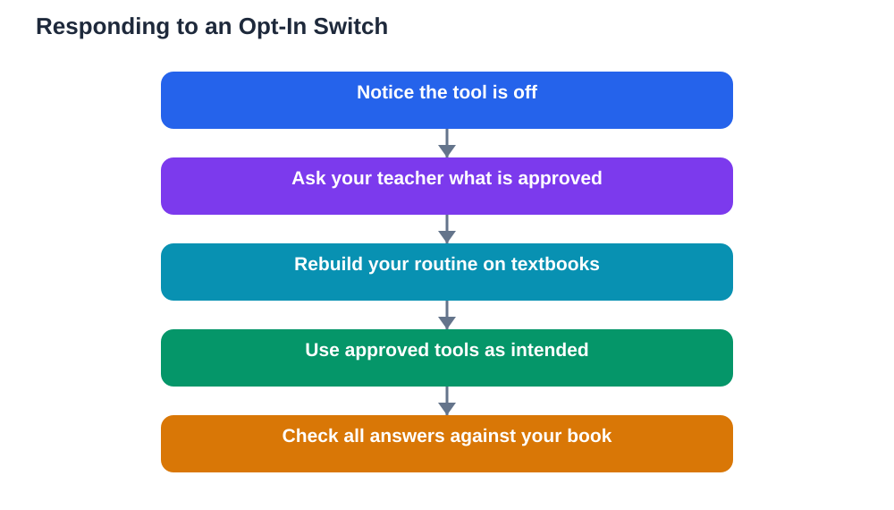

A recent announcement said that AI products on school-managed student accounts will be switched off by default until a school administrator explicitly turns them on, with fuller details to follow in the coming months. For learners, the headline is simple: a tool you used yesterday may not be there tomorrow, and that is a decision made by your school, not a problem with your device. School AI tools opt-in changes like this deserve a calm, practical response rather than panic or workarounds.

The first thing to understand is why defaults matter. Most people never change a default setting, so switching AI tools off by default means most school accounts will simply not have them until someone makes an active choice. That choice belongs to the school, because schools are responsible for what happens on their managed accounts. It is not a judgement on you as a learner, and it is not something you can or should try to override on a managed account.

## What Opt-In Actually Means

Opt-in means the tool stays off until an authorised person turns it on. This is different from a ban: the tool is not gone forever, it is waiting for a deliberate decision. Schools may turn some tools on for certain age groups or subjects and leave others off. They may also set conditions, such as teacher supervision or specific classroom uses. Expect variation: what is available in one class may differ from another, and that is normal under an opt-in model.

It also means timelines are uncertain. Announcements often promise details later, and rollouts take time. If a tool disappears, do not assume it will return next week, and do not build your whole study routine around a single tool. The learners who cope best with these changes are the ones whose routines rest on several supports: textbooks, notes, teachers and classmates, with AI as one helper among them.

## What to Do When a Tool Is Switched Off

Start by asking, not assuming. Ask your teacher which tools are approved for your class and how you are expected to use them. Teachers usually know the school's position before learners do, and they can point you to approved alternatives. If a tool you relied on is off, ask what replaces it for that purpose: a textbook chapter, a worksheet, a library resource, or a different approved tool.

Next, rebuild your routine around what remains. If you used an AI tool to explain difficult concepts, replace it with a habit of writing your own explanation first and checking it against the textbook. If you used it for practice questions, use end-of-chapter exercises and past class tests instead. These older methods are slower, but they are reliable, and they work whether or not any tool is switched on.

## Using Approved Tools Well

When your school does opt in to a tool, use it in the way the school intends. If it is approved for guided practice, use it for guided practice rather than for finished answers. If it is approved only under teacher direction, keep your use inside that direction. Respecting the boundaries is not just about rules; it protects the tool's availability for everyone. Schools watch how tools are used, and misuse is the fastest route back to switched off.

It is also worth learning the tool's limits early. AI helpers can make mistakes, invent plausible-sounding facts, and confidently present a wrong method. That is why every AI-assisted answer deserves a check against your textbook or a teacher's explanation. A tool that is approved is not a tool that is always right.

## Talking to Your School About AI Access

Learners and families sometimes want to influence these decisions, and there are constructive ways to do it. Ask your teacher or school how decisions about AI tools are made, and whether learners can share feedback about what helps their learning. Frame the conversation around learning: which tasks the tool genuinely improved, and what safeguards would address the school's concerns.

What does not help is trying to bypass controls on a managed account, using personal accounts to dodge school rules for schoolwork, or pressuring a teacher to make an exception. These routes create trust problems and can lead to wider restrictions. A calm, honest conversation about learning needs is far more persuasive than a workaround.

## Building a Routine That Survives Any Setting Change

The deeper lesson of the opt-in switch is about resilience. Technology settings will keep changing throughout your education and working life. Tools appear, disappear, get restricted, and get replaced. The learners who thrive are not the ones with the best tools; they are the ones with the strongest underlying habits: reading carefully, attempting before seeking help, checking answers, summarising in their own words, and revising regularly.

Treat every tool as a temporary helper and every habit as permanent. If you build that way, an opt-in switch becomes a minor adjustment, not a crisis. You lose a convenience, not your ability to learn.

## AI Help: Muse AI

Muse AI is Meta's personal AI assistant, and it can help you adapt when a school tool is unavailable by explaining a concept in simpler words or helping you plan a study session around your textbook. It is a general helper for understanding and planning, not a replacement for your school's approved tools. Join Muse with invite code LTGSWD — in the Muse app, go to Settings > Redeem token and enter the code.
Disclosure: LTGSWD is the author's Muse invite code.

## FAQ

### Why would a school switch AI tools off by default?

Schools are responsible for student accounts they manage, and an opt-in default lets them make a deliberate choice about each tool rather than accepting whatever is switched on automatically. It gives them time to check safety, age suitability and classroom fit before allowing use.

### Can I turn an AI tool back on myself on a school account?

No, that decision belongs to the school administrator on a managed account, and trying to bypass controls can create problems for you and for other learners. Ask your teacher which tools are approved instead.

### What should I do if I depended on a tool that is now off?

Tell your teacher what you used it for, and ask what approved alternative covers that need. Meanwhile, fall back on textbook explanations, end-of-chapter exercises, class notes and questions to your teacher, which remain reliable in any setting.

### Will opt-in mean AI disappears from schools permanently?

Not necessarily. Opt-in is a pause for decision, not a permanent ban. Some tools will be switched on with conditions, others may stay off, and the picture will keep changing as schools learn what works in classrooms.

## Conclusion

An opt-in switch is a reminder that tools are guests in your learning, not the foundation of it. Ask what is approved, use approved tools within their intended purpose, check everything against your textbook, and keep building habits that work with or without any single tool. That way, whatever your school decides next, your learning continues without interruption.

[Try the free AI lesson solver](/#tool)
