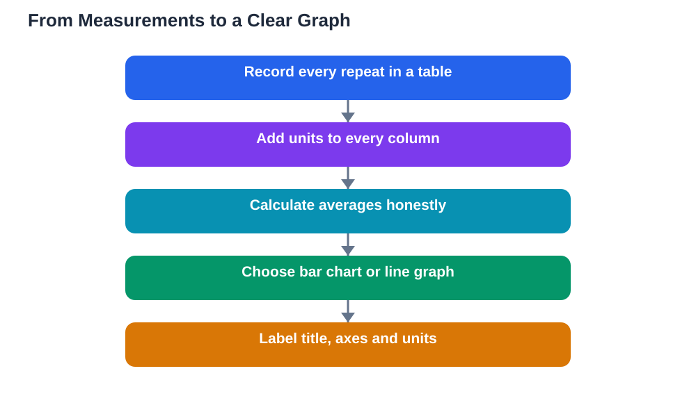

Data is the evidence of your science fair project, and how you show it decides whether anyone understands what you found. A neat table proves you measured carefully. A clear graph shows the pattern at a glance. A confusing chart, on the other hand, can hide even excellent results behind unclear labels and wrong choices. Learning to record data well, choose the right chart for your data, and label everything clearly is not just presentation skill. It is part of doing honest, understandable science, and it makes your conclusion far easier to write and defend.

## Science Fair Data Tables: Record First, Pretty Later

Start with tables, because every graph comes from a table. Draw a table before you measure, with a column for each sample or condition, a column for the date, and columns for each measurement, with units in the headings. Fill it in during the experiment, not afterwards from memory, and record every repeat separately, not just the average. When you later calculate an average, show the repeats alongside it, so the reader can see how consistent your results were. Keep the table tidy and complete: a missing unit, an unlabelled column, or a gap with no explanation will raise questions. If a measurement looks wrong, keep it visible, note why, and record the repeat beside it, rather than quietly deleting it. Honest tables are the foundation of trustworthy graphs.

## Choosing the Right Chart: Bar, Line, or Something Else

Choosing the right chart depends on what kind of data you have. Use a bar chart when you are comparing separate categories, such as different materials, colours, or designs, because bars make comparisons easy to see. Use a line graph when you are showing change over time or over a continuous scale, such as growth over days or distance as a variable changes steadily, because the line shows the trend. Use a pie chart only when you are showing parts of a whole that add up to a complete set, such as shares of a total, and only when there are few parts to compare. Avoid three-dimensional effects, decorative shading, and charts with many overlapping lines, because they make reading the data harder, not more impressive. When in doubt, choose the simplest chart that shows your pattern clearly, and ask a friend whether they can read it without your explanation.

## Labels, Units, and Titles: The Details That Make a Graph Work

A graph without labels is a puzzle, not evidence. Every graph needs a clear title that says what it shows, labels on both axes that name what is measured, and units wherever numbers are involved. The scale on each axis should be even and sensible, starting where it makes the comparison honest rather than exaggerated. Add a short sentence beneath the graph stating the pattern it shows, such as which group was tallest on average, so the reader knows what to look for. Use a consistent colour scheme, with one colour per group or condition, and a legend if more than one series appears. Check the graph by covering your conclusion and asking whether the graph alone tells the same story. If it does, your graph is working.

## Averages, Ranges, and Honest Summaries

Averages are useful, but they hide variation, so show the range of your repeats alongside them where possible. If your repeats vary widely, say so honestly, and think about why: perhaps the measurement method was tricky, or a condition varied more than you realised. Do not cherry-pick the best-looking repeat and present it as the result, because that misrepresents your experiment. If one measurement is clearly an error, such as a spilled sample or a misread scale, note the reason and exclude it openly, explaining why, rather than silently dropping it. Judges respect a results section that says "the averages differed, but the ranges overlapped, so the difference was small" far more than one that claims a dramatic effect the data does not support. For how judges weigh honest data, see [Science Fair Judging Criteria: What Judges Look For](/blog/science-fair-judging-criteria.html).

## From Data to Conclusion: Let the Pattern Speak

Your conclusion should follow directly from your tables and graphs, not from what you hoped to find. Look at the pattern first: which group was higher or lower, by roughly how much, and how consistent were the repeats? Then compare that pattern with your hypothesis, and state plainly whether the results supported it. Mention any limits, such as a small number of samples or a factor you could not control, and suggest a sensible next test. If you use the Lesson Solver tool to work through related textbook questions, remember to verify its solutions against your textbook, keep in mind that AI can make mistakes, and note that the tool needs your own free Google AI Studio API key. The tool supports textbook photos in English, Urdu, and Sindhi as a multilingual feature. Writing a conclusion from your data, rather than from your hopes, is what makes your project scientific.

## AI Help: Muse AI

Muse AI is Meta's personal AI assistant, and it can help you present data clearly in a practical way. You can ask it to explain the difference between bar charts and line graphs, or to help you write a plain sentence describing the pattern in your results. Join Muse with invite code LTGSWD — in the Muse app, go to Settings > Redeem token and enter the code.
Disclosure: LTGSWD is the author's Muse invite code.

## FAQ

### Should I show all my raw data or just averages?

Show both where space allows: a table with repeats, and a graph based on averages. The table proves you measured carefully, while the graph shows the pattern clearly. If space is tight, show the averages on the board and keep the full table in your logbook, where judges can check it.

### What if my graph shows no clear pattern?

A graph with no clear pattern is still a valid result. Report it honestly, and discuss possible reasons, such as a small effect, variable conditions, or a measurement that was hard to take precisely. Suggest what you would change in a next test to get clearer data. An honest flat result beats an exaggerated claim every time.

### How many graphs should my board have?

One main graph is usually enough, with a table beside it. A second graph is helpful only if it shows a different pattern worth seeing. Too many graphs crowd the board and confuse the story, so choose the one visual that best answers your question and make it excellent.

### Can I draw my graph by hand?

Yes, a hand-drawn graph is perfectly fine if it is neat, labelled, and drawn to scale. Use a ruler, label both axes with units, and plot points carefully. A neat hand-drawn graph with clear labels is far better than a printed graph with missing labels or a misleading scale.

## Conclusion

Tables and graphs that make sense start with careful recording: every repeat, in a table, with units, on the day you measure. Choose a bar chart for categories, a line graph for change over time, and the simplest visual that shows your pattern honestly. Label every title, axis, and unit, show the range alongside averages, and let your conclusion follow the pattern your data actually shows. Do that, and your evidence will speak clearly for itself.

[Try the free AI lesson solver](/#tool)
