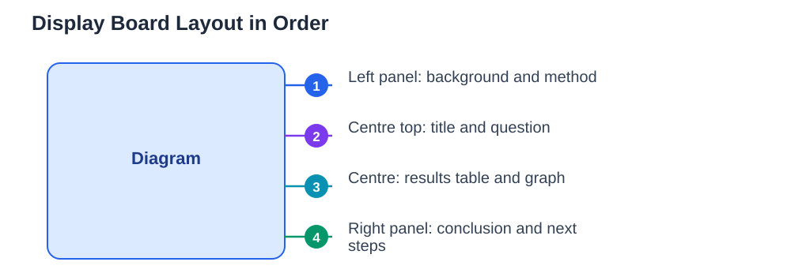

A display board is your project's first impression, and often the only part a busy visitor reads fully. Judges and visitors walk past many boards, so yours must tell the whole story at a glance: what you asked, what you did, what you found, and what it means. A board that wins attention is not the loudest or the most decorated. It is the clearest. When the layout follows the order of your investigation, a reader can follow your thinking without needing you beside the board to explain it. This guide shows how to plan that layout, what to put on each panel, and which mistakes to avoid.

## Science Fair Display Board: Plan the Story Before You Glue Anything

Start by planning on paper, not on the board itself. Sketch three panels and decide what goes where before you print or cut anything. The centre panel usually carries the most important parts: your title, your question, and your results, because it faces the viewer directly. The left panel usually carries background, your hypothesis, and your method, in the order you did the work. The right panel usually carries your conclusion, what you learned, and ideas for future work. This order matters, because readers naturally move from question to method to results to conclusion. Write short headings for each section first, then draft the text for each heading in a few clear sentences. Planning this way stops the common problem of running out of space halfway through, or squeezing the conclusion into a tiny corner.

## The Title and Question: Clear From a Few Steps Away

Your title should be readable from a distance and should say what the project is about, not just sound clever. A title such as "Does Light Colour Affect Seedling Growth?" tells a visitor the question immediately, while a vague title such as "The Amazing Plant Project" tells them nothing. Place the title at the top of the centre panel in large, neat letters, and put your research question directly beneath it. Keep the question in plain words, exactly as you investigated it, so the rest of the board clearly answers it. Avoid tiny lettering, crowded decoration around the title, and colours that make text hard to read. Dark text on a light background is almost always the clearest choice, and consistency in lettering across the board looks professional and calm.

## Method and Results: Show the Work, Show the Data

The method section should be short and practical: what you changed, what you kept the same, what you measured, and how many times you repeated it. Use numbered steps or short bullet points, so a reader can follow the procedure in order. Do not paste long paragraphs of dense text, because few visitors will read them. Your results deserve the most space on the board, because they are the evidence for your conclusion. Use a table for your measurements and a graph for the pattern, and label both clearly with titles and units. A graph that shows a pattern at a glance is worth far more than a paragraph describing the same pattern. Keep your data honest: show the results you actually got, including repeats, rather than only the neatest ones. For help choosing the right chart, see [Science Fair Data: Tables and Graphs That Make Sense](/blog/science-fair-data-tables-graphs.html).

## Conclusion and Presentation Details That Matter

Your conclusion should answer your question directly, state whether your results supported your hypothesis, and mention what you learned or would test next. Keep it to a short paragraph, because a conclusion that repeats the whole project loses its punch. Presentation details matter more than students expect. Check spelling carefully, keep headings the same style throughout, and leave breathing space between sections instead of filling every centimetre. Mount printed sections neatly, align edges, and avoid loose paper that curls or falls. If you include photos, choose a few clear ones that show the experiment in progress, with short captions explaining what the viewer is seeing. A tidy board signals careful science, while a cluttered board makes even good data look unreliable.

## Common Board Mistakes and How to Fix Them

The most common board mistake is too much text, which makes visitors walk away before they reach the results. Cut every section to its essential sentences, and move detail to your logbook, where judges can look if they want more. Another mistake is putting sections out of order, which forces the reader to jump around the board to follow the story. A third is a graph without labels, units, or a title, which leaves the viewer guessing what the numbers mean. A fourth is decoration that competes with content, such as large pictures unrelated to the experiment. Fix these by stepping back and reading the board as a stranger would: can you find the question, the method, the results, and the conclusion within a minute? If not, simplify until you can. Practising your explanation aloud also helps, and tips for that are in [Science Fair Presentation: Explaining Your Project](/blog/science-fair-presentation-tips.html).

## AI Help: Muse AI

Muse AI is Meta's personal AI assistant, and it can help you plan a display board in a practical way. You can ask it to help you shorten a long paragraph into clear headings, or to suggest a logical order for your board sections. Join Muse with invite code LTGSWD — in the Muse app, go to Settings > Redeem token and enter the code.
Disclosure: LTGSWD is the author's Muse invite code.

## FAQ

### How much text should go on a display board?

Less than most students expect. Each section needs only a few clear sentences, with headings doing much of the work. Detailed notes belong in your logbook, not on the board. If a section takes more than a short paragraph to explain, try cutting it to its main point and one supporting detail.

### Should the board be colourful?

Colour helps when it guides the reader, such as consistent heading colours or a graph with clear colours. It hurts when it makes text hard to read or distracts from the data. Use a small set of colours consistently, keep text dark on light backgrounds, and let your results, not decoration, be the brightest part of the board.

### Where should my graph go?

Put your main graph in the centre panel, near your results, where it is visible from the front. Label it with a title, axis labels, and units, and add one sentence beneath it stating the pattern it shows. A graph hidden on a side panel or without labels loses much of its value.

### Can I include photos on my board?

Yes, a few clear photos of your experiment in progress add credibility and interest. Choose photos that show the setup or measurement clearly, add short captions, and keep them neat and flat. Avoid blurry photos, photos of people posing without context, and so many photos that they crowd out your results.

## Conclusion

A display board that wins attention is a board that tells a clear story in order: a readable title and question, a short method, honest results shown in a table and a graph, and a conclusion that answers the question. Plan the layout on paper first, keep text short, label every visual, and leave space for the board to breathe. Do that, and visitors and judges will understand your project in a glance, and want to learn more.

[Try the free AI lesson solver](/#tool)
