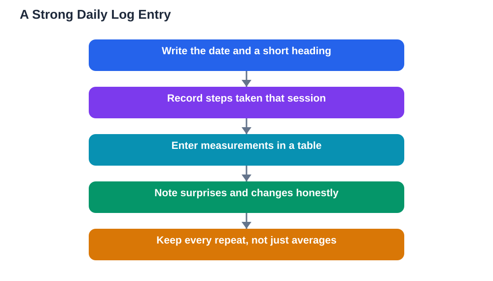

An experiment log is the honest record of everything you did, when you did it, and what actually happened. It is the difference between a project you remember vaguely and a project you can prove. Judges take logbooks seriously, because a careful log shows that measurements were really taken, repeats were really done, and surprises were noticed rather than hidden. It also protects you: when you forget a detail weeks later, your log remembers it. Keeping a good log is not extra work on top of your project. It is part of doing the project properly, and it makes writing your board and conclusion far easier at the end.

## Science Fair Experiment Log: What Belongs in It

Your log should open with your question, your hypothesis, and a list of materials, so anyone reading it can understand the project from the start. After that, every work session gets a dated entry: the date, what you did, the conditions, the measurements you took, and anything you observed. Record numbers with their units, such as centimetres or millilitres, and record them at the time you measure, not later from memory. Include the small details that seem unimportant at the time, such as room temperature, light conditions, or a change in setup, because those details can explain surprising results later. If you use the Lesson Solver tool for related textbook questions, remember to verify its solutions against your textbook, keep in mind that AI can make mistakes, and note that the tool needs your own free Google AI Studio API key.

## Dated Entries: Write It the Day You Do It

The single most important habit in logging is writing entries on the day of the work, not days later. Memory smooths over details and invents order where there was none, so a log written from memory is unreliable even when you mean well. Keep the logbook beside your experiment, and write the entry before you tidy up. Start each entry with the date and a short heading, such as "Day 5: measuring seedling heights", then record the steps you took and the numbers you found. If you repeat a measurement, record every repeat, not just the average, because the spread of repeats shows how consistent your results are. A dated, same-day entry is believable in a way that a reconstructed summary never is, and judges notice the difference.

## Measurements: Neat, Complete, and in Tables

Measurements belong in tables, not scattered through paragraphs, because tables make patterns and mistakes easy to spot. Draw a simple table for each measurement, with columns for the sample, the date, and each measurement, and fill it in during the experiment. Always include units in the column headings, and write numbers clearly enough that you can read them weeks later. If you estimate a reading, note that it is an estimate. If a measurement seems wrong, do not erase it or replace it quietly. Cross it out with a single line, note why you think it was wrong, and record the repeat measurement beside it. This honest handling of mistakes shows scientific integrity, and it keeps your data trustworthy. For help turning these tables into clear visuals, see [Science Fair Data: Tables and Graphs That Make Sense](/blog/science-fair-data-tables-graphs.html).

## Surprises, Problems, and Changes: Record Them Honestly

Surprises and problems are some of the most valuable entries in a log, because they show real science happening. If a sample spills, a setup falls over, a measurement jumps unexpectedly, or you change your method, write it down plainly, with the date and what you did next. Do not hide problems to make the project look perfect, because a project with no problems recorded looks less believable, not more. When you later write your conclusion, these entries help you explain unusual results honestly instead of guessing. They also help you if you need to repeat part of the experiment, because you can see exactly what went wrong and what you changed. A log that records only successes is a story; a log that records everything is evidence.

## Using Your Log to Write the Board and Conclusion

When the experiment is finished, your log becomes the source for everything else. Your method section comes from the steps you recorded, your results table comes from your measurement tables, and your conclusion comes from comparing your results with your hypothesis. Work through the log in order, noting the key dates, the pattern in the numbers, and any surprises that matter. This is also the time to check for gaps: a missing date, an unlabelled table, or a measurement without units can often be fixed from memory if caught early, but not if discovered on the day of the fair. Keep the log itself neat enough to show, because judges may ask to see it, and a tidy, complete logbook strengthens everything else you present. For judging expectations, see [Science Fair Judging Criteria: What Judges Look For](/blog/science-fair-judging-criteria.html).

## AI Help: Muse AI

Muse AI is Meta's personal AI assistant, and it can help you keep a better experiment log in a practical way. You can ask it to suggest a simple table layout for your measurements, or to help you turn rough daily notes into clear dated entries. Join Muse with invite code LTGSWD — in the Muse app, go to Settings > Redeem token and enter the code.
Disclosure: LTGSWD is the author's Muse invite code.

## FAQ

### Should I write my log by hand or on a computer?

Either works, as long as entries are dated and written on the day of the work. A paper notebook is simple, portable, and easy to keep beside an experiment. A digital document is easier to search and back up. Choose the format you will actually use every session, and keep it in one place from start to finish.

### What if I forget to log a session?

Write the entry as soon as you remember, and mark it clearly as written later, with the actual date of the work and the date you wrote it. Do not pretend it was written on the day. An honestly late entry is far better than a gap, and it keeps your record trustworthy.

### Should I record failed attempts in my log?

Yes, failed attempts are part of real science and belong in your log. Record what you tried, what went wrong, and what you changed. These entries explain your final method, show that you solved problems, and often become the most interesting part of your story when you present.

### How detailed should each entry be?

Detailed enough that you, or someone else, could repeat the work from the log alone. Include the date, steps taken, conditions, measurements with units, and observations. A few clear sentences plus a table are usually enough; you do not need to write an essay for every session.

## Conclusion

A good experiment log is written daily, dated, and honest. It records your question and hypothesis, your materials, every measurement with units, and every surprise and change along the way. Keep it beside your experiment, write in it the same day, and never quietly erase a mistake. Do that, and your log will prove your work, explain your results, and make your board and conclusion much easier to write.

[Try the free AI lesson solver](/#tool)
