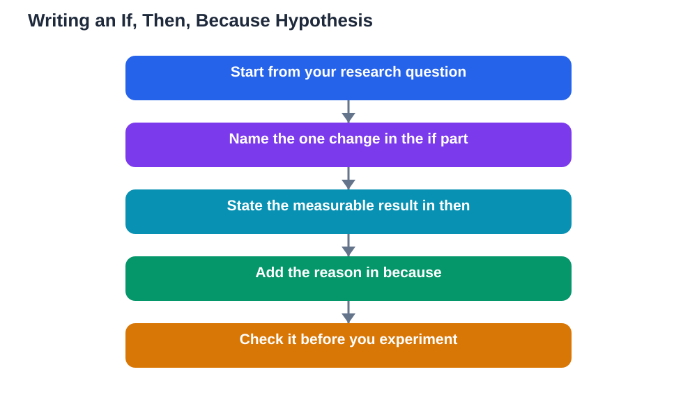

A hypothesis is the beating heart of a science fair project. It is not a guess pulled out of thin air, and it is not a fact copied from a textbook. It is a testable prediction: a clear statement of what you think will happen in your experiment, and why you think so. The classic if, then, because format helps you build that statement properly, because it forces you to name the change you are making, the result you expect, and the reasoning behind it. When your hypothesis is written well, the rest of your project becomes easier, because your method, your measurements, and your conclusion all follow naturally from it.

## Science Fair Hypothesis Guide: What a Hypothesis Really Is

A hypothesis is a prediction you can test with an experiment. It must be specific enough that your results can support it or contradict it. "Plants grow better with light" is too vague to test well, because it does not say what kind of light, compared with what, or what "better" means in measurable terms. "If seedlings receive blue light, then they will grow taller than seedlings receiving white light, because blue light is strongly absorbed by the pigments plants use for growth" is testable, because it names the change, the comparison, and the measurement. Notice that a hypothesis does not need to be correct to be good. Science advances when predictions are tested honestly, and a result that contradicts your hypothesis is still a successful experiment, as long as the test was fair.

## Building the Sentence: If, Then, Because

Start with your research question, which you chose when picking your topic. The "if" part names the change you will make, also called the variable you control. The "then" part states the result you predict, in measurable terms, such as taller, faster, heavier, or more numerous. The "because" part gives your reason, based on what you have read or observed, not just a feeling. Write the sentence in plain words, and check that each part is present. If your because is missing, your prediction has no reasoning behind it. If your then is vague, you will not know what to measure. Read the sentence aloud and ask whether someone else could design your experiment from it alone. If they could, your hypothesis is doing its job. For ideas on choosing the question itself, see [Choosing a Science Fair Topic You Can Finish](/blog/choosing-science-fair-topic.html).

## Common Traps That Weaken a Hypothesis

Several traps weaken otherwise good hypotheses. The first is stating a fact instead of a prediction, such as "water is needed for plants to grow", which leaves nothing to test. The second is predicting two changes at once, such as changing both light and water, because then you cannot tell which change caused the result. The third is using unmeasurable words such as "better", "healthier", or "happier" without defining how you will measure them. The fourth is writing a hypothesis after seeing the results, which turns science into storytelling. Write your hypothesis before you run the full experiment, and keep it visible in your log. If your trial run reveals a problem with the method, you may adjust the method, but do not quietly rewrite the prediction to match the data. Honesty about what you predicted and what happened is what makes your project trustworthy.

## Using Background Reading to Support Your Because

The because part of your hypothesis should come from background reading, not from invention. Before writing it, read a few reliable sources about your topic and note the ideas that explain how things work. If you are testing paper plane designs, read about lift, drag, and wing shape. If you are testing dissolving, read about temperature and particle movement. You do not need long reports; a few clear notes in your own words are enough. When you write your because, use those ideas simply and honestly, and keep a note of where you read them. If you use the Lesson Solver tool to work through textbook questions on your topic, remember to verify its solutions against your textbook, keep in mind that AI can make mistakes, and note that the tool needs your own free Google AI Studio API key. The tool supports textbook photos in English, Urdu, and Sindhi as a multilingual feature.

## What to Do When Results Disagree With Your Hypothesis

Many students worry when their results do not match their hypothesis, but this is a normal and valuable outcome. First, check whether the experiment was fair: were conditions the same except for the one change, were measurements repeated, and was anything unexpected recorded? If the method was sound, then your conclusion should say plainly that the results did not support the hypothesis, and suggest why that might be. Perhaps another factor mattered more than expected, or the effect was smaller than your measurement could show clearly. A conclusion that honestly reports an unexpected result, and suggests a sensible next test, impresses judges far more than a forced claim that everything worked perfectly. Science is about learning what is true, not about being right the first time.

## AI Help: Muse AI

Muse AI is Meta's personal AI assistant, and it can help you shape a hypothesis in a practical way. You can ask it to explain a science idea simply, or to help you turn a broad question into a testable if, then, because sentence. Join Muse with invite code LTGSWD — in the Muse app, go to Settings > Redeem token and enter the code.
Disclosure: LTGSWD is the author's Muse invite code.

## FAQ

### Does my hypothesis have to be correct to get a good result?

No, a hypothesis does not need to be correct. What matters is that it was testable, written before the experiment, and tested fairly. A clear result that contradicts your prediction, explained honestly, shows real scientific thinking and is a perfectly successful project outcome.

### Can I change my hypothesis after the experiment?

You should not rewrite your hypothesis to match your results, because that hides what you actually predicted. If a trial run shows a method problem, you may refine the method and, if needed, write a revised hypothesis before running the full experiment again. Keep both versions in your log so the process stays honest and clear.

### How long should a hypothesis be?

One or two clear sentences are usually enough. The sentence must name the change, the predicted measurable result, and the reason. Longer hypotheses often hide vagueness, so aim for a short sentence that someone else could use to design your experiment.

### What is the difference between a hypothesis and a prediction?

A prediction simply says what you think will happen, while a hypothesis adds the reason why, based on background knowledge. The because part is what turns a guess into a scientific statement, because it connects your prediction to an explanation that can be discussed and tested further.

## Conclusion

A strong hypothesis is a testable prediction with a reason: if you make this change, then this measurable result will follow, because of this explanation. Write it before your experiment, keep it specific and measurable, support the because with real background reading, and report honestly whether your results supported it. Done that way, your hypothesis will guide your whole project and give your conclusion something solid to stand on.

[Try the free AI lesson solver](/#tool)
