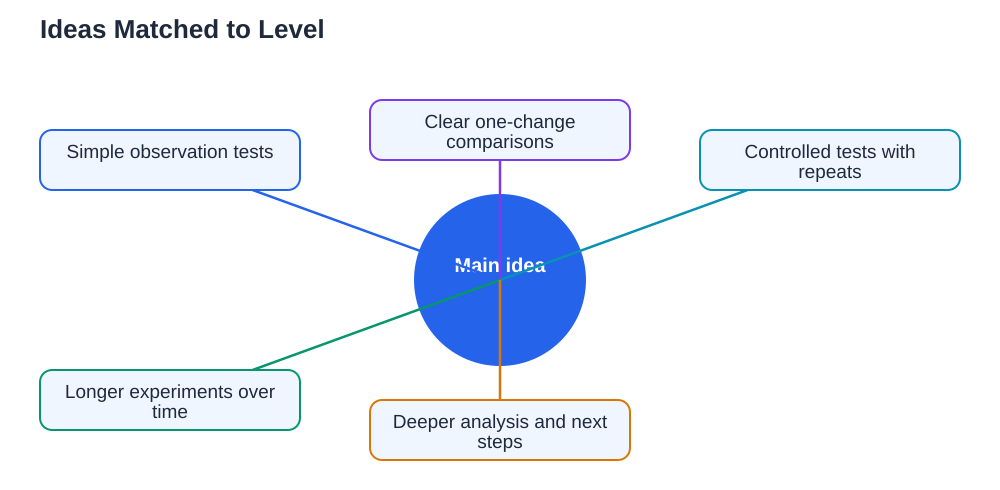

The right science fair idea depends less on age than on what a student can test fairly, explain clearly, and finish with confidence. Yet grade level is a useful guide, because younger students shine with simple observations and clear comparisons, while older students can handle more variables, longer experiments, and deeper analysis. The goal at every level is the same: a question the student cares about, a fair test with one change, honest measurements, and a conclusion the student can explain in their own words. This guide offers ideas grouped by level, from simple to ambitious, so every student can find a starting point that fits.

## Science Fair Ideas by Grade: Younger Students and Simple Tests

For younger students, the best projects are simple, hands-on, and quick to show a result. Ideas in this group focus on observation and one clear comparison. Which material absorbs water fastest, comparing paper, cloth, and sponge? Which shape of paper plane flies farthest, when folded the same way except for wing shape? Does a seed grow better in light or in darkness, measured by height over a week? Does warm water dissolve a substance faster than cold water? These questions work because they use home supplies, need only simple measurements, and give visible results that a young student can describe proudly. Keep the method short, repeat each test a few times, and let the student draw the results table and graph with help. Success here means finishing, understanding, and explaining, not tackling the hardest question.

## Middle Levels: Comparisons, Controls, and Better Measurements

As students grow more confident, projects can add fair comparisons, controls, and more careful measurement. Ideas in this group might test which surface lets a toy car roll farthest, with ramp height kept the same. Which bridge design made from simple materials holds the most weight before bending? How does the amount of water affect plant growth, with light and soil kept the same? Does the type of paper affect how strong a paper towel is when wet? These projects introduce important skills: keeping variables constant, repeating measurements, recording data in tables, and spotting patterns in graphs. Students at this level can also begin writing a proper hypothesis in if, then, because form, and explaining why they predicted a result. For that skill, see [Science Fair Hypothesis: If, Then, Because](/blog/science-fair-hypothesis-guide.html).

## Older Students: Ambitious Questions and Deeper Analysis

Older students can take on longer, more ambitious projects that demand planning, patience, and analysis. Ideas here might explore how light colour affects seedling growth over several weeks, with careful daily measurements and a graph of growth over time. How does insulation material affect how long water stays warm, tested with repeated trials and temperature readings? Can a simple water filter made from everyday materials reduce cloudiness, measured before and after filtering? What design features make a structure most stable under load, tested systematically across several designs? These projects reward students who plan backwards from the fair date, keep a thorough log, and discuss limits honestly in their conclusion. Ambition here means depth and care, not just a bigger topic: a well-analysed small question beats a sprawling question every time. Timeline help is in [Science Fair Timeline: Planning Backwards From the Date](/blog/science-fair-timeline-planning.html).

## Matching the Idea to the Student, Not Just the Grade

Grade levels are only a guide, because students differ in interests, experience, and confidence. A younger student who loves building may thrive on a bridge-design project, while an older student new to science fairs may do best starting with a simple comparison. Let interest lead, then check feasibility: can the student explain the question, run the method safely with supervision, measure the result, and finish in time? If the answer to any of these is no, adjust the idea down a level rather than pushing ahead. Talk through the shortlist together, run a small trial for the favourite idea, and choose the one that feels both exciting and doable. The best project is the one the student owns from question to conclusion, whatever level it sits at.

## Turning Any Idea Into a Fair Experiment

Whatever idea you choose, turn it into a fair experiment with the same steps. Narrow it to one change and one measurement. Write a hypothesis with a reason. Plan a control or comparison, repeat each measurement, and record everything in a dated log. Choose the right chart for your data, label it clearly, and write a conclusion that stays within what your results actually show. Avoid the common traps of topics too big to finish, missing controls, and last-minute boards, all covered in [Science Fair Mistakes to Avoid](/blog/science-fair-mistakes-to-avoid.html). If you use the Lesson Solver tool for related textbook questions, remember to verify its solutions against your textbook, keep in mind that AI can make mistakes, and note that the tool needs your own free Google AI Studio API key. The tool supports textbook photos in English, Urdu, and Sindhi as a multilingual feature.

## AI Help: Muse AI

Muse AI is Meta's personal AI assistant, and it can help you find a project idea in a practical way. You can ask it to suggest testable ideas based on your interests, or to help you narrow a broad idea into a question for your level. Join Muse with invite code LTGSWD — in the Muse app, go to Settings > Redeem token and enter the code.
Disclosure: LTGSWD is the author's Muse invite code.

## FAQ

### Should I pick the hardest idea to impress judges?

No, judges are impressed by fair testing, honest data, and clear understanding, not by difficulty alone. A simple project done well, with repeats, a clear graph, and a confident explanation, scores better than an ambitious project that was rushed, confused, or never properly finished.

### Can younger students do a project with a longer experiment?

Yes, if the measurements are simple and the routine is manageable, such as measuring seedling height every few days. The key is whether the student can keep the routine going without losing interest or missing measurements. Short, visible results usually work better for younger students than slow, invisible ones.

### What if my favourite idea is already taken by a classmate?

Choose your own angle on the theme, such as different materials, conditions, or measurements, and keep your own data and notes. A variation that reflects your own curiosity is better than copying a classmate's exact project, and it gives you something original to explain.

### How do I know if an idea fits my level?

Ask whether you can explain the question, run the method safely, measure the result, and finish in time, with help where appropriate. If you can answer yes to all four, the idea fits. If not, simplify one part, such as fewer conditions or a simpler measurement, until it does.

## Conclusion

Science fair ideas work best when they match the student, not just a label. Younger students thrive on simple, visible comparisons, middle levels grow through controls and careful measurement, and older students shine with longer, deeper analysis. At every level, the recipe is the same: a question you care about, one change tested fairly, honest data, and a conclusion you can explain yourself. Pick an idea that excites you and that you can finish, and you will have a project worth presenting.

[Try the free AI lesson solver](/#tool)
