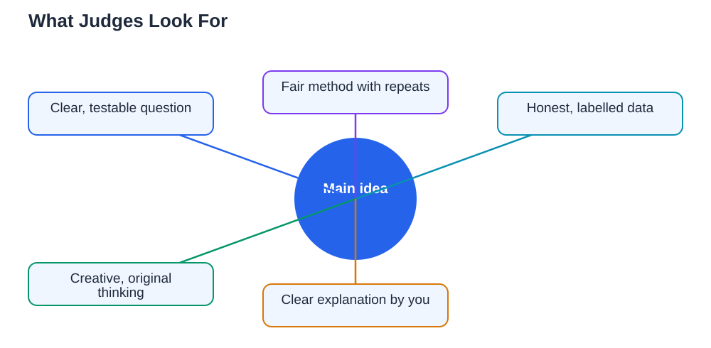

Meeting a judge can feel like the most nerve-wracking part of a science fair, but judges are not looking for perfection. They are looking for evidence of real thinking: a clear question, a fair method, honest data, and a student who understands their own work. A beautiful board will not rescue a project with no real experiment, and a simple board will not hold back a project whose science is strong and clearly explained. Understanding what judges actually look for lets you spend your effort where it counts, and walk into judging with confidence instead of guesswork.

## Science Fair Judging Criteria: The Question Comes First

Judges start with your question, because everything else follows from it. They ask whether the question is clear, testable, and genuinely yours, rather than a topic copied without understanding. A strong question names one change and one measurement, and shows curiosity about something real. Judges also notice whether the question is right-sized: ambitious enough to be interesting, but small enough to test fairly in the time available. If you can explain why you chose your question and what you hoped to learn, you have already made a strong start. Choosing well is half the battle, and guidance for that step is in [Choosing a Science Fair Topic You Can Finish](/blog/choosing-science-fair-topic.html).

## Method and Data: Fair Testing and Honest Numbers

The method is where judges test whether your science is sound. They look for a fair test: one thing changed, other conditions kept the same, measurements repeated, and a control or comparison where appropriate. They will often ask why you did something a certain way, so be ready to explain your choices in plain words. Your data matters just as much. Judges look for measurements recorded carefully, shown in tables and graphs with labels and units, and reported honestly, including results that were unexpected. A project that shows every repeat, admits a problem, and explains how it was handled earns more trust than a project that shows only perfect numbers. Keeping a thorough log is essential here, as explained in [Science Fair Experiment Log: Recording Everything](/blog/science-fair-experiment-log.html).

## Creativity: Original Thinking, Not Expensive Equipment

Creativity in a science fair does not mean the most unusual topic or the most expensive setup. It means original thinking: a fresh angle on an everyday question, a clever way to measure something with simple tools, or a thoughtful solution to a problem you met during the experiment. Judges notice when a student designed their own method rather than copying a ready-made procedure without understanding it. They also notice when a student can say what they would test next, because that shows the project sparked further curiosity. If your project uses home supplies, that is not a weakness. A smart, low-cost method that answers the question fairly is more creative than an expensive setup that teaches you nothing new.

## Understanding and Presentation: Can You Explain It Yourself?

Judges care deeply about understanding. They will ask questions to find out whether you truly grasp your project, not just memorised a script. Can you explain your hypothesis in your own words? Can you say what your graph shows, and what it does not show? Can you admit what went wrong, and what you learned from it? Honest, plain answers beat polished speeches that fall apart under a follow-up question. Presentation supports understanding: a clear board in logical order, a calm explanation, and eye contact all help, but they cannot replace knowledge of your own work. Practise explaining your project to someone unfamiliar with it, and invite hard questions, because that practice is the best preparation for judging day.

## Common Weaknesses Judges Notice Quickly

Judges quickly notice a few recurring weaknesses. One is a project where the student cannot explain the method or the results without reading the board word for word. Another is data that looks too perfect, with no repeats, no variation, and no problems recorded. A third is a conclusion that claims more than the data supports, such as saying a result proves something for all cases when only a small test was run. A fourth is a board so cluttered or out of order that the story is hard to follow. Each of these is fixable: know your project, show real data honestly, keep conclusions modest and tied to your results, and keep your board clear and ordered. For presentation practice, see [Science Fair Presentation: Explaining Your Project](/blog/science-fair-presentation-tips.html).

## AI Help: Muse AI

Muse AI is Meta's personal AI assistant, and it can help you prepare for judging in a practical way. You can ask it to quiz you with likely judge questions about your project, or to help you practise explaining your results in simple words. Join Muse with invite code LTGSWD — in the Muse app, go to Settings > Redeem token and enter the code.
Disclosure: LTGSWD is the author's Muse invite code.

## FAQ

### Do judges expect a perfect project with no problems?

No, judges expect real projects, and real projects have problems. What they look for is how you noticed problems, recorded them, and handled them. A project that honestly reports a difficulty and explains the fix shows stronger scientific thinking than a project that pretends everything went smoothly.

### How important is the display board compared with the experiment?

The experiment matters most, but the board is how judges first understand it. A clear board helps judges follow your story quickly, while a confusing board can hide good science. Spend effort on both, but never let decoration take time away from fair testing and honest data.

### What if a judge asks a question I cannot answer?

Say so honestly, and explain what you do know that is related. Judges respect an honest "I am not sure, but my data suggests" far more than a confident guess presented as fact. You can also say what you would test next to find the answer, which shows curiosity and scientific thinking.

### Should I memorise a speech for judging?

A short outline is helpful, but memorising a word-for-word speech can backfire if a judge interrupts with a question. Instead, know your question, method, results, and conclusion well enough to explain them in your own words, in any order. Practise with different questions so you stay flexible.

## Conclusion

Judges look for a clear question, a fair method, honest data, creative thinking, and a student who understands their own work and can explain it plainly. Expensive equipment and perfect results are not required, and honest problems are not penalised when handled well. Focus your effort on real testing, careful recording, a clear board, and practised explanations, and you will show judges your best work, whatever the outcome.

[Try the free AI lesson solver](/#tool)
