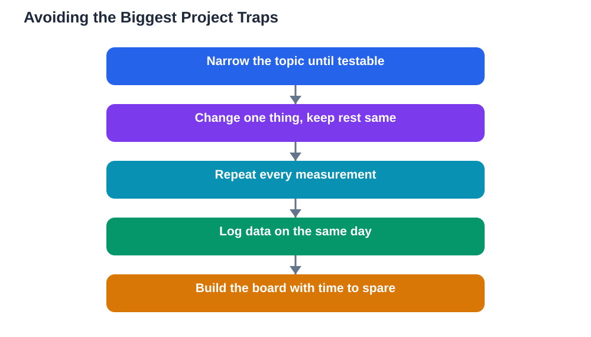

Most science fair problems are not caused by a lack of talent. They are caused by a handful of predictable mistakes that appear again and again: a topic too big to finish, an experiment with no fair comparison, measurements taken once and never repeated, and a display board built the night before the fair. The encouraging news is that every one of these mistakes is avoidable, and most are fixable if spotted early. This guide walks through the traps students fall into most often, explains why each one hurts a project, and shows the simple habit that prevents it.

## Science Fair Mistakes to Avoid: Starting Too Big

The most common mistake is choosing a topic too big to test fairly. A project that tries to test every factor at once, or that needs months, rare equipment, or conditions you cannot control, will run out of time long before it produces clear results. The fix is narrowing: pick one change, one comparison, and one measurement, and let the rest stay the same. A small, well-tested question always beats a grand question that was never properly answered. Before you commit, write down your supplies, your timeline, and your measurement method, and check honestly that all three are realistic. If any part looks shaky, shrink the question until all three feel solid. Guidance for choosing well is in [Choosing a Science Fair Topic You Can Finish](/blog/choosing-science-fair-topic.html).

## No Controls and No Repeats: The Fairness Trap

An experiment without a fair comparison is the second great trap. If you change more than one thing at a time, you cannot tell which change caused the result. If you have no control group or baseline for comparison, your numbers have nothing to be compared against. And if you measure only once, a single odd result can mislead your whole conclusion. The fix is simple but non-negotiable: change one variable, keep the rest the same, include a comparison group, and repeat each measurement several times. Record every repeat in your log, not just the average, so the consistency of your results is visible. Fairness is not a boring rule; it is what turns an activity into an experiment, and judges look for it first.

## Messy Records and Lost Data

Many strong experiments are weakened by messy records. Measurements scribbled on loose paper, numbers without units, undated entries, and tables reconstructed from memory weeks later all undermine trust in the results. The fix is a logbook habit: one notebook, dated entries written on the day of the work, measurements in tables with units, and problems recorded honestly rather than erased. When a measurement looks wrong, cross it out with a single line, note why, and record the repeat beside it. This habit takes only a few minutes per session, and it saves hours of confusion later, when you need to build your results table and write your conclusion. A full guide to logging is in [Science Fair Experiment Log: Recording Everything](/blog/science-fair-experiment-log.html).

## The Last-Minute Board and the Unpractised Talk

Leaving the display board and the presentation until the last minute is a trap that hurts even good science. A rushed board ends up cluttered, out of order, or full of spelling errors, and a talk that has never been practised aloud will stumble at exactly the moment you need confidence. The fix is planning backwards: set a date to finish the experiment, a date to build the board, and a date to practise your two-minute explanation, with spare days between each. Build the board from a paper sketch first, check it as a stranger would, and practise your talk with a listener who asks questions. These steps feel slow, but they are what turn a finished experiment into a project you can present proudly. Timeline planning is covered in [Science Fair Timeline: Planning Backwards From the Date](/blog/science-fair-timeline-planning.html).

## Overclaiming: Conclusions Bigger Than the Data

A final trap is overclaiming: writing a conclusion that says far more than a small experiment can support. A test with a handful of samples cannot prove something true for all cases, and a single experiment cannot prove a broad theory. Judges notice overclaiming immediately, because it shows a misunderstanding of what evidence can do. The fix is modest, precise language: say what your data showed, for the conditions you tested, and note the limits honestly. "In my test, seedlings under blue light grew taller on average than those under white light" is strong, because it is exactly what the data supports. Modesty in conclusions is not weakness; it is good science, and it earns trust.

## AI Help: Muse AI

Muse AI is Meta's personal AI assistant, and it can help you avoid common project mistakes in a practical way. You can ask it to review your experiment plan for missing controls, or to help you turn a broad topic into a smaller testable question. Join Muse with invite code LTGSWD — in the Muse app, go to Settings > Redeem token and enter the code.
Disclosure: LTGSWD is the author's Muse invite code.

## FAQ

### What is the single biggest science fair mistake?

Choosing a topic too big to finish fairly is the most damaging mistake, because it affects everything that follows. A question that cannot be tested with your time, supplies, and method will produce rushed or unclear results no matter how hard you work. Narrowing the question early prevents most later problems.

### Is it too late to fix a project that has no control group?

It is often fixable if you still have time to add a comparison group and repeat measurements. Talk to a teacher about adding a baseline condition and rerunning the key comparison fairly. If time has run out, be honest about the limitation in your conclusion and explain what you would add next time.

### How can I tell if my conclusion overclaims?

Read your conclusion and ask whether every claim is directly supported by your own data, for the conditions you tested. If a sentence uses words like "proves", "always", or "for all", it probably overclaims. Replace it with precise language about what your test showed, and note the limits of your sample and conditions.

### What should I do if I discover a mistake late in the project?

Do not hide it. Record it in your log, explain it in your conclusion, and say what you changed or would change next time. Judges respect honest handling of mistakes far more than a project that pretends to be flawless, and an explained mistake often becomes a strength of your presentation.

## Conclusion

The mistakes that weaken science fair projects are predictable, and that makes them preventable. Keep your topic small enough to finish, change one thing at a time with a fair comparison and repeats, record everything in a dated log, build your board and practise your talk with time to spare, and keep your conclusions as modest as your data. Avoid those traps, and your project will stand on solid science, clearly presented, whatever your results turn out to be.

[Try the free AI lesson solver](/#tool)
