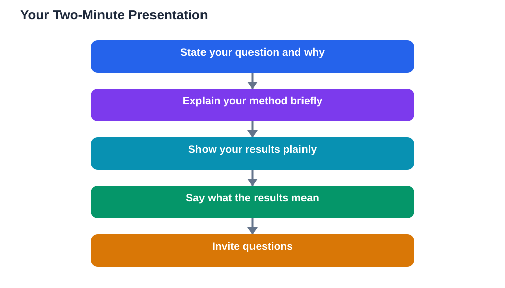

You have done the experiment, recorded the data, and built the board. Now comes the part many students dread: explaining it all to another person. The good news is that a science fair presentation does not need to be a long speech or a performance. It needs to be a short, clear story: what you asked, what you did, what you found, and what it means. Most visitors and judges will give you about two minutes before they start asking questions, so a tight two-minute version is your most powerful tool. This guide shows how to build it, practise it, and handle questions without panic.

## Science Fair Presentation: The Two-Minute Structure

Build your presentation around four sentences, then expand each one slightly. First, your question: what did you want to find out, and why did it interest you? Second, your method: what did you change, what did you keep the same, and what did you measure? Third, your result: what did your data actually show, in plain words, with the key numbers or pattern? Fourth, your meaning: did the results support your hypothesis, what did you learn, and what would you test next? Practise this structure until it feels natural, not memorised word for word. When you know the four parts in order, you can deliver them calmly even if you feel nervous, and you can jump back in easily if a question interrupts you.

## Speak Plainly and Point to Your Evidence

Plain language is your friend. Avoid long technical sentences and jargon you cannot explain, because a judge will ask what those words mean. Instead, use everyday words, and point to your board as you speak: gesture to the question, then to the method, then to the graph, then to the conclusion. Pointing gives your hands something to do, helps the listener follow your story, and shows that your claims are backed by visible evidence. Speak slowly enough that each sentence lands, and pause briefly between the four parts. If you catch yourself rushing, take a breath and slow down; a calm pace sounds confident, while rushing sounds unsure even when the science is strong. For board layout that supports this flow, see [Science Fair Display Board: Layout That Wins Attention](/blog/science-fair-display-board.html).

## Practise Out Loud, With Real Questions

Practising silently in your head is not enough, because speaking aloud feels different. Practise out loud, standing beside your board if possible, and time yourself. Aim for a version that fits comfortably in about two minutes without rushing. Then practise with a listener, such as a family member, friend, or teacher, and ask them to interrupt with questions. Common questions include why you chose the topic, why you used that method, what surprised you, and what you would do differently. Answering these in practice makes the real thing far less frightening. If you stumble in practice, that is useful: it shows you which part needs clearer wording or better understanding. Fix that part, and practise again.

## Handling Questions and Nerves Honestly

Questions are not traps; they are signs of interest, and judges ask them to learn how well you understand your work. Listen to the whole question before answering, and if you do not understand it, ask politely for it to be repeated. Answer in plain words, point to your data where relevant, and be honest about limits. Saying "my data suggests this, but I only tested a small number of samples" is a strong answer, because it shows you understand what your evidence can and cannot prove. As for nerves, they are normal, and most visitors expect them. Standing still, breathing slowly, and starting with your well-practised first sentence usually settles the nerves within seconds. Remember that the listener wants you to do well, and that a warm, honest explanation beats a flawless recital.

## The Opening and Closing Lines That Frame Your Talk

A good opening line orients your listener immediately. Try something simple, such as "My question was whether the colour of light affects how tall seedlings grow, and I wanted to find out because I grow plants at home." That one sentence gives the listener your question and your motivation. A good closing line wraps up the story: "My results supported my hypothesis, and next I would test whether the effect changes with different plant types." End by inviting questions, such as "I am happy to answer any questions." This closing signals confidence and openness, and it turns a monologue into a conversation, which is exactly what a science fair presentation should be. Judging expectations behind these conversations are covered in [Science Fair Judging Criteria: What Judges Look For](/blog/science-fair-judging-criteria.html).

## AI Help: Muse AI

Muse AI is Meta's personal AI assistant, and it can help you practise a presentation in a practical way. You can ask it to suggest likely questions about your project, or to help you shorten a long explanation into a clear two-minute version. Join Muse with invite code LTGSWD — in the Muse app, go to Settings > Redeem token and enter the code.
Disclosure: LTGSWD is the author's Muse invite code.

## FAQ

### How long should my science fair presentation be?

About two minutes for your opening explanation is ideal, covering question, method, result, and meaning. After that, the listener will usually ask questions, and the conversation continues naturally. A longer opening risks losing attention before you reach your results, which are the most important part.

### What should I do if I forget what to say next?

Pause, breathe, and look at your board. Your board is in the same order as your story, so glancing at the next heading will remind you of the next part. You can also say, "Let me show you my results," and move to the graph, which gives you a natural way back into the talk.

### Should I read from notes during my presentation?

Brief notes are fine, but reading a full script makes a presentation sound stiff and makes eye contact hard. Use a few cue words for the four parts if you need them, and aim to speak from understanding rather than from a page. Practising aloud a few times usually removes the need for detailed notes.

### How do I answer a question about a mistake in my project?

Answer honestly and calmly. Explain what happened, what you recorded in your log, and what you changed or learned. Mistakes handled openly show scientific integrity, and judges often respect that answer more than a perfect-sounding project with no problems at all.

## Conclusion

A strong science fair presentation is a short, clear story in four parts: question, method, result, and meaning. Speak plainly, point to your evidence, practise out loud with real questions, and answer honestly when you do not know something. Open with your question, close by inviting questions, and let the conversation do the rest. With that structure practised, you can explain your project with confidence to anyone who stops at your board.

[Try the free AI lesson solver](/#tool)
