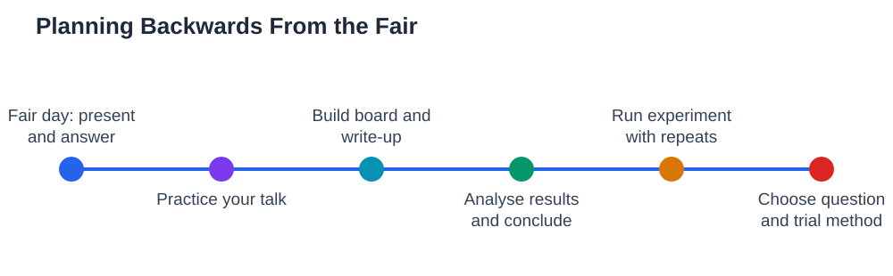

Most science fair panic comes from one cause: starting the plan from today instead of from the fair date. When you plan forwards, the experiment expands to fill all the time available, and the board, the write-up, and the practice get squeezed into the final days. Planning backwards fixes this. You start with the fair date, then work backwards, giving each stage its own block of time, with spare days built in for the surprises that every real experiment brings. The result is a calmer project, a better board, and a presentation you have actually practised.

## Science Fair Timeline Planning: Start From the Fair Date

Take your fair date and write it down, then work backwards in blocks. The last few days before the fair belong to practice and final checks, not to running the experiment. Before that comes the board and the write-up, which need unhurried days of their own. Before that comes analysing results and drawing conclusions, which needs time to think, not just to calculate. And before that comes the experiment itself, with repeats and time for a second run if something goes wrong. When you lay these blocks out backwards, you will see immediately whether your plan is realistic. If the experiment block is too short for repeats, or the board block collides with the experiment, you have found the problem early, while there is still time to adjust the question or the method.

## The Question and Research Stage: Do Not Rush It

The first stage, choosing your question and doing background reading, deserves real time, even though it can feel like you are not yet doing science. A rushed question leads to a vague hypothesis, a method that needs redesigning, and weeks of wasted effort. Give yourself time to list ideas, narrow them to testable questions, check supplies and safety, and run a small trial. Write your hypothesis and your method plan before the main experiment begins, and get a teacher or parent to look them over. This stage is also when you set up your logbook, so that from the very first session, every measurement has a proper home. A well-planned start is the cheapest time you will ever spend on the project, because it prevents the most expensive mistakes.

## The Experiment Stage: Repeats, Records, and Spare Days

The experiment stage should be the longest block, and it should include spare days. Plan for repeats from the start, because a single measurement is not enough for a fair conclusion, and plan for the possibility that one run goes wrong and needs repeating. Record measurements in your log on the day you take them, and check your tables regularly for gaps or unclear entries. If results look surprising, resist the urge to rush to a conclusion; check your method, check for a factor you overlooked, and consider whether a repeat is needed. Spare days are not wasted days. They are insurance, and projects without them are the ones that end in last-minute panic when a sample spills or a setup fails. For logging habits, see [Science Fair Experiment Log: Recording Everything](/blog/science-fair-experiment-log.html).

## Board, Write-Up, and Practice: Give Them Their Own Weeks

Once results are in, give the board and write-up their own unhurried time. Sketch the board layout on paper first, draft each section in short, clear sentences, and build the results table and graph carefully, with labels and units. Then step back and read the board as a stranger would, checking that the story flows in order from question to conclusion. After the board, practise your two-minute presentation aloud, with a listener asking questions, until the four parts feel natural. These stages are often squeezed, but they are how judges and visitors actually meet your work. A project presented clearly will always look stronger than the same science presented in a rush. Presentation tips are in [Science Fair Presentation: Explaining Your Project](/blog/science-fair-presentation-tips.html).

## When the Plan Slips: Adjust Early, Not at the End

Even good plans slip, and the skill is adjusting early. Check your progress against your timeline once a week, and if you are behind, act immediately: narrow a measurement, simplify a setup, or ask a teacher for advice, rather than hoping the lost time will reappear. Do not steal time from the board and practice stages to rescue the experiment, because that only moves the panic to the end. If a major problem appears, a smaller, well-finished project is better than a large, half-finished one. Tell your teacher early about serious problems, because they can often suggest a sensible adjustment. The goal of a timeline is not rigid perfection; it is giving you time to notice problems while you can still fix them calmly.

## AI Help: Muse AI

Muse AI is Meta's personal AI assistant, and it can help you plan a project timeline in a practical way. You can ask it to help you break a project into weekly stages, or to suggest what to do first when you are running behind schedule. Join Muse with invite code LTGSWD — in the Muse app, go to Settings > Redeem token and enter the code.
Disclosure: LTGSWD is the author's Muse invite code.

## FAQ

### How far ahead should I start planning?

Start as soon as you know the fair date, and plan backwards from it in weekly blocks. The exact number of weeks depends on your project, but the principle stays the same: give the experiment the longest block, protect time for the board and practice, and keep spare days for surprises.

### What if my experiment needs more time than I planned?

Check first whether you can simplify without harming fairness, such as reducing the number of conditions while keeping repeats. If not, talk to a teacher early about adjusting the scope. It is better to finish a smaller question well than to run out of time on a larger one.

### Should I set daily deadlines or weekly ones?

Weekly milestones work best for most students, because experiments do not always cooperate on a daily schedule. Set a clear goal for each week, such as finishing the trial run or completing all repeats, and check progress at the end of each week. Daily tasks can sit inside the weekly goal.

### How much spare time should I build in?

Build in at least a few spare days between major stages, and more if your experiment depends on living things, weather, or slow changes. Spare days feel unnecessary until something goes wrong, and then they are the difference between a calm fix and a last-minute crisis.

## Conclusion

Planning backwards from the fair date turns a stressful project into a manageable one. Give the question and research stage real time, give the experiment its longest block with repeats and spare days, protect separate time for the board and for practising your talk, and check your progress weekly so slips are caught early. A timeline is not about rigid rules; it is about making sure every part of your project gets the time it deserves, so you arrive at the fair calm, prepared, and proud of your work.

[Try the free AI lesson solver](/#tool)
