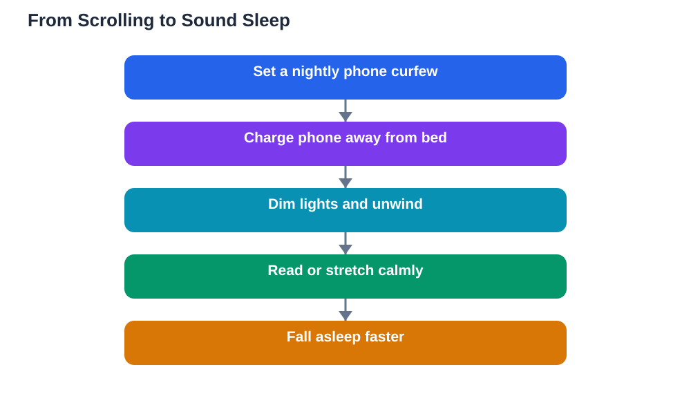

Almost every student knows the pattern: one quick check of a phone before bed turns into a long scroll, and suddenly bedtime is far later than planned. The link between screens before bed sleep problems is not about willpower alone. Screens are designed to hold attention, shine alerting light, and deliver fresh stimulation at exactly the hour when the brain needs calm. This article explains how screens steal sleep, and how a simple phone curfew can win your nights back.

## How Screens Before Bed Sleep Problems Begin

The trouble starts with light. Screens pour bright light into your eyes at close range, signalling to the brain that it is still daytime. That signal delays the brain's nightly wind-down, so drowsiness arrives later even when you feel tired. Reading on a bright screen is therefore very different from reading a paper book under a soft lamp, even when the content is the same.

The second problem is stimulation. Feeds, videos, games, and messages are engineered to keep you engaged: each swipe promises something new, each notification demands a reaction. The brain stays in alert mode, scanning and reacting, instead of slowing down. Even content that feels relaxing, like funny videos, keeps the mind active and makes the shift into sleep much harder.

## The Scroll Trap: Why One Check Becomes a Long Session

Apps are built to remove stopping points. There is always another video, another post, another reply, and no natural moment to put the phone down. When you are already tired, self-control is at its weakest, so the scroll continues far past your intention. This is not a character flaw; it is a design working exactly as intended, against your bedtime.

The cost shows up the next day. A late, screen-filled night usually means fragmented sleep, a groggy morning, and weaker concentration in class. The tiredness then makes evening self-control even weaker, creating a loop: tired students scroll more, and scrolling students sleep worse. Breaking the loop requires changing the environment, not just trying harder in the moment.

## Blue Light, Alertness and the Brain's Night Signal

Bright screen light is especially disruptive because it mimics daylight. Your internal clock uses light as its main time cue, so evening screen light confuses it, pushing the whole sleep cycle later. This is why you can feel wide awake at midnight after an evening of screens, even though you were tired at dinner time.

Night-mode settings and dimming help a little, but they do not solve the stimulation problem. A dimmed feed is still a feed, still delivering novelty and reactions. Reducing brightness is a useful step, but it cannot replace putting the screen away. The most effective change is time-based: screens off well before bed, not merely dimmer at bedtime.

## Setting a Phone Curfew That Actually Works

A phone curfew is a fixed evening time after which screens go away. Choose a time you can keep on most nights, and make it a rule rather than a nightly decision, because decisions made while tired usually go the wrong way. Put the phone on charge outside the bedroom if possible, or at least across the room and face down. Distance removes the temptation of one more check.

Replace the scroll with something satisfying. A paper book, a short journal entry, gentle stretching, or planning tomorrow's tasks all give the evening a pleasant ending without a screen. Tell friends your curfew if late messages are the trigger; most will understand, and you can answer in the morning. If homework requires a device, finish it before the curfew, and verify solutions against your textbook, since AI can make mistakes, then close the device properly.

## Reclaiming Evenings Without Giving Up Technology

A phone curfew is not anti-technology. Screens are wonderful tools during the day for learning, creating, and connecting. The point is simply to give the brain a screen-free runway into sleep. Many students find that evenings actually feel longer and calmer without the scroll, because time stops disappearing into feeds and returns to reading, hobbies, rest, and real conversation.

If you slip, do not abandon the curfew. One late night does not erase the habit; just return to the normal time the next evening. Track your mornings for a week after starting a curfew: most students notice faster sleep onset, easier waking, and better focus within days. That improvement is the best motivation to keep the curfew going.

## AI Help: Muse AI

Muse AI is Meta's personal AI assistant, and it can help with this topic by suggesting screen-free evening activities matched to your interests. Ask it to draft a simple phone curfew plan and a list of calm alternatives to scrolling before bed.
Join Muse with invite code LTGSWD — in the Muse app, go to Settings > Redeem token and enter the code.
Disclosure: LTGSWD is the author's Muse invite code.

## FAQ

### Does night mode fix the screen problem?

Night mode reduces brightness and changes screen colours, which helps a little, but it does not stop the stimulation of feeds, videos, and messages. A screen curfew, putting the device away before bed, works far better than relying on a display setting alone.

### What if my homework is on a screen?

Finish screen homework before your wind-down begins, then step away properly. Use a paper notebook for final review, and keep the device charging away from your bed. The goal is a screen-free stretch before sleep, not zero screen use all day.

### How do I stop checking messages in bed?

Charge the phone outside the bedroom or across the room, face down. If messages are urgent, they can wait until morning, and most senders understand a bedtime boundary once you mention it. A traditional alarm clock removes the last excuse for keeping the phone by the bed.

### I use videos to fall asleep. Is that harmful?

Videos may feel soothing, but they keep the brain processing new information and light, which fragments sleep even if you drift off. Try calm audio, slow breathing, or a paper book instead, and keep the room dark once you settle down.

## Conclusion

Screens do not just delay bedtime; they change how the brain prepares for sleep. Bright light, endless novelty, and constant alerts keep you wired when you need to wind down. A simple phone curfew, a charging spot away from the bed, and a calm screen-free ending to the evening can restore your sleep, your mornings, and your focus. Start tonight: pick a curfew time and stick to it.

[Try the free AI lesson solver](/#tool)
