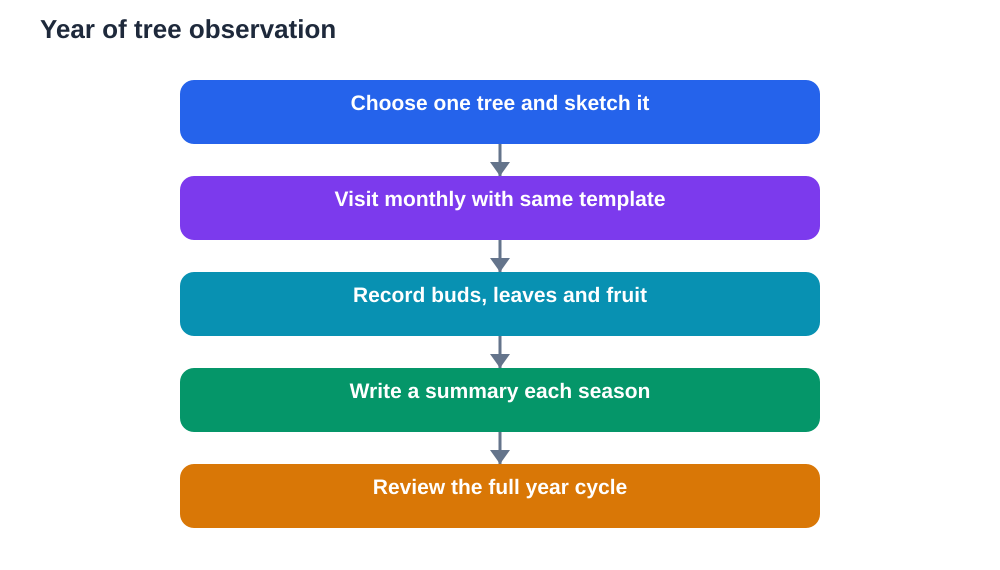

A year is easy to miss when you live it day by day. Days blur together, and slow change hides behind routine. Watching one tree through four seasons solves that problem beautifully. The same tree, visited month after month, becomes a living calendar, and its buds, leaves, fruit and bare branches mark time more vividly than any page in a diary.

Seasonal observation also builds a rare study skill: patience across a long project. Short experiments teach quick results, but a year-long study teaches commitment, regular recording and the joy of looking back over a full cycle. By the end, you will not just know that seasons change. You will have watched change happen.

## Choose Your Tree and Your Routine

Begin by choosing one tree that you can visit safely and regularly throughout the year. It should be easy to reach in different weather, visible from a safe standing point, and distinct enough to recognise in every season, even when it has no leaves. Give it a simple label in your notebook, such as Year Tree, and sketch its shape and surroundings on the first visit.

Fix a simple routine and keep it. Visit on a similar day each month, or twice a month if you can manage it, and spend a short, focused time looking, sketching and writing. Record the date, the general weather, and your main observations every time. A routine that survives busy weeks matters more than an ambitious routine that collapses after a month.

Photographs can support your notes if you take them from the same spot each time, but drawings and written notes remain the core record. A drawing forces you to look closely, while a photograph can be taken without really seeing. Use both when possible, and always label every record with its date.

## Winter Stillness and Hidden Preparation

In the coldest season, many trees look still, and beginners sometimes assume nothing is happening. Look closer. Bare branches reveal the full shape of the tree in a way leafy branches hide. You can see how branches divide, which branches are thickest, and how the tree balances its weight. Sketch that skeleton shape carefully, because it is the structure beneath every later season.

Buds are the quiet promise of winter. Examine twigs gently without breaking them. Buds may be small, pointed, rounded or sticky, and they sit in patterns worth noting. Some sit opposite each other on a twig, while others alternate along it. Record bud size, colour and position in plain words. Those details will help you recognise the same tree when leaves return.

Ground notes matter in winter too. Note fallen leaves, bare soil, frost in general terms, or new growth near the base. Winter is not empty time. It is preparation time, and a careful observer learns to respect stillness as part of a cycle rather than as an absence of life.

## Spring Awakening, Bud by Bud

Spring is the season of fastest visible change, and it rewards frequent visits. Buds swell, then open, and tiny leaves unfold over days rather than months. Try to catch the first signs: a bud growing larger, a hint of green, a first leaf fully open, or a first flower. Record the date of each first, because first dates are powerful seasonal markers.

Spring leaves are often soft, bright and smaller than summer leaves. Notice how they grow and harden over following visits. Flowers, where present, deserve careful notes too. Record their general form and colour, and note visiting insects in general terms without disturbing them. Spring is busy for wildlife, so observe quietly and keep a respectful distance.

This is also the season when comparisons become exciting. Compare this spring with your winter sketch. The same branches now carry leaves, and the tree looks fuller and softer. That contrast, recorded in your own notes, teaches seasonal change far better than a diagram alone.

## Summer Fullness and Steady Growth

In summer, the tree reaches its fullest leaf cover, and the study shifts from dramatic change to steady detail. Leaves are now mature, and you can study their shape, size, veins and edges more reliably. Compare leaves from sunny outer branches with leaves from shaded inner branches. Do they differ in size or colour? Such small comparisons train careful eyes.

Summer also brings fruit or seeds on many trees. Record their first appearance, growth and eventual fall in general terms. Note how the shade beneath the tree changes through the day, and how the ground beneath it feels cooler and damper than open ground. Those observations connect the tree to its surroundings, showing that a tree shapes its own small environment.

Heat, dry periods and storms all leave traces worth noting. After strong wind, check for fallen twigs or leaves. After dry weather, note whether leaves look wilted or curled. Always describe what you see and avoid guessing at causes beyond your evidence. Your journal is a record, not a collection of assumptions.

## Autumn Colour and Letting Go

Autumn is often the most colourful season for tree study, and it is also the most emotional. Leaves change colour gradually, often starting at the edges or on outer branches. Record the date when you first notice colour change, and track how it spreads across the tree over following visits. Different parts of the same tree may change at different speeds, which is a useful observation in itself.

Leaf fall deserves the same care. Note when leaves begin to fall in numbers, and how the ground beneath the tree changes. Fallen leaves form a layer that protects soil and feeds it as they break down, so autumn is not only an ending. It is also preparation for the next cycle. Sketch the tree as leaves thin out, and compare that sketch with your winter skeleton drawing from earlier in the year.

Fruit and seed dispersal also peak for many trees in autumn. Watch, without interfering, how seeds fall, blow or are carried away. Those quiet journeys explain how new trees begin far from their parent, and they complete the story of the year.

## Monthly Notes That Actually Show Change

Monthly notes work best when they follow the same pattern each time. Use a simple template: date, general weather, buds or leaves, flowers or fruit, bark and branches, ground beneath the tree, wildlife seen in general terms, and one personal observation or question. The same template every month makes comparison easy, because differences stand out against a steady background.

Drawings should follow a pattern too. Each month, make a small whole-tree sketch from the same viewpoint, plus one detail drawing, such as a leaf, bud or fruit. Over a year, those sketches form a flip-book of change. Even rough sketches work, because they record shape and proportion honestly.

At the end of each season, write a short summary. What changed most? What surprised you? What would you watch more closely next season? Those summaries turn twelve separate visits into one coherent study, and they make excellent material for school work and revision.

## What a Year of Watching Teaches You

A year of watching one tree teaches that change is rarely sudden or uniform. Buds do not all open on one day. Leaves do not all change colour together. Growth speeds up, slows down and pauses. That uneven rhythm is true of many natural processes, and recognising it protects you from oversimplified explanations.

It also teaches the value of long records. Memory alone would blur the dates of first buds or first colour change, but your notebook preserves them. When you look back, you can answer questions with evidence: when did change begin, how fast did it spread, and what was different this year from last? Those are the questions real researchers ask.

Remember to check general explanations against your textbook, and remember that AI tools can make mistakes. Your year of notes is a genuine local record, and that gives it real value for study and discussion.

## AI Help: Muse AI

Muse AI is Meta's personal AI assistant, and it can help you organise long-term notes into clear study material. For this topic, you can ask it to help you turn monthly tree notes into a short seasonal summary.

Join Muse with invite code LTGSWD — in the Muse app, go to Settings > Redeem token and enter the code.

Disclosure: LTGSWD is the author's Muse invite code.

## FAQ

### How often should I visit my tree?

Once a month is a good minimum, and twice a month is better during fast-changing periods. The key is regularity rather than frequency alone. A visit on a similar day each month, kept up for a full year, produces a far stronger record than many visits in one season and none in another.

### What if I start halfway through the year?

Start anyway. A half-year record still shows real change, and you can continue into the next year to complete a full cycle. Label your starting date clearly and note that the study began mid-cycle. Honest labelling keeps your record useful even when it does not cover a perfect year.

### What should I record on every visit?

Use the same short template each time: date, general weather, buds or leaves, flowers or fruit, bark and branches, ground notes, wildlife in general terms, and one question. Consistency makes comparison easy, and a question each visit keeps the study curious rather than mechanical.

### Do I need to know the name of my tree?

No. A careful record of shape, bark, leaves, buds and seasonal change is valuable without a name. Identification can come later, and your detailed notes will make it much easier. Focus first on observing well, and let naming follow observation.

### How can seasonal notes help with school study?

Seasonal notes build long-term observation, tabulation, summarising and evidence-based reasoning. They give you real local examples for topics such as growth, adaptation and cycles, and they show teachers a sustained piece of work rather than a single rushed assignment.

## Conclusion

One tree, watched for a year, teaches more about change than a dozen hurried lessons. Monthly notes, steady sketches and seasonal summaries reveal buds, leaves, fruit and bare branches as chapters in one continuous story. Choose your tree, keep the routine simple, and let the year teach you at its own pace.

[Try the free AI lesson solver](/#tool)
