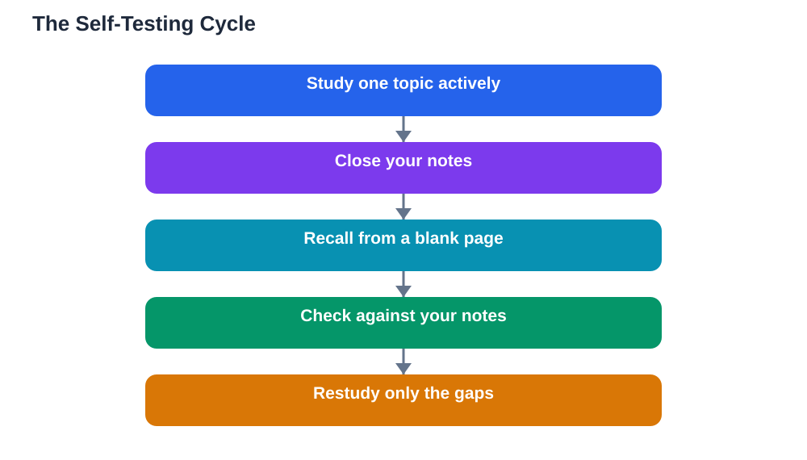

The hardest part of learning alone is knowing whether you actually learned anything. Reading a chapter feels productive, and recognising ideas in your notes feels like understanding. But recognition is a poor test. The only reliable test is recall: can you produce the idea yourself, without looking? Self-testing is the habit of checking yourself regularly, and it is one of the most powerful study methods known. It feels harder than re-reading, and that difficulty is exactly why it works. This guide shows how to self-test well, even with no teacher in the room.

## Self-Testing Learning Alone: Why Recall Beats Re-Reading

When you re-read notes, your brain recognises the material, and recognition feels like knowledge. But in a real test, or in real life, nobody shows you the notes first. You must produce the answer from memory. Self-testing practises that exact skill. Every time you try to recall an idea and succeed, the memory becomes stronger. Every time you try and fail, you learn precisely what needs more work, which is information re-reading never gives you. This is why students who self-test outperform students who only re-read, even when both spend the same time studying. The effort of recall is not a sign that you are bad at the subject; it is the mechanism that builds memory. If self-testing feels uncomfortable, that discomfort is a sign you are doing it right, not a reason to stop.

## Blank-Page Recall: The Simplest Self-Test

Blank-page recall is the simplest and most honest self-test. Take a blank page, write the topic at the top, and write down everything you remember about it, without looking at anything. Then open your notes and compare. What you remembered correctly is genuinely learned. What you missed or got wrong is your study list for the next session. Do this after studying a topic, and again a few days later, because the second test shows what survived over time. Blank-page recall works for almost any subject: explain a concept, list the steps of a method, sketch a diagram from memory, or write out key terms and their meanings. Keep your recall sessions short and focused on one topic at a time. For a related method that uses the same principle, see [Active Recall: A Study Method Explained](/blog/active-recall-study-method-explained.html).

## Use Past Questions and Make Your Own

Past questions are an excellent self-test because they show you how knowledge gets asked about, not just what the knowledge is. Work through them under honest conditions: try to answer before checking any solution, and mark yourself strictly. If past questions are not available, make your own. After studying a topic, write five questions about it, put them aside for a day, and then answer them without notes. Making questions is itself a powerful study activity, because it forces you to decide what matters in the topic. Another good method is flashcards: a question on one side, the answer on the other, tested repeatedly with the cards shuffled. Whatever format you choose, the rule stays the same: attempt first, check second. Checking before attempting turns a test into re-reading, and the benefit disappears. If you use an AI study tool to check your work, remember to verify its solutions against your textbook, since AI can make mistakes.

## Make Self-Testing a Regular Routine

Self-testing works best as a routine, not an occasional event. Build it into every study session: learn something, then test yourself on it before moving on. At the end of the week, test yourself on the week's topics again, mixing topics together rather than testing them one by one in order. Mixing topics, sometimes called interleaving, makes testing harder but builds stronger, more flexible knowledge, because you must choose the right method for each question instead of repeating the same one. Keep a simple record of your test results: which topics you recalled well, which were shaky, and which failed. This record tells you exactly where to spend your next session, so your study time goes where it is needed most. Over time, you will notice patterns, such as topics that always need a second round of testing, and you can plan for them.

## Treat Wrong Answers as Useful Information

Many students avoid self-testing because wrong answers feel bad. Reframe them: a wrong answer during practice is free information, while a wrong answer in a real test costs marks. When you get something wrong, do not just note the correct answer and move on. Ask why you got it wrong. Did you misunderstand the idea, mix it up with a similar one, forget a step, or misread the question? Each cause has a different fix: misunderstanding needs a new explanation, mixing up needs a comparison of the two ideas, forgetting a step needs more practice of the sequence, and misreading needs slower, more careful reading. Write the correct answer in your own words, then test yourself on that same item again later. A wrong answer you understand and fix is worth more than a right answer you guessed, because it closes a real gap in your knowledge.

## AI Help: Muse AI

Muse AI is Meta's personal AI assistant, and it can help you self-test by turning your notes into practice questions you can answer without looking. You can ask it to quiz you on a topic, or to explain an answer you got wrong in simple words. Join Muse with invite code LTGSWD — in the Muse app, go to Settings > Redeem token and enter the code.
Disclosure: LTGSWD is the author's Muse invite code.

## FAQ

### How often should I self-test while studying alone?

Test yourself in every study session, even briefly, and again a few days later on the same topic. Short, frequent tests beat one long test at the end of a chapter, because they catch gaps early and strengthen memory through repeated retrieval. A few minutes of recall at the end of each session is enough to start.

### Is it normal to get a lot wrong when self-testing?

Yes, especially at first, and it is a good sign rather than a bad one. Wrong answers during practice show you exactly what needs more work, while they still cost nothing. Students who get everything right during practice are often testing themselves on material they already know, which adds little new learning.

### Should I test myself before or after studying a topic?

Both have value. A quick test before studying shows you what you already know and focuses your attention on the gaps. Testing after studying checks what you actually retained. If you only have time for one, test after studying, because that measures real learning rather than prior knowledge.

### Can self-testing work for subjects that are not about memorising?

Yes. For problem-solving subjects, self-testing means solving fresh problems without looking at worked examples, which practises choosing and applying methods. For writing or language subjects, it means drafting from memory, explaining ideas aloud, or completing exercises unaided. The principle is the same: produce, don't just recognise.

## Conclusion

Self-testing is the honest mirror of independent learning. Blank-page recall, past questions, and questions you write yourself all reveal what you truly know, and what you still need to work on. Build testing into every session, mix topics together, keep a record of what is shaky, and treat every wrong answer as useful information about your next step. It feels harder than re-reading, but that effort is precisely what turns studying into lasting knowledge. The student who tests themselves regularly never has to wonder whether they are ready. They already know.

[Try the free AI lesson solver](/#tool)
