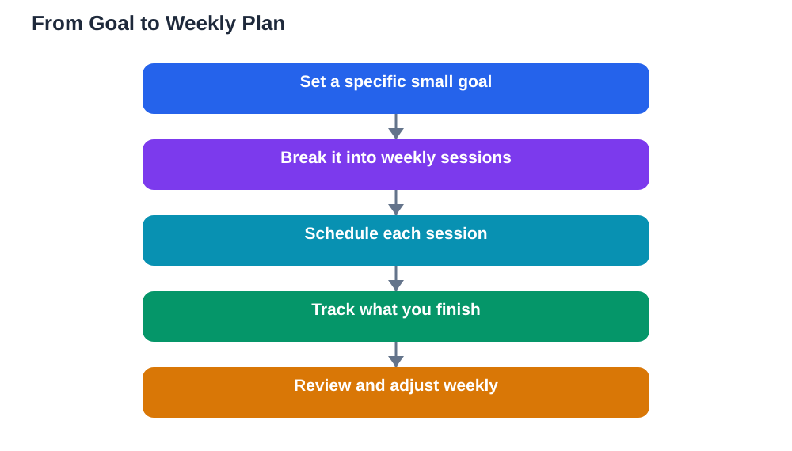

Many students set goals that sound inspiring and then quietly disappear: "I will be great at maths" or "I will study harder this term." These goals fail because they are too vague to act on. You cannot tell whether you are making progress, and you cannot tell what to do next. A goal that keeps you going is different: it is specific, small enough to finish, and reviewed regularly. This article shows how to set learning goals that survive contact with real life, including busy weeks, boring topics, and bad days.

## Setting Learning Goals Students Can Actually Use

A useful learning goal names exactly what you will learn and how you will know you learned it. Compare "I will improve at fractions" with "I will be able to add and subtract fractions with different denominators without looking at examples." The second goal tells you what to practise and when you are done. Good goals are also small. A goal that takes a whole term to finish gives you no sense of progress for months, while a goal you can finish this week gives you a win to build on. Break big ambitions into weekly goals, and weekly goals into daily actions. If your goal is to master a chapter, this week's goal might be to understand its first three sections and solve ten practice problems from them. Small goals are not unambitious; they are how big goals actually get done.

## Make Goals Specific, Small and Reviewed Weekly

Three qualities separate goals that work from goals that fade. Specific means the goal names the topic, the skill, and the proof: what you will do, and how you will check it. Small means the goal fits into your real week, with your real time and energy, not an imaginary week where nothing else happens. Reviewed weekly means you set aside a few minutes each week to look at your goals honestly: what did you finish, what is stuck, and what needs to change? A weekly review is where goals stay alive. Without it, a goal set in week one is forgotten by week three. During your review, celebrate finished goals before setting new ones. Progress you notice is progress you repeat. If a goal keeps failing week after week, do not just try harder; make the goal smaller or change the method. A goal that survives contact with your real life is a goal worth keeping.

## Turn a Goal Into a Weekly Plan

A goal without a plan is a wish. Once you set a weekly goal, break it into the sessions that will achieve it. Ask: how many sessions do I need, how long will each take, and when will they happen? Write the sessions into your week like appointments. For example, a goal of understanding three sections might become three sessions of thirty minutes, one on three different days, each ending with a short self-test. Put the hardest session at a time when you have energy, not at the end of a long day. Also plan for the week going wrong: decide in advance what you will do if you miss a session, such as moving it to the next day rather than skipping it entirely. Planning for setbacks is not pessimism; it is what keeps a missed day from becoming a missed week. For help building the daily routine behind your plans, see [Building a Daily Study Habit](/blog/building-a-daily-study-habit.html).

## Track Progress in a Way You Can See

Motivation grows when progress is visible. A simple tracking method beats a complicated one: a notebook page, a checklist, or a calendar with marked days. Each time you finish a session, mark it. Each time you finish a weekly goal, write down what you achieved. Over weeks, this record becomes proof that you are improving, and on a low-motivation day, that proof matters more than any pep talk. Track effort and results separately. Effort is the sessions you completed; results are the problems you can now solve or the ideas you can now explain. If effort is high but results are low, your method needs changing, not your hours. If results are good but effort feels miserable, your plan may be too heavy and need lightening. Honest tracking turns vague feelings about studying into facts you can act on.

## When Goals Stop Working, Change the Goal

Every learner hits a goal that stops working. The topic turns out harder than expected, life gets busy, or interest fades. The mistake is to treat this as a personal failure and quietly quit. Instead, treat it as information. Ask three questions: is the goal too big, is the method wrong, or is the timing bad? A goal that is too big should be split into smaller steps. A goal with the wrong method needs a different approach, such as worked examples instead of re-reading, or practice problems instead of notes. A goal with bad timing can be paused honestly and restarted later, which is very different from abandoning it silently. Changing a goal is not giving up; it is how serious learners stay on track. The students who reach their goals are rarely the ones who never struggle. They are the ones who adjust quickly when a goal stops working, and keep moving in smaller steps.

## AI Help: Muse AI

Muse AI is Meta's personal AI assistant, and it can help you set better learning goals by turning a vague ambition into specific weekly steps. You can ask it to break a big topic into small goals, or to suggest a simple checklist for reviewing your goals each week. Join Muse with invite code LTGSWD — in the Muse app, go to Settings > Redeem token and enter the code.
Disclosure: LTGSWD is the author's Muse invite code.

## FAQ

### How many learning goals should I set at once?

Few is better than many. Two or three active goals at a time are plenty for most students, because each goal needs sessions, review, and attention. Setting ten goals at once spreads your energy so thin that none of them moves forward. Finish one goal before adding another, and let completed goals build your confidence.

### What is the difference between a goal and a wish?

A goal names what you will learn, how you will practise it, and how you will check that you learned it, along with a time frame. A wish only names a feeling, such as wanting to be better at a subject. Turning a wish into a goal means adding those specifics, so you always know your next step.

### How often should I review my learning goals?

A short weekly review works best for most students. Once a week, check what you finished, what is stuck, and what you will aim for next week. Daily reviews are too frequent to show real progress, while monthly reviews let problems grow unnoticed for too long. Keep the weekly review short: a few honest minutes are enough.

### What should I do if I keep missing my goals?

First, make the goal smaller rather than trying harder at the same size, because a goal you keep missing is usually too big for your current week. Second, check your method: if you are only re-reading, switch to practice and self-testing. Third, check your schedule: move sessions to times when you genuinely have energy. If a goal still fails after these changes, pause it honestly and pick a smaller one to rebuild momentum.

## Conclusion

Goals that keep you going are specific, small, and reviewed weekly. They tell you exactly what to do, they fit into your real life, and they get adjusted when they stop working. Start with two or three goals, break them into weekly sessions, track your progress where you can see it, and review honestly each week. That steady loop of setting, doing, and reviewing is what turns good intentions into real learning, one finished goal at a time.

[Try the free AI lesson solver](/#tool)
